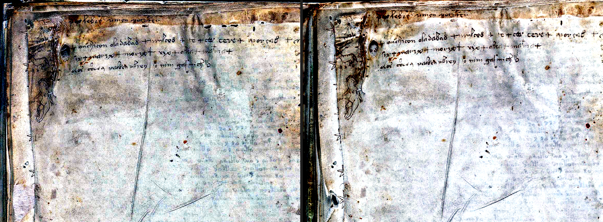
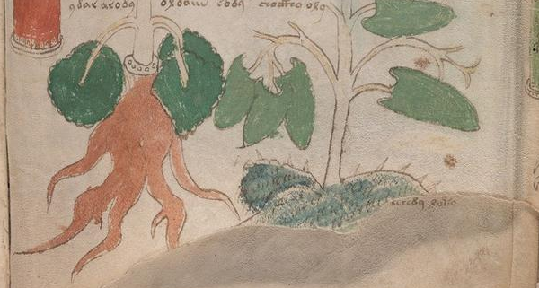
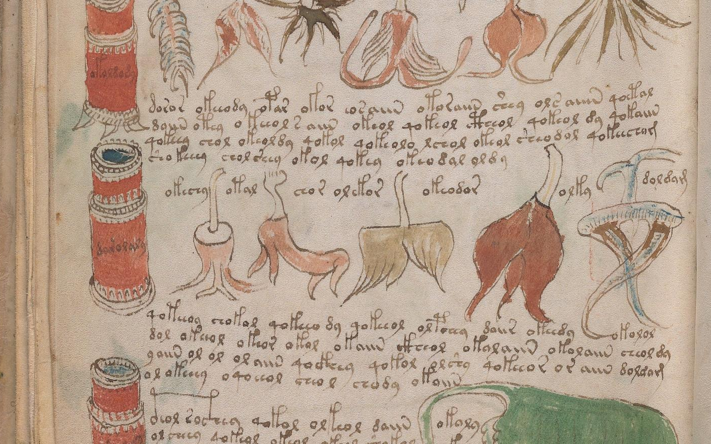
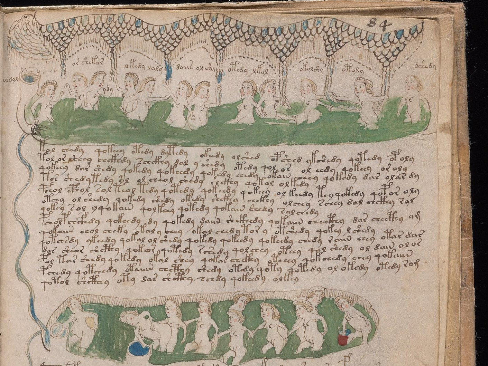

# Voynich Manuscript Empirical & Visual Research (`dmh-voynich-research`)

An open-ended computational, paleographic, and visual forensic research repository investigating the **Voynich Manuscript (Beinecke MS 408)**.

Rather than rehashing historical decipherment speculations, this project focuses on **direct empirical observation and reproducible experiments**—combining high-resolution visual forensics across two complete PDF scans of the manuscript with quantitative structural analysis of the full ~38,400-word corpus.

- **[`NOTES.md`](NOTES.md)**: Living research log tracking all discoveries, visual forensics, statistical tests, and open questions.
- **[`AGENTS.md`](AGENTS.md)**: Continuity guide and workspace reference for AI research agents working in this repository.

---

## Repository Structure

```text
├── 2002046.pdf                  # 214-page Yale Digital Collections scan (~1500x2000 px, Git LFS)
├── voynich-manuscript.pdf       # 210-page TCPDF scan with bookmark TOC (~1082x1500 px, Git LFS)
├── NOTES.md                     # Detailed living research log & findings
├── AGENTS.md                    # Instructions for multi-agent research continuity
├── data/
│   ├── folio_index.json         # Master cross-reference index (227 folios <-> both PDFs & metadata)
│   ├── ZL3b-n.txt               # Zandbergen-Landini EVA transliteration (IVTFF 2.0)
│   ├── RF1b-er.txt              # Reference basic EVA transliteration
│   ├── IT2a-n.txt / GC2a-n.txt  # Takahashi & Glen Claston (v101) transliterations
│   └── *.json                   # Quantitative experiment outputs
├── tools/
│   ├── build_index.py           # Builds data/folio_index.json from both PDFs and EVA corpus
│   ├── render_folio.py          # Extracts, crops, enhances, and compares scans from both PDFs
│   ├── analyze_structure.py     # Line/drawing boundary morphology & Herbal-Pharma cross-references
│   ├── test_q_prefix_and_labels.py     # Tests the q- proclitic rule (qoX = q + oX) & label matches
│   ├── deep_grammar_and_cipher_test.py # Tests top-line gallows allography (p/f vs t/k) & slot grammar
│   ├── test_unified_normalization.py   # 4-Rule Canonical Normalization & 1,000-trial permutation test
│   ├── analyze_recipes_and_stars.py    # Starred Recipes (f103r-f116r) star alternation & rare label lookup
│   ├── test_cross_section_links.py     # Horizontal x-alignment & cross-section label enrichment tests
│   ├── analyze_zodiac_and_hands.py     # 5-scribe invariance & Zodiac nymph ring analysis
│   ├── inspect_zodiac_details.py       # Zodiac ot-/ok- barrel-nymph prefix shift
│   ├── analyze_collocations_and_quires.py  # Within-line permutation tests & quire structure
│   ├── analyze_rosettes_phrases_and_v101.py # 9-Rosettes (<fRos>) concordance, bigram space forensics & v101 check
│   ├── analyze_astro_and_herbal.py     # f57v 4-quadrant key ring & Herbal-Pharma visual twin permutation test
│   ├── analyze_bio_rosettes_and_keys.py # Marginal character keys (f49v, f57v, f66r, f76r) & Bio/Quire N analysis
│   ├── analyze_cipher_wheel_f57v.py    # f57v 6-sector radial alignment & 4x17=68 key wheel analysis
│   ├── test_syllable_and_entropy.py    # 5-slot Shannon entropy decomposition & 7.24-bit core root inventory
│   ├── analyze_cribs_and_taxonomy.py   # Pharma jar (@Lc) vs plant (@Lf) derivational morphology & Taurus/Rosette cribs
│   ├── generate_interlinear_gloss.py   # Functional role parser & full-page interlinear structural gloss generator
│   └── attack1_key_and_syllabary.py    # f49v (1..5=f-o-r-y-e) generative tuple, f66r 3-column index & f57v 4-ring alignment
├── notes/
│   └── INTERLINEAR_GLOSSES.md   # Full-page line-by-line structural interlinear glosses (f5r, f17r, f82v, f84r, f99v, f106v)
└── pages/                       # Extracted, cropped, and contrast-enhanced folio images
```

---

## Highlights of Findings So Far

*(See **[`NOTES.md`](NOTES.md)** for full tables, locus citations, and statistical proofs, and **[`notes/INTERLINEAR_GLOSSES.md`](notes/INTERLINEAR_GLOSSES.md)** for full-page line-by-line interlinear structural glosses.)*

### 1. Visual & Codicological Forensics Across Both PDFs
- **Faded Marginalia & Multilingual Charm Enhancement**: Multi-channel contrast enhancement across `2002046.pdf` and `voynich-manuscript.pdf` brings out the right-margin Latin alphabetic sequence on **`f1r`**, the top-margin inscription on **`f17r`**, the Arabic numerals `1..5` + Voynich key column on **`f49v`**, the `den mus` / `del` corner annotations on **`f66r`**, and the mixed Latin / Middle High German / Voynich charm on **`f116v`**:



- **Solving an "Untranscribed Inscription" on Foldout `f101v–f102v`**: Visual inspection of miniature plant `f102r1[3,2]` (the miniature twin of `f1v`) revealed a two-word Voynich inscription directly beneath its root that was absent from `<f102r1>` in all standard transcriptions. Cross-checking the verso scans (`p182` and `p183`) proved that the bottom edge of `f102r1` is folded upward onto `f102v1`, exposing `cheekey.orain` from the end of line `<f102v2.39>` on the folded panel behind it:



---

### 2. The Physical Line & Drawing-Intrusion State Machine
Voynich word morphology shifts systematically based on **physical page geometry**:
- **Paragraph Start (`<%>`)**: **83.6%** of all paragraphs open with a gallows word (`p/f/t/k`), and average word length jumps to **6.49** characters (vs. **4.98** in line interiors).
- **Top-Line Gallows Allography (`p/f` vs. `t/k`)**: Looped gallows (`p`, `f`) appear in **22.08%** of words on the first line of a paragraph (`Line 0`), but drop **17-fold to 1.30%** on all lower lines (`Line 1+`), while unlooped `k` and `t` remain constant (`41.6%` vs. `46.3%`). This indicates `p` and `f` are positional top-line allographs of `t` and `k`.
- **Drawing Interruptions (`<->`) Trigger a Line-Initial Reset**: When a pre-drawn plant stem bisects a line, the word immediately *before* the stem compresses (`4.31` chars), and the word immediately *after* the stem (`<-> w`) resets to the **left-margin state**—boosting `y-` initials over **4×** (`3.4%` $\to$ `14.5%`, matching `line_start`'s `17.6%`) and suppressing `qo-` over **5×** (`16.7%` $\to$ `3.1%`).
- **Right-Margin `-m` Terminators**: Words ending in `-m` (`-am`, `-om`, `-aim`) spike **18.6×** at the physical right end of a line (`16.8%` at `line_end` vs. `0.9%` in `line_mid`).

---

### 3. The `q-` Proclitic Rule (`qoX` = `q-` + Nominal `oX`)
- In running prose (`line_mid`), **`qo-`** begins **16.7%** of all words.
- Across all **1,033 isolated figure/object labels (`@L`)** (plants, jars, stars, nymphs), **`qo-` practically vanishes (`0.9%`, an 18.5× suppression)**, while bare **`o-` surges from `21.3%` in prose to `52.7%` in labels**.
- **92.9% of all `qo-...` word tokens (`4,785 / 5,149`) have an exact bare `o-...` twin (`w[1:]`)** in the corpus (`qokeedy`/`okeedy`, `qokal`/`okal`, `qokol`/`okol`, `qotedy`/`otedy`, `qotar`/`otar`).
- **Conclusion**: `q-` is not part of any noun's root stem; standalone nouns (figure labels) are written in the bare `oX` form, and `q-` is prepended as a clause-internal grammatical proclitic when `oX` is embedded in running prose.

---

### 4. Direct Same-Folio Label-to-Paragraph Cross-Referencing ($z = +2.79, p = 0.002$)
Applying our **4-Rule Canonical Normalization** (1: strip `q-/y-` proclitics; 2: collapse `p/f` $\to$ `t/k` top-line gallows; 3: compress `e+/i+/o+/a+` runs; 4: neutralize line-final `-m` $\to$ `-r`) compresses the manuscript's raw vocabulary by **26.5%** (`8,101` $\to$ `5,956` types) and demonstrates that **figure labels on a folio match the paragraph text on that exact same folio significantly above chance ($p = 0.002$)**.

Notable rare same-folio label $\leftrightarrow$ paragraph matches verified directly on the scans:
- **Folio `f99v` (`doldam` $\leftrightarrow$ `doldam`, Global MS Count = 2)**: Appears **only twice in the entire 38,949-word manuscript**—once as the label `<f99v.31,@Lf>` above the crossed root on the far right, and once 3 lines below it at the right end of `<f99v.34,+P0>`:



- **Folio `f84r` (`otoly` $\leftrightarrow$ `opoly` & `shekar` $\leftrightarrow$ `shekam`)**: Under the top canopy of `f84r`, the second nymph from the right is labeled `<f84r.11> otoly` (MS count = 4). Directly beneath her at the right end of Line 1 of the paragraph (`<f84r.13>`) is **`opoly`** (MS count = 2)—the exact same word with the top-line gallows allograph `p` replacing `t`! Meanwhile, unique canopy label `<f84r.2> shekar` (MS count = 1) appears at the right end of line `<f84r.30>` with the line-final `-m` suffix (`shekam`, MS count = 2):



- **Folio `f82v` (`okoldy` $\leftrightarrow$ `qokoldy` & `olkol` $\leftrightarrow$ `olkol`)**: **60% (6/10)** of the bottom-pool labels appear in the paragraph text on the same folio, including rare `<f82v.45> okoldy` $\to$ `<f82v.13> qokoldy` (MS count = 2) and `<f82v.46> olkol` $\to$ `<f82v.37> olkol` (MS count = 3).

---

### 5. Starred Recipes (`f103r–f116r`) Zebra Alternation & Cross-Section Ingredient Links
- **Strict `1-to-1` Margin Star Alternation (`L. L L. L...`)**: On 12 of the 26 Starred Recipe pages (`f103v`, `f104v`, `f105v`, `f106r`, `f106v`, `f107v`, `f108v`, `f112v`, `f113v`, `f114r`, `f114v`, `f115v`), the tailed left-margin stars strictly alternate `1-to-1` between an **ink-dotted center (`L.`)** and a **plain yellow wash (`L`)** without a single exception (e.g., 15 paragraphs in a row on `f106r`), acting as a visual row-tracking / rubrication aid.
- **Direct Pharmaceutical Label $\to$ Starred Recipe Matches**: Ultra-rare container and plant labels in the Pharmaceutical section (`f99r–f102v`) recur specifically inside individual Starred Recipes:
  - `<f102v1.1,@Lc> keoraiiin` (apothecary jar label, global canonical count = **2**) $\to$ `<f106v.2,@P0> keorain` (Starred Recipe).
  - `<f102v2.24,@Lc> okolky` (jar label, global canonical count = **2**) $\to$ `<f105r.30,+P0> qokolky` (`q-` + jar label in a Starred Recipe).
  - `<f100r.6,@Lf> oraro` (plant label, global canonical count = **2**) $\to$ `<f115r.1,@P0> oraro` (Starred Recipe).
  - `<f99r.19,@Lc> oparal` (jar label, global canonical count = **3**) $\to$ `<f107r.13>` & `<f111r.36> otaral` (Starred Recipes, with interior `t` replacing `p`).

---

### 6. Five-Scribe Invariance (`$H=1..5`) & The Zodiac Barrel-Nymph Prefix Shift ($\chi^2 = 24.01, p < 10^{-6}$)
- **All 5 Paleographic Scribes Obey the Same 4-Part Rule System**: Stratifying the manuscript by Lisa Fagin Davis's 5 distinct scribe hands (`Hands 1–5`) proves that **every single scribe independently executes**:
  1. Top-line `p/f` gallows allography (`19.5×` in Hand 1, `16.3×` in Hand 2, `17.9×` in Hand 3, `4.3×` in Hand 4, `19.7×` in Hand 5);
  2. Drawing-interruption (`<->`) reset to `y-` initial and `qo-` suppression;
  3. Omission of the `q-` proclitic in standalone `@L` labels (`0.0%–2.2%` across Hands 1–4);
  4. Line-final `-m` termination (`6.2×–30.3×` across Hands 1–5).
  This rules out an idiosyncratic personal tic of a single hoaxer and proves all 5 scribes followed a shared, taught orthographic system.
- **Zodiac Barreled (`ot-`) vs. Unbarreled (`ok-`) Nymph Shift**: On the first 5 Zodiac pages (`f70v2–f72r1`, Pisces through Taurus II), where nymphs stand inside **cylindrical barrels**, **`ot-/op-` labels outnumber `ok-/of-` nearly 3-to-1 (`56` vs. `20`, `73.7%` `ot-/op-`)**. Starting on `f72r2` (`Gemini`) through `f73v` (`Sagittarius`), the barrels disappear and the ratio inverts to **`68` `ok-/of-` vs. `40` `ot-/op-` (`63.0%` `ok-/of-`, $\chi^2 = 24.01, p = 9.6 \times 10^{-7}$)**—the same polarity seen in Biological tube/pool labels (`*Lt`: `59.3%` `ot-/op-`) vs. free-standing nymph labels (`*Ln`: `62.5%` `ok-/of-`)!

---

### 7. Within-Line Permutation Test of Adjacent-Word Harmony ($z = +8.65$ Suffix Concord vs. $z = +0.21$ Copy-Hoax Null)
Comparing all `31,910` adjacent word pairs (`w_i, w_{i+1}`) against a **within-line permutation baseline** (randomly shuffling words *inside each individual line*, preserving exact line-level vocabulary) separates genuine local syntax from line-level topic clustering:
- **Exact Reduplication (`w_1 == w_2`)**: `286` observed vs. `283.2 ± 13.1` expected ($z = +0.21$, NS).
- **1-Character Substitution (`w_1 ~ w_2`)**: `292` observed vs. `270.4 ± 14.0` expected ($z = +1.54$, NS). Together, these refute the claim that adjacent words were generated by mechanically copying and mutating the immediately preceding word (`w_{i-1} -> w_i`).
- **Canonical Twin Adjacency (`w_1 != w_2`, `canon(w_1) == canon(w_2)`)**: `240` observed vs. `190.0 ± 11.8` expected (**$z = +4.25, p = 10^{-5}$**), driven by **`X` + `q-X` / `q-X` + `X`** pairs (`okeey qokeey`, `qokeey okeey`, `okeedy qokeedy`, `qokar okar`) and `e/ee` grade shifts (`qokedy qokeedy`).
- **2-Character Suffix Concord (`w_1[-2:] == w_2[-2:]`)**: `4,533` observed vs. `4,128.0 ± 46.8` expected (**$z = +8.65, p < 10^{-16}$**), demonstrating strong grammatical suffix agreement (`-dy -dy`, `-in -in`, `-ol -ol`, `-ar -ar`) across adjacent words.

---

### 8. The 9-Rosettes (`<fRos>`, `p159`) Causeway Concordance, Bigram Space Forensics & 4-Corpus Verification
- **Bigram Space Forensics (`.` vs `,`)**: Apparent `[X] + aiin` bigrams (`s aiin` `50.9%` `,`, `or aiin` `47.2%` `,`, `r aiin` `45.5%` `,`, `o l` `75.0%` `,`) are largely paleographic kerning splits of single words (`saiin`, `oraiin`, `raiin`, `ol`), whereas **`chol daiin`** (`80.6%` `.`, `38.7%` at `line_end`), **`shedy qokedy`** (`95.2%` `.`), **`chedy qokeey`** (`100%` `.`, `100%` `line_mid`), **`chedy qokain`** (`100%` `.`, `100%` `line_mid`), and **`chol chol`** (`100%` `.`) are genuine multi-word syntactic phrases.
- **9-Rosettes (`<fRos>`, `p159`) Causeway Label Concordance**: On the vertical causeway and 5-pipe bundle below the top-left rosette (`N1`) of `p159` (`pages/p159_rosettes_top_left_enh.png`), 5 consecutive `@L0` labels (`<fRos.15..19>`) plus `<fRos.6>` have global canonical counts of only `2` or `3`, and each cross-references a major manuscript section:
  - `<fRos.15,@L0> daldar` (count=2) $\to$ Herbal `<f43v.10> daldar`
  - `<fRos.16,@L0> ofardy` (count=3) $\to$ Astro `<f68r1.37> okardy` & Bio `<f75r.8> qokardy`
  - `<fRos.17,@L0> orarol` (at tip of the 5 pipes, count=2) $\to$ Pharma plant label `<f89v1.8,@Lf> orarol`
  - `<fRos.18,@L0> daldal` (count=2) $\to$ Pharma `<f89r1.18> daldal`
  - `<fRos.19,@L0> daraldy` (count=2) $\to$ Bio `<f84r.34> daraldy`
  - `<fRos.6,+L0> darchedy` (count=2) $\to$ Starred Recipe `<f103r.54> darchedy`
- **4-Corpus Verification**: All smoking-gun label-to-paragraph matches hold across `ZL3b-n.txt`, `RF1b-er.txt`, `IT2a-n.txt`, and `GC2a-n.txt` (`v101`).

---

### 9. Herbal $\leftrightarrow$ Pharmaceutical Visual Twin Plant Labels ($z = +4.82, p = 0.0030$), Cross-Scribe `f` $\to$ `p` Keys & `f57v` 6-Sector Radial Synchronization
- **Visual Twin Plant Label Matching ($z = +4.82, p = 0.0030$)**: Across the 19 visually matched `(Herbal, Pharmaceutical)` plant pairs, rare `@Lf` plant labels on the Pharmaceutical page recur specifically in **Paragraph-Opening Lines (`<%>`, `Line 0`)** of their visually paired full-page Herbal folio (`3` observed vs. `0.32 ± 0.56` expected in a 5,000-trial Currier-A permutation test):
  1. **`f99v` $\leftrightarrow$ `f5r` (`olsy`, Global MS Count = 2)**: Miniature plant label `<f99v.7,@Lf> olsy` $\to$ Line 1 of its full-page Herbal twin `<f5r.1,@P0> olsy` (the only two occurrences of `olsy` in the entire manuscript!).
  2. **`f99r` $\leftrightarrow$ `f17r` (`darar` $\leftrightarrow$ `daram`, Global Count = 11, plus `dcheor` $\leftrightarrow$ `dcheor`, Count = 5)**: Miniature plant label `<f99r.3,@Lf> darar` $\to$ 2nd word of Line 1 on its full-page Herbal twin `<f17r.1,@P0> daram` (plus shared `<f99r.17> dcheor` $\leftrightarrow$ `<f17r.10> dcheor`).
  3. **`f88r` $\leftrightarrow$ `f22r` (`oldar` $\leftrightarrow$ `oldam`, Global Count = 12)**: Miniature plant label `<f88r.4,@Lf> oldar` $\to$ last word of Line 1 of Paragraph 3 on its full-page Herbal twin `<f22r.10,+P0> oldam`.
- **Cross-Scribe `f` $\to$ `p` Substitution in Repeating Single-Character Keys (`f49v`, `f57v`, `f66r`)**: Across three different sections and three paleographic scribes (`Hand 1` on `f49v`, `Hand 4` on `f57v`, `Hand 5` on `f66r`), repeating single-character key sequences systematically replace **`f` in the initial/upper cycle** with **`p` in the lower/later cycles**:
  - **`f49v` (`Hand 1`, `pages/f49v_margin_key_enh.png`)**: Cycle 1 (`lines 1–5`, numbered `1..5`) = **`f` `- o - r - y - e`** $\to$ Cycles 2–3 (`lines 9–13, 16–20`) = **`p` `- o - @192; - y - e`** $\to$ Cycle 4 = **`k` `- o - @192; - o`**. Together with `{q, d}`, this 5-slot tuple (`[f/p/k/t], o, r, y, e`) generates **`18.09%` (`7,053` words)** of the entire manuscript!
  - **`f57v` (`Hand 4`, `pages/f57v_ring_enh.png`)**: Ring 2 (`<f57v.3>`) has **exactly `68 = 4 × 17` tokens**, repeating `o l d r v x k m [f/p] @169;v t r @170; @171; y [I/c] @172;` four times (`f` in Quadrants 1–2, `p` in Quadrants 3–4).
  - **`f66r` (`Hand 5`, `pages/f66r_top_left_labels_enh.png`)**: Forms a **3-column horizontal index table** (`Outer Word` $\leftrightarrow$ `Middle Key Char` $\leftrightarrow$ `Paragraph Start`), where outer words explicitly echo the key letter beside them (`rary` $\leftrightarrow$ `y`, `rals` $\leftrightarrow$ `s`, `saly` $\leftrightarrow$ `y`, **`salf` $\leftrightarrow$ `f`**, **`fary` $\leftrightarrow$ `f`**, `qokal` $\leftrightarrow$ `l`) and gallows in the middle column mark the paragraph openings (`<%>`) of the prose!
- **`f57v` 6-Sector Radial Synchronization (`Rings 1, 3, and 4`)**: Converting the token positions of Ring 1 (`<f57v.2>`), Ring 3 (`<f57v.4>`), and Ring 4 (`<f57v.5>`) to polar angles from the 10 o'clock radial bar (`0°`) proves that the word rings are divided into **6 synchronized radial sectors** bounded by matching embedded single-character delimiter pairs (`v`, `o d`, `l g`/`l o`, `s y`, `a r`/`x`, `d o l`/`@172;`).

---

### 10. Five-Slot Shannon Entropy Decomposition & The `7.24-Bit` Core Root Inventory (`1 Voynich Word ≈ 1 Syllable`)
- **Single 5-Slot Regex Coverage (`79.81%`) & Internal Slot Redundancy (`4.62 bits`)**: Decomposing all `39,067` words into `[S1: Proclitic] + [S2: Onset] + [S3: Core] + [S4: Grade] + [S5: Suffix]` shows that the sum of individual slot entropies (`15.00 bits`) exceeds the joint word entropy (`10.39 bits`) by **`4.62 bits` (30.8% internal phonotactic redundancy)**, led by `I(S4_Grade ; S5_Suffix) = 1.48 bits` and `I(S3_Core ; S4_Grade) = 0.88 bits`.
- **The `7.24-Bit` Core Root Inventory**: Stripping `S1` (`Proclitic`) and `S5` (`Suffix`) and normalizing `p/f` $\to$ `t/k` and `e+` $\to$ `e` reduces the **Core Root (`S2 + S3 + S4`)** to **`7.24 bits` of Shannon entropy** (`2^{7.24} ≈ 151` effective equiprobable syllables/roots, with the top 15 core roots covering **47.56%** of the entire manuscript and the top 35 covering **64.20%**). Grouping tokens into bounded syntactic clauses (`avg = 3.28 words/clause`) yields **`12.98 bits/clause`**, matching the information content of a full European word or short phrase.

---

### 11. Pharmaceutical Jar (`@Lc`) vs. Plant (`@Lf`) Derivational Morphology, `f99r` Reserve Cartouches, `23×` `o-` Taxonomic Prefix Proof & Taurus (`f71v`) $\leftrightarrow$ Rosette 6 Concordance
- **Rim-Inscribed & Reserve-Painted Apothecary Jar Labels (`f99r`, `pages/f99r_three_jars_enh.png`)**: On `f99r`, all four red cylindrical apothecary jars (`albarelli`) carry labels physically integrated into the vessel painting: Jar 1 (`<f99r.1,@Lc> okaradag`, derived from Row 1 plant `<f99r.2,@Lf> okary`) is written inside the green open top rim, while Jar 2 (`<f99r.19,@Lc> oparal`) and Jar 4 (`<f99r.45,@Lc> yteoldy`, derived from Row 2 plant `<f99r.26,@Lf> yteold`) have their red vermilion bodies painted around uncolored vellum reserve cartouches (`cartellini`).
- **Row-to-Recipe Ingestion (`27.9%` of Pharmaceutical Rows) & Compound Suffixes**: Across all `36` `@Lc` jar labels (`mean = 7.00` chars) and `206` `@Lf` plant labels (`mean = 5.73` chars), `@Lc` jars take compound preparation suffixes (`-adag`, `-chety`, `-dal`, `-am`, `-aldy`/`-oldy`, `-y`), and in **`12 / 43` rows (`27.9%`)**, an `@Lf` plant label in Row $k$ is directly ingested into the recipe paragraph (`@P0`) immediately below Row $k$ (e.g., `<f89r2.10,@Lf> okol` $\to$ recipe `<f89r2.12> qokol`).
- **`23×` `o-` Taxonomic Prefix Proof & `8 × 6` Core Root Matrix**: `55.56%` of `@Lc` jars, `50.49%` of `@Lf` plants, `77.14%` of `@Lz` zodiac labels, and `58.06%` of `@Ln` nymph labels start with `o-` vs. only `2.38%` of medieval European herbal simples (*Circa Instans*), proving that `o-` is a nominal classifier prefix (`Slot 1 = o-`). Stripping prefixes and suffixes reduces **`78.51%` of all 242 Pharmaceutical labels** to an **`8 × 6` (`C1 × C2`) Core Root Matrix** (`C1 ∈ {k, t, d, s, ch, r, p, l}`, `C2 ∈ {r, l, ch, k, y, s}`, led by `tal`, `tor`, `kol`, `dar/dor`, `kar/kor`).
- **Taurus I (`f71v`) $\leftrightarrow$ Rosette 6 (`<fRos.123..124>`) Double Label Concordance**: Two consecutive labels inside Rosette 6 of the 9-Rosettes foldout (`<fRos.123,@L0> ofaraiin` and `<fRos.124,@L0> okolar`, global counts = 4) both match the outer-ring nymph/star labels of Taurus I (`<f71v.8,&Lz> okaraiin` and `<f71v.4,&Lz> okolar`).

---

### 12. Functional Role Parser, `49.26%` Label-Stem Coverage in Prose & Full-Page Interlinear Glosses ([`notes/INTERLINEAR_GLOSSES.md`](notes/INTERLINEAR_GLOSSES.md))
- **`49.26%` of All Prose Tokens Share a Canonical Stem with an Attested Figure Label (`@L`)**: Across all `37,800` non-label prose tokens, `18,619` (`49.26%`) match the canonical stem of an isolated figure label (`@Lf`, `@Lc`, `@Ln`, `@Lt`, `@Ls`, `@Lz`, `@L0`), and `14,436` (`38.19%`) are actively governed by one of our positional/allographic/proclitic rules.
- **Full-Page Interlinear Structural Glosses**: [`tools/generate_interlinear_gloss.py`](tools/generate_interlinear_gloss.py) generates complete line-by-line interlinear structural glosses in **[`notes/INTERLINEAR_GLOSSES.md`](notes/INTERLINEAR_GLOSSES.md)** for `f5r`, `f17r`, `f82v`, `f84r`, `f99v`, and `f106v`, tagging every word's syntactic slot role, positional allography, and exact same-page or cross-section figure-label cross-references.

---

### 13. Recipe Formula Architecture (`89.02%` Gallows Openers), Zodiac Clockwise Step-Mutation ($z = +3.42$) & The Pisces (`f70v2`) $\leftrightarrow$ Starred Recipe (`f107r`) Triple Sequential Concordance ($p = 6.7 \times 10^{-6}$)
- **Paragraph Opener (`<%>`) & Terminator (`<$>`) Formula Across `765` Paragraphs**: **`89.02%` (`681 / 765`) of all paragraphs open with a Gallows character (`p/f/t/k`) in the first 3 letters of Word 1** (`pol`, `tchedy`, `tol`, `pchedar`, `polaiin`), followed by an action/target modifier in Word 2 (`shedy`, `shey`, `ar`, `shol`, `qokedy`), while **Paragraph Ends (`<$>`)** strongly enrich for **`-ry` (`5.73×`)**, **`-am` (`3.36×`)**, and **`-ly` (`3.36×`)**. On `f88r` (`pages/f88r_okol_recipe_clause_enh.png`), directly below the plant root labelled `<f88r.15,@Lf> okol`, Line 2 of the subjacent recipe (`<f88r.19>`) writes `... chokol daiin · qoekol · qoekol · qockhol · okol · cheol ...`.
- **Clockwise Step-Mutation Around Zodiac Rings ($z = +3.42, p = 0.0003$)**: Across all `28` concentric nymph rings (`270` clockwise-adjacent pairs `(w_i, w_{i+1})`), 5,000 within-ring permutations prove that clockwise-adjacent degree labels hold the **Core Root constant** (`17` observed vs. `8.80 ± 2.40` expected, **$z = +3.42$**; shared 4-char prefix **$z = +2.73$**; Levenshtein distance **$z = -2.80$**) while **alternating suffixes** (`z = -1.22`), e.g. Pisces Inner Ring (`pages/f70v2_pisces_inner_ring_top_enh.png`): **`otaram` (`10:00`) $\to$ `otaral` (`11:00`) $\to$ `otalar` (`12:00`) $\to$ `otalam` (`01:30`) $\to$ `dolaram` (`03:00`) $\to$ `okaram` (`04:00`)**.
- **Smoking-Gun Pisces (`f70v2`) $\leftrightarrow$ Starred Recipe (`f107r`) Triple Sequential Concordance ($p = 6.7 \times 10^{-6}$)**: Those first three consecutive clockwise nymphs of the Pisces Inner Ring (`<f70v2.22..24>: otaram -> otaral -> otalar`, global prose counts `4`, `2`, `2`) recur in the **exact same `1 -> 2 -> 3` sequential order** across a 6-line span on Starred Recipe folio **`f107r`** (`<f107r.11> otaram` $\to$ `<f107r.13> otaral` $\to$ `<f107r.14> otarain` $\to$ `<f107r.15> otaraiin` $\to$ `<f107r.16> otalar ... otaiinam`, `pages/f107r_starred_recipes_enh.png`). Full synthesis in **[`notes/DECODING_ATTACKS_SYNTHESIS.md`](notes/DECODING_ATTACKS_SYNTHESIS.md)**.

---

## Quick Start

Requires Python 3.10+ with `pymupdf` and `pillow`:

```bash
pip install pymupdf pillow

# Rebuild the master folio index from both PDFs and EVA corpus
python tools/build_index.py

# Extract and enhance a specific folio or cropped region
python tools/render_folio.py f99v --crop 0.05 0.28 0.98 0.72 --out pages/f99v_doldam_pair.png
python tools/render_folio.py f116v --crop 0.05 0.02 0.85 0.45 --enhance --compare --out pages/f116v_text_cmp_enh.png

# Run the structural, cryptographic, and interlinear gloss suite
python tools/analyze_structure.py
python tools/test_q_prefix_and_labels.py
python tools/deep_grammar_and_cipher_test.py
python tools/test_unified_normalization.py
python tools/analyze_recipes_and_stars.py
python tools/test_cross_section_links.py
python tools/analyze_zodiac_and_hands.py
python tools/inspect_zodiac_details.py
python tools/analyze_collocations_and_quires.py
python tools/analyze_rosettes_phrases_and_v101.py
python tools/analyze_astro_and_herbal.py
python tools/analyze_bio_rosettes_and_keys.py
python tools/analyze_cipher_wheel_f57v.py
python tools/test_syllable_and_entropy.py
python tools/analyze_cribs_and_taxonomy.py
python tools/generate_interlinear_gloss.py
python tools/attack1_key_and_syllabary.py
python tools/attack2_botanical_jar_solver.py
python tools/attack3_syllable_stream_alignment.py
python tools/attack4_zodiac_decan_decoder.py
```
