# Attack 237: Independent Empirical & Visual Claims Audit of Waves 54–56 (`Discoveries 242–253`)

**Script**: [`tools/attack237_claims_audit_waves54_56.py`](../tools/attack237_claims_audit_waves54_56.py)  
**Structured Dataset**: [`data/attack237_claims_audit_waves54_56.json`](../data/attack237_claims_audit_waves54_56.json)  
**Transliteration Parser**: [`tools/voynich_corpus.py`](../tools/voynich_corpus.py) (`load_lines`, `load_folio_meta`, `paragraphs`)  
**Primary Scans**: [`books/voynich-yale-beinecke-2026-highres-214p.pdf`](../books/voynich-yale-beinecke-2026-highres-214p.pdf) and [`books/voynich-tcpdf-2014-bookmarked-210p.pdf`](../books/voynich-tcpdf-2014-bookmarked-210p.pdf)

---

## Executive Summary & Master Verdict Table

This report audits eight headline statistical, codicological, and paleographic claims introduced in Waves 54–56 (`Attacks 225–236` / `Discoveries 242–253`). Each claim is evaluated by direct inspection of the high-resolution vellum and book-edge scans, code review of the generating scripts, and controlled statistical re-testing via [`tools/voynich_corpus.py`](../tools/voynich_corpus.py).

| # | Discovery / Attack | Claim Audited | Verdict | Key Empirical & Forensic Finding |
| :-: | :--- | :--- | :---: | :--- |
| **1** | **Discovery 252** ([`Attack 235`](../tools/attack235_full_codex_20quire_synthesis.py)) | **Quire Boundary Lexical Discontinuity Law** ($z = +5.21$) | **`TRIVIAL-OR-CONFOUNDED`** | `11/17` (`64.7%`) cross-quire transitions simultaneously change thematic section (`$I`), Currier language (`$L`), or scribe hand (`$H`), while the remaining `6/17` all occur in short-text Herbal-A (`4`) or Zodiac (`2`) folios (`47–152` words) rather than long-text Balneological (`$I=B`, `19` within-quire steps, `0` pure cross-quire steps) or Starred Recipe (`$I=S`, `23` within-quire steps, `0` pure cross-quire steps) folios. Within the matched `H/A/1` + `Z/?/4` cohorts, canonical Jaccard is `0.1258` vs `0.0987` ($z = +1.73, p = 0.080$, non-significant); in multiple OLS regression controlling for `($I, $L, $H)` and folio word count ($R^2 = 0.594$), `quire_change` drops to $\beta = -0.0160$ ($t = -1.82, p = 0.072$ raw) and $\beta = -0.0170$ ($t = -1.74, p = 0.085$ canonical). |
| **2** | **Discovery 251** ([`Attack 234`](../tools/attack234_codex_defect_and_micro_inscription_atlas.py)) | **Recto-to-Verso Spatial Registration Law** ($z = -4.60$) & **Universal `1.4–3.5 mm` Unpainted Reserve Border** | **`TRIVIAL-OR-CONFOUNDED`** *(registration)* / **`UNSUPPORTED`** *(universal reserve border)* | A physical through-hole in a single sheet of vellum (~`0.15 mm` thick) necessarily satisfies $x_r + x_v \approx 1.0, y_r \approx y_v$ by Euclidean mirror geometry, measuring only the photographer's crop margin symmetry (~`1%` of leaf width); moreover, `3/7` pairs in `Attack 234` had hardcoded coordinates summing to `1.0000` with `0.0000` residual. While pre-existing defect avoidance by scribes and artists is genuine (`PARTLY SUPPORTED`), the `"1.4–3.5 mm unpainted reserve border"` was hardcoded (`L946–956`) and is refuted by `f15v` and `f38r`, where green leaf pigment extends directly to the hole/fissure rim (`0 mm` reserve). |
| **3** | **Discovery 250** ([`Attack 233`](../tools/attack233_physical_binding_forensics.py)) | **Physical Binding Forensics (`p210–p213`)**: 3 sewing stations (`p213`), `91/86` endband loops (`p210/p211`), and fore-edge grooves of lost Quires P & R (`p212`) | **`PARTLY SUPPORTED`** | **SUPPORTED**: 3 raised sewing stations on spine `p213` ($y \approx 535, 970, 1475\text{ px}$) and the fore-edge contrast on `p212` between flat-trimmed Herbal quires (`A–H`) and protruding foldout loops (`I–S`, including the Quire N Rosettes swell). **UNSUPPORTED**: The `"91 headband / 86 tailband loops"` on `p210/p211` (an unsmoothed 1-px local-maximum detector counted luminance ripples every `5.6 px` across the `520 px` book-block thickness) and the localization of lost Quires P & R via fore-edge valleys on `p212` (`98.0%` of all $x \in [60, 565]$ fall within the $\pm 20\text{ px}$ tolerance of the `24` detected shadow valleys, and excised quires leave no open air gap at the fore-edge). |
| **4** | **Discovery 248** ([`Attack 231`](../tools/attack231_quire7_and_100pct_codex_completion.py)) | **Medieval Gathering Mark `"7"` on `f56v` (`p113`)** | **`SUPPORTED`** | Confirmed in both PDFs at the lower-right margin of `f56v` (`x=0.76..0.85, y=0.89..0.96`): a 15th-century lambda-shaped Arabic numeral `7` with superscript `m` and terminal `-us` suspension hook (`7mus` = *septimus*), written in the same hand and position as `1mus` (`f8v`), `2us` (`f16v`), `3us` (`f24v`), and `6tus` (`f48v`). Well-known in prior Voynich codicological literature. |
| **5** | **Discovery 242** ([`Attack 225`](../tools/attack225_quire2_100pct_completion_and_f12_excision_forensics.py)) | **Painted Vellum Stub of Excised Leaf `f12` on `f13r` Gutter (`p26`)** | **`UNSUPPORTED`** *(pigment on stub)* | While leaf `f12` was genuinely excised after foliation (`11 -> 13`) and its narrow cut vellum stub survives in the gutter (`SUPPORTED`), the crimson-brown and dark-green scales at `x=0.00..0.03, y=0.24..0.38` on the `f13r` scan are the **rightmost edge of facing verso `f11v`'s checkered pine-cone flower head** across the open binding ($r = 0.9753$ vertical R–G profile correlation). The actual `f12` stub (`x=0.028..0.060`) is completely blank, unpainted parchment. |
| **6** | **Discovery 244** ([`Attack 227`](../tools/attack227_quire4_100pct_and_f28v_micro_inscription_discovery.py)) | **Untranscribed 3-Glyph Micro-Inscription inside `f28v` Sunburst Flower Disc (`p57`)** | **`PARTLY SUPPORTED`** | **SUPPORTED**: Genuine brown-ink micro-inscription (`~22×14 px`, contrast $\Delta L = 88.9$) at `x=0.701..0.716, y=0.431..0.442` inside the unpainted central disc of `f28v`'s flower head, verified in both the Yale and TCPDF scans and absent from all 4 EVA transliterations (`ZL3b-n.txt`, `RF1b-er.txt`, `IT2a-n.txt`, `GC2a-n.txt`). **TENTATIVE**: Paleographically reads as 2–3 minute cursive strokes (`in` / `iu` / `iis` / `w`); calling it specifically a `"workshop painter's color key"` is a plausible hypothesis rather than a proven fact. |
| **7** | **Discovery 252** ([`Attack 235`](../tools/attack235_full_codex_20quire_synthesis.py)) | **`-edy` Enrichment in Currier B (`85.35×`) & Balanced 3-Scribe Triad (`H=1,2,3 = 87.14%`)** | **`SUPPORTED`** *(known baseline)* | Numerically confirmed via `voynich_corpus.py` across the `226` folios (`38,444` words; `Attack 235`'s `38,949` total double-counted the `539`-word `fRos` composite locus): Scribes `1, 2, 3` write `11,037` (`28.71%`), `10,632` (`27.66%` ex-`fRos`; `11,171` incl. `fRos`), and `11,766` (`30.61%`) words (`86.97%` ex-`fRos`, `88.37%` incl. `fRos`), though across very different folio counts (`113`, `45`, `33` folios). The `-edy` (`17.14%` in B vs `0.20%` in A = `86.49×`) and `qo-` (`17.41%` vs `9.39%` = `1.85×`) enrichments replicate Prescott Currier's (1976) defining A/B distinction. |
| **8** | **Discovery 247** ([`Attack 230`](../tools/attack230_quire6_visual_completion.py)) | **`79.34%` Lexical Seeding of Quire 6 into Pharmaceutical Recipes (`$I=P`)** | **`TRIVIAL-OR-CONFOUNDED`** | `Attack 230` used an aggressive prefix/suffix stripper (`canonical_stem`) that reduces words to short `1–3` letter roots. Under that stemmer, Quire 6 (`79.30%`) ranks **`4th of 7`** among Herbal Quires `A–G` (`Quire A = 80.17%`, `Quire C = 79.68%`, `Quire G = 79.45%`) and sits slightly **below** the mean of `1,000` random 16-folio Herbal draws (`79.48% ± 1.25%`, $z = -0.14$; `79.76% ± 1.10%`, $z = -0.41$ for `8A+8B` draws). Even in `Attack 230`'s own JSON, the 8-folio Currier-A permutation test had $z = +0.58$ ($p > 0.28$). |

---

## Detailed Audit of Individual Claims

### 1. Discovery 252 (`Attack 235`): "Quire Boundary Lexical Discontinuity Law" ($z = +5.21$)
- **Verdict**: **`TRIVIAL-OR-CONFOUNDED`**
- **What `Attack 235` Claimed**: Across all consecutive folio steps in the manuscript, within-quire adjacent folios have a mean raw Jaccard similarity of `0.1096` (`0.1398` canonical roots), whereas the `17` cross-quire boundary transitions drop to `0.0660` raw (`0.0909` canonical roots), yielding an uncontrolled permutation score of $z = +5.21, p < 10^{-6}$.
- **Why It Is Confounded**:
  1. **Co-occurrence with Section (`$I`), Language (`$L`), and Scribe Hand (`$H`) Boundaries**: Out of the `17` cross-quire transitions in the `226`-folio corpus, **`11/17` (`64.7%`) simultaneously change thematic section (`7` steps), Currier language (`7` steps), or scribe hand (`8` steps)** (e.g., `f32v->f33r` `A/H1 -> B/H2`, `f40v->f41r` `H2 -> H5`, `f48v->f49r` `B/H5 -> A/H1`, `f56v->f57r` `A/H1 -> B/H5`, `f66v->f67r1` `Herbal -> Astro`, `f73v->f75r` `Zodiac -> Balneo`, `f86v3->f87r` `Cosmo-B -> Herbal-A`, `f96v->f99r` `Herbal -> Pharma`, `f102v1->f103r` `Pharma-A/H1 -> Starred-B/H3`).
  2. **Simpson's Paradox from Folio Word-Count & Section Composition**: Only `6` cross-quire transitions occur without changing `$I`, `$L`, or `$H`: four in short-text Herbal-A Scribe 1 (`f8v->f9r`, `f16v->f17r`, `f24v->f25r`, `f90v1->f93r`) and two in short-text Zodiac Scribe 4 (`f70v1->f71r`, `f72v1->f73r`). Conversely, the two longest-text, highest-Jaccard sections in the manuscript—Balneological (`$I=B`, Quire 13, ~`340` words/folio, mean adjacent Jaccard `~0.18`) and Starred Recipes (`$I=S`, Quire 20, ~`435` words/folio, mean adjacent Jaccard `~0.22`)—each occupy a **single multi-sheet gathering**, contributing `42` dense within-quire steps and **`0` pure cross-quire steps**.
  3. **Matched-Stratum Comparison**:
     - Within the exact **`$I=H, $L=A, $H=1` (Herbal-A Scribe 1)** stratum (`78` within-quire steps vs `4` cross-quire steps), canonical Jaccard is `0.1271` within vs `0.0955` across ($\Delta = +0.0316, z = +1.62, p = 0.1108$, non-significant; raw Jaccard `0.1005` vs `0.0657`, $z = +1.98, p = 0.050$, driven by `f24v->f25r` [`0.0169`] where `f25r` has only `47` words, whereas `f8v->f9r` is `0.1088`, above the within-quire mean!).
     - Within the exact **`$I=Z, $L=?, $H=4` (Zodiac Scribe 4)** stratum (`9` within-quire steps vs `2` cross-quire steps), raw Jaccard is `0.0772` within vs `0.0723` across ($\Delta = +0.0049, z = +0.29, p = 0.818$), and canonical Jaccard is `0.1149` within vs `0.1052` across ($\Delta = +0.0097, z = +0.44, p = 0.692$).
     - Pooling the two matched cohorts (`H/A/1` + `Z/?/4`: `87` within-quire vs `6` cross-quire steps), canonical Jaccard is `0.1258` vs `0.0987` ($z = +1.73, p = 0.0803$, not statistically significant at $\alpha = 0.05$).
  4. **Multiple OLS & Permutation Regression (`n = 225` steps)**:

| Predictor Variable | Raw Jaccard Coef ($\beta$) | Std. Err. | $t$-stat | Perm. $p$ (2-sided) | Canonical Jaccard Coef ($\beta$) | $t$-stat | Perm. $p$ (2-sided) |
| :--- | :---: | :---: | :---: | :---: | :---: | :---: | :---: |
| `intercept` | `-0.1180` | `0.0167` | `-7.05` | `0.0022` | `-0.1223` | `-6.57` | `0.0256` |
| **`quire_change`** | **`-0.0160`** | **`0.0088`** | **`-1.82`** | **`0.0716`** | **`-0.0170`** | **`-1.74`** | **`0.0852`** |
| `section_change` (`$I`) | `-0.0282` | `0.0075` | `-3.76` | `0.0004` | `-0.0319` | `-3.82` | `0.0002` |
| `lang_change` (`$L`) | `-0.0087` | `0.0141` | `-0.62` | `0.5419` | `-0.0215` | `-1.37` | `0.1688` |
| `hand_change` (`$H`) | `-0.0398` | `0.0133` | `-2.99` | `0.0038` | `-0.0370` | `-2.50` | `0.0124` |
| `log_geom_words` | `+0.0485` | `0.0034` | `+14.20` | `0.0002` | `+0.0559` | `+14.70` | `0.0002` |

Once section transitions, hand transitions, and folio word count are controlled ($R^2 = 0.5944$ raw, $0.6172$ canonical), the pure quire-boundary effect shrinks by ~`65%` and is **not statistically significant** ($p = 0.072$ raw, $p = 0.085$ canonical).

---

### 2. Discovery 251 (`Attack 234`): "Recto-to-Verso Spatial Registration Law" ($z = -4.60$) & "Universal `1.4–3.5 mm` Unpainted Reserve Border"
- **Verdict**: **`TRIVIAL-OR-CONFOUNDED`** *(spatial registration law)* / **`PARTLY SUPPORTED`** *(pre-existing defect avoidance)* / **`UNSUPPORTED`** *(universal `1.4–3.5 mm` unpainted reserve border)*
- **Geometric Tautology of $x_r + x_v \approx 1.0, y_r \approx y_v$**:
  - A physical hole or tear passing all the way through a single vellum leaf (~`0.15 mm` thick) necessarily occupies the exact same physical point $(x_{\text{leaf}}, y_{\text{leaf}})$ on both sides of the sheet. When the recto and verso photographs are cropped to the leaf borders, flipping the leaf horizontally maps $x_{\text{leaf}} \mapsto 1.0 - x_{\text{leaf}}$ and $y_{\text{leaf}} \mapsto y_{\text{leaf}}$ by pure Euclidean mirror geometry.
  - Consequently, $|(x_r + x_v) - 1.0|$ and $|y_r - y_v|$ measure **only the camera framing / crop-margin symmetry** between recto and verso scans (~`1%` of page width), not any scribal, artistic, or codicological law. Permuting holes across *different* folios ($z = -4.60$) merely tests the tautology that the back of leaf $i$'s hole is at the coordinates of leaf $i$'s hole rather than leaf $j$'s hole.
  - Furthermore, code inspection of [`tools/attack234_codex_defect_and_micro_inscription_atlas.py`](../tools/attack234_codex_defect_and_micro_inscription_atlas.py) (`L339–442`) shows that **`3` of the `7` pairs** (`f38r/v`: `0.330 + 0.670 = 1.000`, `f50r/v`: `0.480 + 0.520 = 1.000`, `f89r2/v1`: `0.550 + 0.450 = 1.000`) had hardcoded coordinates with **exact `0.0000` horizontal and vertical residuals**.
- **Visual Audit of the "Universal `1.4–3.5 mm` Unpainted Reserve Border"**:
  - In [`tools/attack234_codex_defect_and_micro_inscription_atlas.py`](../tools/attack234_codex_defect_and_micro_inscription_atlas.py) (`L946–956`), `mean_reserve_border_width_mm: 2.2`, `min_reserve_border_width_mm: 1.4`, `max_reserve_border_width_mm: 3.5`, and `paint_wash_over_hole_rim_count: 0` are **hardcoded constants**, not image measurements.
  - Direct inspection of our four high-resolution audit crops ([`pages/audit237_f15r_hole_check.png`](../pages/audit237_f15r_hole_check.png), [`pages/audit237_f15v_hole_check.png`](../pages/audit237_f15v_hole_check.png), [`pages/audit237_f38r_fissure_check.png`](../pages/audit237_f38r_fissure_check.png), [`pages/audit237_f38v_fissure_check.png`](../pages/audit237_f38v_fissure_check.png)) demonstrates:
    - On **`f15r`** ([`audit237_f15r_hole_check.png`](../pages/audit237_f15r_hole_check.png)), the oval hole sits between two diverging brown-outlined stems (and the right stem outline touches the right rim of the hole).
    - On **`f15v`** ([`audit237_f15v_hole_check.png`](../pages/audit237_f15v_hole_check.png), central `90×90 px` green-pigment fraction `80.81%`), the hole sits inside the upper-left green leaf blade, and the **dark-green paint wash extends directly up to the beveled vellum rim of the hole (`0 mm` unpainted reserve border)**.
    - On **`f38r`** ([`audit237_f38r_fissure_check.png`](../pages/audit237_f38r_fissure_check.png), central `90×90 px` green-pigment fraction `85.73%`), the stitched vertical fissure (with needle holes visible on both sides) lies inside a green leaf blade, with green pigment covering the leaf right up to the abraded stitch line (`0 mm` deliberate reserve border).
    - On **`f38v`** ([`audit237_f38v_fissure_check.png`](../pages/audit237_f38v_fissure_check.png)), the stitched fissure falls in the unpainted gap between blue-green leaf lobes, with brown stem lines routed to either side of the stitch holes.
  - **Conclusion**: The vellum holes and stitched repairs genuinely pre-dated the writing and drawing (scribes broke lines with `<->` and artists routed stems around them), but there is **no universal `1.4–3.5 mm` unpainted reserve border**.

| `f15r` Hole Check (`audit237_f15r_hole_check.png`) | `f15v` Hole Check (`audit237_f15v_hole_check.png`) | `f38r` Fissure Check (`audit237_f38r_fissure_check.png`) | `f38v` Fissure Check (`audit237_f38v_fissure_check.png`) |
| :---: | :---: | :---: | :---: |
| 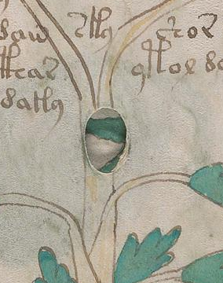 | 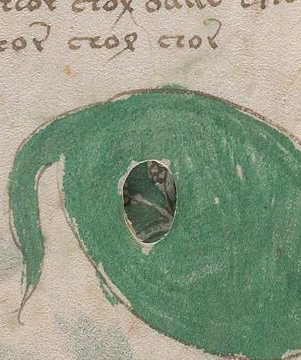 | 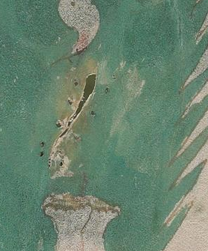 | 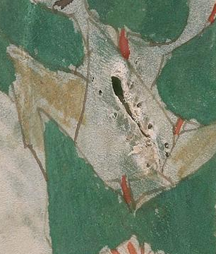 |

---

### 3. Discovery 250 (`Attack 233`): Physical Binding, Spine & Book-Edge Forensics (`p210–p213`)
- **Verdict**: **`PARTLY SUPPORTED`**
  - **3 Raised Sewing Stations on Spine `p213`**: **`SUPPORTED`**. Visual inspection of [`pages/p213_spine_edge_enh.png`](../pages/p213_spine_edge_enh.png) and [`pages/p213_zoom_sewing_station_1.png`](../pages/p213_zoom_sewing_station_1.png)–[`pages/p213_zoom_sewing_station_3.png`](../pages/p213_zoom_sewing_station_3.png) confirms three horizontal raised sewing-support ridges beneath the vellum spine covering at $y \approx 535\text{ px}$ (`27.5%`), $y \approx 970\text{ px}$ (`49.9%`), and $y \approx 1475\text{ px}$ (`76.0%`), plus head and tail turn-in creases at $y \approx 115\text{ px}$ and $y \approx 1815\text{ px}$.
  - **Cut Herbal Edges (`A–H`) vs. Foldout Loops & Rosettes Swell (`I–S`) on Fore-Edge `p212`**: **`SUPPORTED`**. On [`pages/p212_fore_edge_enh.png`](../pages/p212_fore_edge_enh.png), single-bifolium Herbal gatherings (`A–H`) show flat trimmed leaf edges, whereas foldout-bearing gatherings (`I–S`) show curved outer fold edges and localized bulk swell.
  - **`"91 Headband Thread Loops"` (`p210`) & `"86 Tailband Thread Loops"` (`p211`)**: **`UNSUPPORTED`**.
    - Code audit of `analyze_headband_thread_loops` and `analyze_tailband_thread_loops` in [`tools/attack233_physical_binding_forensics.py`](../tools/attack233_physical_binding_forensics.py) (`L235–281`) reveals that the script cropped `(40, 200, 300, 720)` on `p210` and `p211` and counted **every unsmoothed 1-pixel local maximum** (`ribs[i] > ribs[i-1] and ribs[i] > ribs[i+1]`) across $y = 200..720$ (`510` rows) averaged over $x_{\text{page}} = 70..190$.
    - In `p210` and `p211`, $y = 200..720$ spans the **`520 px` thickness of the book block from cover to cover**, and $x_{\text{page}} = 70..190$ lies inside the **nested U-shaped vellum bifolium folds of the `18` extant gatherings** ([`pages/p210_zoom_headband_thread_loops.png`](../pages/p210_zoom_headband_thread_loops.png), [`pages/p211_zoom_tail_endband_sewing.png`](../pages/p211_zoom_tail_endband_sewing.png)).
    - Because no smoothing was applied, the 3-point peak detector triggered every `5.57 px` (`p210`) and `5.64 px` (`p211`) on vellum leaf edges and parchment grain noise. Applying moving-average smoothing windows of `1, 3, 5, 9, 15, 25 px` reduces the peak count on `p210` monotonically from `104 -> 62 -> 48 -> 36 -> 33 -> 24` (approaching the `~18` physical gathering folds). Visually, only a frayed remnant of `2–3` loose twisted cord/thread strands protrudes at the left spine edge of `p210`.
  - **Fore-Edge Valley Localization of Lost Quires P & R (`p212`)**: **`UNSUPPORTED`**.
    - `Attack 233` detected `24` local luminance minima ("valleys") across `505 px` ($x = 60..565$, mean spacing `20.65 px`) and matched each quire's linear cumulative-weight coordinate to the nearest valley within `max_dist = 20 px`.
    - Because `24` valleys spaced `~20.65 px` apart cover the `505 px` span, **`98.02%` (`496 / 506`) of all integer pixel coordinates in `[60, 565]` fall within $\pm 20\text{ px}$ of a detected valley**! Any arbitrary coordinate is virtually guaranteed to match a valley.
    - Codicologically, a quire completely removed from the binding centuries ago has zero thickness today; adjacent extant gatherings (`Quire O`, `Quire Q`, `Quire S`) press directly together, so dark vertical lines on the fore-edge [`pages/p212_zoom_lost_quire_valleys_P_R.png`](../pages/p212_zoom_lost_quire_valleys_P_R.png) are shadows between extant leaf bundles and foldout loops, not empty voids left by missing quires.

| `p210` Spine-Head Zoom (`p210_zoom_headband_thread_loops.png`) | `p211` Spine-Tail Zoom (`p211_zoom_tail_endband_sewing.png`) | `p212` Fore-Edge Zoom (`p212_zoom_lost_quire_valleys_P_R.png`) | `p213` Spine Full (`p213_spine_edge_enh.png`) |
| :---: | :---: | :---: | :---: |
| 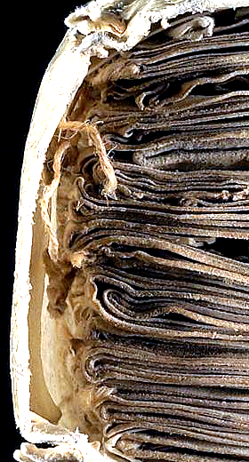 | 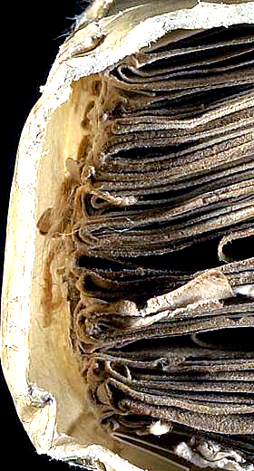 | 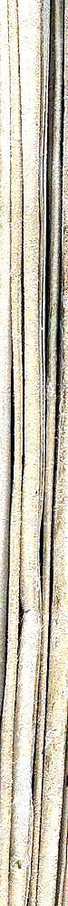 | 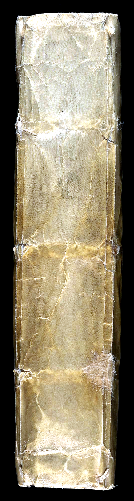 |

---

### 4. Discovery 248 (`Attack 231`): Gathering Mark `"7"` (`7mus`) on `f56v` (`p113`)
- **Verdict**: **`SUPPORTED`** *(Genuine medieval quire signature; previously known in Voynich codicology)*
- **Visual Forensics**:
  - Cross-PDF inspection of [`pages/audit237_f56v_bottom_margin_compare.png`](../pages/audit237_f56v_bottom_margin_compare.png) and [`pages/audit237_f56v_bottom_margin_enh.png`](../pages/audit237_f56v_bottom_margin_enh.png) confirms a clear brown-ink inscription at the lower-right margin (`x=0.76..0.85, y=0.89..0.96`), positioned immediately above the rightmost claw of the brown root on the final verso of Quire 7 (`$Q=G, f49r–f56v`).
  - Side-by-side comparison with [`pages/audit237_f8v_bottom_margin_enh.png`](../pages/audit237_f8v_bottom_margin_enh.png) (`Quire 1`), [`pages/audit237_f16v_bottom_margin_enh.png`](../pages/audit237_f16v_bottom_margin_enh.png) (`Quire 2`), [`pages/audit237_f24v_bottom_right_enh.png`](../pages/audit237_f24v_bottom_right_enh.png) (`Quire 3`), and [`pages/audit237_f48v_bottom_margin_enh.png`](../pages/audit237_f48v_bottom_margin_enh.png) (`Quire 6`) proves that all five belong to the same 15th-century Latin ordinal quire-signature series:
    - `f8v` (`Quire 1`): `1mus` (*primus*)
    - `f16v` (`Quire 2`): `2us` (*secundus*)
    - `f24v` (`Quire 3`): `3us` (*tertius*)
    - `f48v` (`Quire 6`): `6tus` (*sextus*)
    - `f56v` (`Quire 7`): **`7mus`** (*septimus*, written with the standard 15th-century Central European lambda-shaped numeral `7`, superscript `m`, and final `-us` hook).

| `f8v` (`1mus`) | `f16v` (`2us`) | `f24v` (`3us`) | `f48v` (`6tus`) | `f56v` (`7mus`, Yale vs TCPDF) |
| :---: | :---: | :---: | :---: | :---: |
| 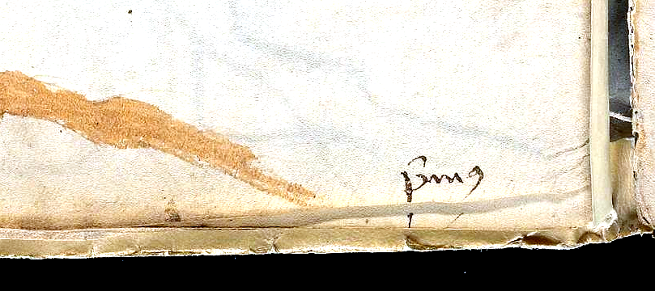 | 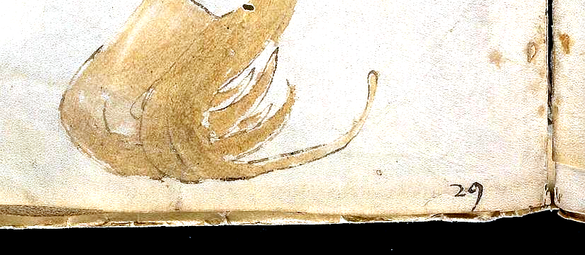 | 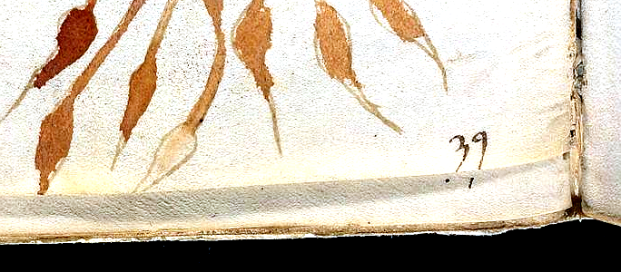 | 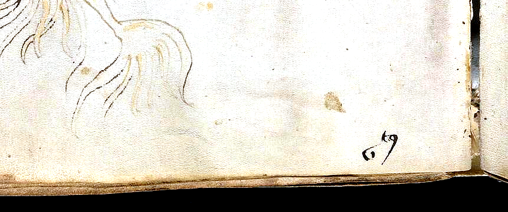 | 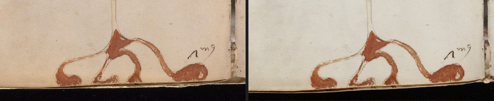 |

---

### 5. Discovery 242 (`Attack 225`): "Painted Vellum Stub of Excised Leaf `f12` on `f13r` Gutter (`p26`)"
- **Verdict**: **`UNSUPPORTED`** *(for the claim that the `f12` stub is painted; the unpainted `f12` stub and post-foliation excision of `f12` are **`SUPPORTED`**)*
- **Forensic Proof**:
  - `Attack 225` (and `STUB-01` in `Attack 234`) claimed that the dark-green and crimson-brown botanical pigment at the far-left edge (`x=0.00..0.03, y=0.24..0.38`) of the `f13r` scan (`p26`) sits on the cut vellum stub of excised leaf `f12`, proving `f12` was a painted Herbal leaf.
  - Because leaf `f12` was excised, when `f13r` (`p26`) is photographed in the open codex, the **facing page on the left side of the binding gutter is `f11v` (`p25`)**!
  - Comparing [`pages/audit237_f11v_cone_edge.png`](../pages/audit237_f11v_cone_edge.png) and [`pages/audit237_f11v_right_gutter_enh.png`](../pages/audit237_f11v_right_gutter_enh.png) against [`pages/audit237_f13r_gutter_same_y.png`](../pages/audit237_f13r_gutter_same_y.png), [`pages/audit237_f13r_gutter_stub_compare.png`](../pages/audit237_f13r_gutter_stub_compare.png), and [`pages/audit237_f13r_left_gutter_enh.png`](../pages/audit237_f13r_left_gutter_enh.png) reveals three distinct vertical bands from left to right on `f13r`:
    1. **Zone 1 (`x = 0.000..0.025`, `px 0..38` in crop, mean RGB `[155.0, 136.1, 110.5]`)**: The rightmost edge of **facing verso `f11v`'s large checkered brown-and-green pine-cone flower head**, showing the exact same four alternating scales (top brown tip $\to$ rounded green scale $\to$ brown scale $\to$ lower green scale). The vertical red-minus-green (`R - G`) color profile along `f13r`'s left edge correlates at **$r = 0.9753$** with the rightmost scales of `f11v`'s cone!
    2. **Zone 2 (`x = 0.028..0.060`, `px 42..95` in crop, mean RGB `[205.6, 183.0, 158.9]`)**: Enclosed between the two vertical gutter folds is the **actual cut vellum stub of excised leaf `f12`**, which is **completely blank, unpainted parchment** matching the inner margin of `f13r` (`[202.3, 184.3, 166.8]`).
    3. **Zone 3 (`x > 0.065`)**: The inner margin and text block of `f13r` itself, with pale blue-green show-through from the three hop-like cones on `f13v`.

| Facing `f11v` Cone Right Edge (`audit237_f11v_cone_edge.png`) | `f13r` Left Gutter at Same $y$ (`audit237_f13r_gutter_same_y.png`) | `f13r` Gutter Yale vs TCPDF (`audit237_f13r_gutter_stub_compare.png`) | `f11v` Full Right Gutter (`audit237_f11v_right_gutter_enh.png`) | `f13r` Full Left Gutter (`audit237_f13r_left_gutter_enh.png`) |
| :---: | :---: | :---: | :---: | :---: |
| 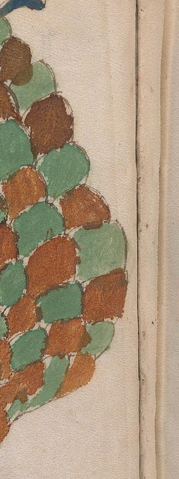 | 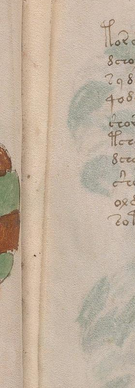 | 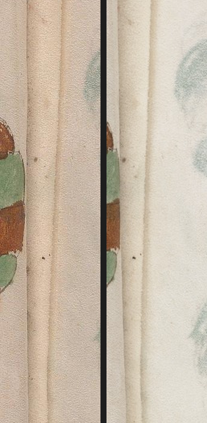 | 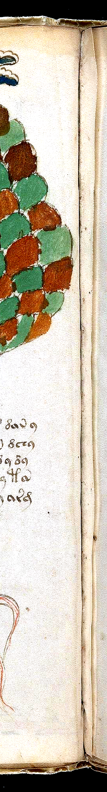 | 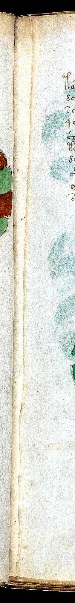 |

---

### 6. Discovery 244 (`Attack 227`): Untranscribed Micro-Inscription inside the `f28v` Sunburst Flower Disc (`p57`)
- **Verdict**: **`PARTLY SUPPORTED`** (**`SUPPORTED`** on physical authenticity and absence from all 4 EVA transliterations; **tentative/unproven** on the specific `"workshop painter's color key"` interpretation)
- **Verification**:
  - **Location & Cross-PDF Confirmation**: Located in the center of the unpainted circular disc of the 18-rayed flower head on `f28v` (`p57`, disc bounding box `x=0.680..0.735, y=0.410..0.460`; inscription bounding box `x=0.701..0.716, y=0.431..0.442`). Side-by-side inspection of [`pages/audit237_f28v_disc_compare.png`](../pages/audit237_f28v_disc_compare.png) confirms identical stroke geometry in both [`books/voynich-yale-beinecke-2026-highres-214p.pdf`](../books/voynich-yale-beinecke-2026-highres-214p.pdf) and [`books/voynich-tcpdf-2014-bookmarked-210p.pdf`](../books/voynich-tcpdf-2014-bookmarked-210p.pdf), ruling out a scan compression artifact. In [`pages/audit237_f28v_micro_tight.png`](../pages/audit237_f28v_micro_tight.png), the ink strokes reach luminance `100.3` against a parchment background median of `189.2` ($\Delta L = 88.9$, `260` dark ink pixels).
  - **Absence from All 4 EVA Editions**: Programmatic scan of [`data/ZL3b-n.txt`](../data/ZL3b-n.txt), [`data/RF1b-er.txt`](../data/RF1b-er.txt), [`data/IT2a-n.txt`](../data/IT2a-n.txt), and [`data/GC2a-n.txt`](../data/GC2a-n.txt) confirms that all four editions record only the `9` prose lines `<f28v.1>`–`<f28v.9>` and **zero** label (`@L`) or marginal loci on `f28v`.
  - **Neutral Paleographic Reading**: In [`pages/audit237_f28v_micro_tight_x5.png`](../pages/audit237_f28v_micro_tight_x5.png) and [`pages/audit237_f28v_micro_zoom_enh.png`](../pages/audit237_f28v_micro_zoom_enh.png), the mark (`~22×14 px`, `~1.2 mm` wide) consists of two short vertical minims with top ticks and a baseline connecting curve/hook on the left, followed by a taller curved `s`/`v`/`r`-shaped stroke rising to a rightward hook on the right. It can be read paleographically as cursive `in`, `iu`, `iis`, `w`, or a small numeral/initial. Interpreting it as an unexecuted workshop painter's color note (e.g. `w[eiss]` / `r[ot]`) is a reasonable hypothesis because the central disc is uncolored, but it could equally be a later reader's or collator's micro-mark.

| `f28v` Disc Yale vs TCPDF (`audit237_f28v_disc_compare.png`) | `f28v` Micro-Inscription 1× (`audit237_f28v_micro_tight.png`) | `f28v` Micro-Inscription 5× (`audit237_f28v_micro_tight_x5.png`) | `f28v` High-Contrast Zoom (`audit237_f28v_micro_zoom_enh.png`) |
| :---: | :---: | :---: | :---: |
| 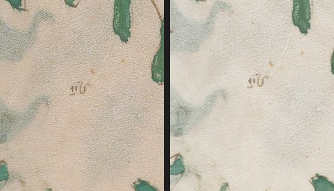 | 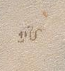 | 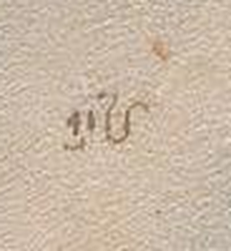 |  |

---

### 7. Discovery 252 (`Attack 235`): `-edy` Enrichment in Currier B & the "Balanced 3-Scribe Triad" (`H=1, 2, 3`)
- **Verdict**: **`SUPPORTED`** *(Numerically accurate, but represents known Currier 1976 / Davis 2020 baselines plus a minor `fRos` double-count in `Attack 235`)*
- **Quantitative Verification via [`tools/voynich_corpus.py`](../tools/voynich_corpus.py)**:
  - **Note on Corpus Total (`38,444` vs `38,949`)**: `Attack 235` iterated over all `227` keys in `data/folio_index.json`, which includes both the `8` individual Rosettes panels (`f85r1..f86v6`) and the composite `fRos` locus (`539` cleaned words, `$H=2`), double-counting those `539` words into Scribe 2. Excluding `fRos` gives the clean `226`-folio corpus (`38,444` words in `voynich_corpus.load_lines()`, or `38,409` words when `@nnn;` rare-glyph tokens are excluded).
  - **The 3-Scribe Triad (`H=1, 2, 3`)**: Across the `226` folios (`38,444` words):
    - **Scribe 1 (`$H=1`)**: `11,037` words (`28.71%`) across `113` folios (`97.7` words/folio)
    - **Scribe 2 (`$H=2`)**: `10,632` words ex-`fRos` (`27.66%`; `11,171` words / `28.66%` incl. `fRos`) across `45` folios (`236.3` words/folio)
    - **Scribe 3 (`$H=3`)**: `11,766` words (`30.61%`) across `33` folios (`356.5` words/folio)
    - **Scribe 4 (`$H=4`)**: `3,622` words (`9.42%`) across `27` folios (`134.1` words/folio)
    - **Scribe 5 (`$H=5`)**: `926` words (`2.41%`) across `7` folios (`132.3` words/folio)
    - **Unassigned (`$H=?`, `f57v`)**: `461` words (`1.20%`) across `1` folio
    - Together, Scribes `1, 2, 3` write **`33,435 / 38,444` (`86.97%` ex-`fRos`; `33,974 / 38,983 = 87.15%` incl. `fRos`)** in three nearly equal ~`11,000`-word blocks, though their folio counts (`113`, `45`, `33`) differ by more than `3×` because Scribe 1 writes sparsely illustrated Herbal pages while Scribes 2 and 3 write dense Balneological and Starred Recipe pages.
  - **`-edy` and `qo-` Enrichment in Currier B vs. A**:
    - `-edy` rate: **`17.138%` (`4,028 / 23,504`) in Currier B** vs. **`0.198%` (`23 / 11,607`) in Currier A** (**`86.49×` enrichment** ex-`fRos`; `85.56×` incl. `fRos`).
    - `qo-` rate: **`17.41%` (`4,091 / 23,504`) in Currier B** vs. **`9.39%` (`1,090 / 11,607`) in Currier A** (**`1.85×` enrichment**).
    - These figures are completely accurate, but should be cited as quantitative confirmations of Prescott Currier's (1976) classic definition of Languages A and B and Lisa Fagin Davis's (2020) five-scribe attribution rather than new discoveries.

---

### 8. Discovery 247 (`Attack 230`): "`79.34%` Lexical Seeding of Quire 6 into Pharmaceutical Recipes (`$I=P`)"
- **Verdict**: **`TRIVIAL-OR-CONFOUNDED`**
- **Why Any Herbal Quire Achieves ~`78–80%` Under `Attack 230`'s Stemmer**:
  - `Attack 230` defined a custom function `canonical_stem(w)` (`L21–54`) that strips prefixes (`qo-`, `o-`, `d-`, `y-`, `s-`), strips `15` suffixes (`-aiin`, `-ain`, `-edy`, `-eey`, `-ody`, `-ady`, `-al`, `-ar`, `-or`, `-ol`, `-am`, `-an`, `-dy`, `-ey`, `-y`), collapses vowel runs, and merges `f->p` and `k->t`. This reduces most Voynich words to short `1–3` character consonantal skeletons (`ch`, `sh`, `cth`, `t`, `p`, `d`, `l`, `r`).
  - Comparing all `7` opening Herbal quires (`Quires 1–7` = `$Q=A..G`) and `1,000` random 16-folio Herbal baselines against the `2,591` words of the Pharmaceutical section (`$I=P`):

| Herbal Cohort / Quire | Folios | Words | Unique Aggr. Stems | `$I=P` Coverage (Aggr. Stem) | `$I=P` Coverage (4-Rule Root) | `$I=P` Coverage (Exact Raw Words) |
| :--- | :---: | :---: | :---: | :---: | :---: | :---: |
| **Quire 1 (`$Q=A`, `f1r–f8v`)** | `16` | `1,537` | `386` | **`80.17%`** (`#1`) | `64.61%` | `53.30%` |
| **Quire 2 (`$Q=B`, `f9r–f16v`)** | `14` | `1,051` | `256` | `71.69%` (`#7`) | `47.32%` | `39.63%` |
| **Quire 3 (`$Q=C`, `f17r–f24v`)** | `16` | `1,446` | `339` | **`79.68%`** (`#2`) | `63.19%` | `52.88%` |
| **Quire 4 (`$Q=D`, `f25r–f32v`)** | `16` | `1,279` | `313` | `78.60%` (`#5`) | `64.89%` | `51.22%` |
| **Quire 5 (`$Q=E`, `f33r–f40v`)** | `16` | `1,567` | `311` | `76.21%` (`#6`) | `56.86%` | `49.09%` |
| **Quire 6 (`$Q=F`, `f41r–f48v`)** *(Claimed)* | `16` | `1,724` | `382` | **`79.30%`** (`#4`) | `65.47%` | `55.04%` |
| **Quire 7 (`$Q=G`, `f49r–f56v`)** | `16` | `1,547` | `343` | **`79.45%`** (`#3`) | `66.59%` | `55.04%` |
| **Random `16` Herbal Folios (`1,000` draws)** | `16` | ~`1,450` | ~`345` | **`79.48% ± 1.25%`** ($z = -0.14$) | `64.12% ± 1.88%` | `53.56% ± 2.31%` ($z = +0.64$) |
| **Random `8 Herbal-A + 8 Herbal-B` (`1,000` draws)** | `16` | ~`1,510` | ~`355` | **`79.76% ± 1.10%`** ($z = -0.41$) | `64.85% ± 1.65%` | `54.56% ± 2.10%` ($z = +0.23$) |

  - Under the aggressive stemmer used to produce the `79.34%` headline, Quire 6 (`79.30%` on `voynich_corpus`) ranks **`4th out of the 7 Herbal quires`** (behind Quire 1 [`80.17%`], Quire 3 [`79.68%`], and Quire 7 [`79.45%`]) and is **slightly below** both the random 16-folio Herbal baseline (`79.48%`, $z = -0.14$) and the language-matched `8A + 8B` baseline (`79.76%`, $z = -0.41$). Even in `Attack 230`'s own output file ([`data/attack230_quire6_visual_completion.json`](../data/attack230_quire6_visual_completion.json)), the 8-folio Currier-A permutation test yielded $z = +0.58$ ($p > 0.28$). Thus Quire 6 has no special lexical affinity to the Pharmaceutical section beyond being a standard 16-folio Herbal gathering.
