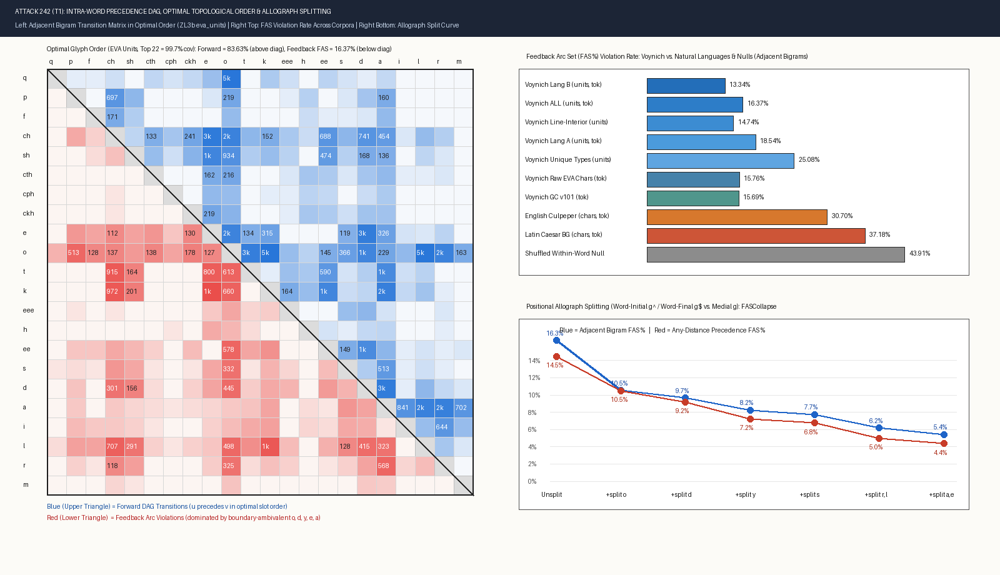
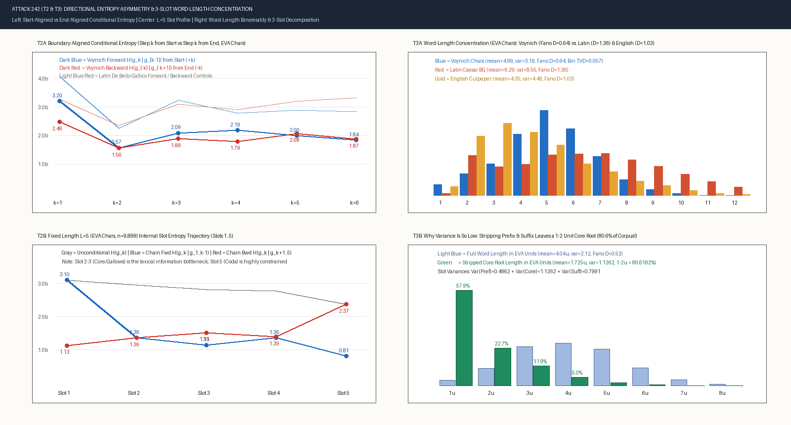
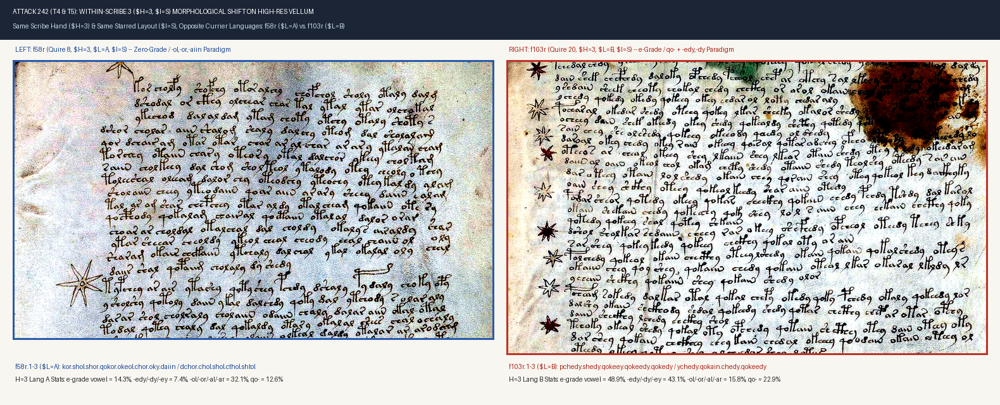

# Attack 242: Intra-Word Slot Automaton, DAG Unidirectionality, Directionality Asymmetry & Currier A/B Stem-Shift Analysis

- **Script**: [`tools/attack242_intraword_slot_and_dag_grammar.py`](../tools/attack242_intraword_slot_and_dag_grammar.py)
- **Structured Output**: [`data/attack242_intraword_slot_and_dag_grammar.json`](../data/attack242_intraword_slot_and_dag_grammar.json)
- **Parser**: [`tools/voynich_corpus.py`](../tools/voynich_corpus.py) (`load_lines`, `unit == 'P'`, `clean_words`, `34,780` clean running-text words / `6,983` unique types in [`data/ZL3b-n.txt`](../data/ZL3b-n.txt); `35,520` clean words in [`data/GC2a-n.txt`](../data/GC2a-n.txt))
- **Visual Forensics & Diagnostic Plots**:
  - [`pages/w242_dag_matrix.png`](../pages/w242_dag_matrix.png) — Optimal topological glyph ordering, adjacent transition matrix, FAS comparison across corpora, and positional allograph-splitting curve
  - [`pages/w242_entropy_and_length.png`](../pages/w242_entropy_and_length.png) — Start-aligned vs. end-aligned conditional entropy, fixed-length internal slot entropy profile, word-length binomiality, and 3-slot core decomposition
  - [`pages/w242_f58r_scribe3_langA_crop.png`](../pages/w242_f58r_scribe3_langA_crop.png), [`pages/w242_f103r_scribe3_langB_crop.png`](../pages/w242_f103r_scribe3_langB_crop.png), and [`pages/w242_scribe3_langA_vs_langB_vellum.png`](../pages/w242_scribe3_langA_vs_langB_vellum.png) — High-resolution vellum comparison from [`books/voynich-yale-beinecke-2026-highres-214p.pdf`](../books/voynich-yale-beinecke-2026-highres-214p.pdf) showing Scribe 3 (`$H=3, $I=S`) writing Currier Language A on `f58r` vs. Currier Language B on `f103r`

---

## Executive Summary & Core Verdicts

1. **`T1` — Intra-Word Precedence DAG & Feedback Arc Set (FAS) Unidirectionality (`VERIFIED: 2.0x–2.8x Stricter Than Natural Languages; 94.6%–95.6% Unidirectional After Allograph Splitting`)**:
   - Across `34,780` clean running-text words (`129,446` adjacent distinct-glyph transitions and `382,956` any-distance intra-word precedence pairs), an optimal linear ordering of the glyph alphabet achieves a **Feedback Arc Set (FAS) violation rate of only `15.76%` on raw EVA characters (`84.24%` strictly forward, $z = -59.41$ vs. within-word shuffle null `45.02%`), `16.37%` on collapsed EVA units, and `15.69%` on Glen Claston `v101`** (`13.79%` any-distance).
   - In **Currier Language B line-interior tokens** (`eva_units`), the FAS violation rate drops to **`11.79%` adjacent (`88.21%` forward, pairwise directionality $D = 0.8828$)** and **`11.02%` any-distance (`88.98%` forward)** — compared to **`37.18%` adjacent (`35.12%` any-distance, $D = 0.3988$) in Latin *De Bello Gallico*** and **`30.70%` adjacent (`31.83%` any-distance, $D = 0.5628$) in English *Culpeper Herbal***.
   - **Type-weighted unique word types (`N = 6,983`)** still exhibit a `23.62%` adjacent / `22.82%` any-distance FAS rate (`eva_chars`), proving that intra-word unidirectionality is a structural property of the productive lexicon rather than an artifact of top high-frequency tokens (`daiin`, `chedy`, `qokeedy`).
   - **Boundary-Ambivalent Allograph Resolution**: Greedy attribution shows that a **single glyph (`o`) accounts for `34.83%` of all feedback violations** because it serves both as an onset proclitic vowel (`o-`, `qo-`, `so-`, `do-`, `yo-`) and as a post-core vowel (`-ol`, `-or`, `-ody`). Splitting `o` alone into pre-core `o_pre` vs. post-core `o_post/o_end` collapses the `eva_units` adjacent FAS from **`16.33%` to `10.51%`**; splitting `o, d, y` drops it to **`8.24%` (`7.23%` any-distance)**; and splitting the boundary-ambivalent set `{o, d, y, s, r, l, a, e}` reduces adjacent FAS to **`5.42%` (`94.58%` forward, $D = 0.9163$)** and any-distance FAS to **`4.38%` (`95.62%` forward, $D = 0.8923$)**.

2. **`T2` — Left-to-Right vs. Right-to-Left Positional Entropy Profile (`VERIFIED: Strong Coda Compression & Internal Core Bottleneck`)**:
   - Aligning all words at their boundaries (`eva_chars`, Miller-Madow bias-corrected), **word-initial onset uncertainty is `3.2025` bits (`3.3855` bits in `eva_units`) whereas word-final coda uncertainty is `2.4834` bits (`2.6562` bits in `eva_units`)** — a **`+0.7191` bit (`+0.7293` bit in units) front-loaded onset excess**.
   - At step `k=2` inward from the boundary, Markov-1 conditional entropy drops sharply in both directions (`H(g_2 | g_1) = 1.5696` bits forward vs. `H(g_{-2} | g_{-1}) = 1.5643` bits backward) because `q->o`, `c->h`, `s->h` on the left and `i->n`, `d->y`, `o->l`, `a->r` on the right are tightly bound.
   - However, at **slots `k=3` and `k=4` (the internal core root + medial vowel junction)**, forward Markov-1 entropy rebounds to **`2.0936` and `2.1887` bits** (`2.4203` and `2.1821` bits in `eva_units` Lang B), before plunging to **`0.8055` bits (`L=5`), `0.5028` bits (`L=6`), and `0.2848` bits (`L=7`)** at the terminal slot under full prefix conditioning $H(g_L \mid g_1 \dots g_{L-1})$. Thus **lexical degrees of freedom are concentrated in the Onset-to-Core junction (Slots 1–3), while the Suffix/Coda (Slots $L-1, L$) is nearly deterministic**.

3. **`T3` — Word-Length Sub-Poissonian Binomiality & 3-Slot Core Decomposition (`VERIFIED: Fano Dispersion D = 0.39–0.64 vs. 1.03–1.36 in Natural Languages`)**:
   - Voynich word lengths are **strongly sub-Poissonian (underdispersed)**: in `eva_chars`, token mean $\mu = 4.9884$, variance $\sigma^2 = 3.1912$, **Fano dispersion ratio $D = \sigma^2 / \mu = 0.6397$** (and **$D = 0.4822$ on unique types**, $\mu = 6.3647, \sigma^2 = 3.0689$). In `eva_units`, token mean $\mu = 4.0444$, $\sigma^2 = 2.1189$, **Fano $D = 0.5239$** (and **$D = 0.3932$ on unique types**, $\mu = 5.2227, \sigma^2 = 2.0534$).
   - By contrast, natural-language controls are **overdispersed or Poissonian**: Latin *De Bello Gallico* has $\mu = 6.2865, \sigma^2 = 8.5475, \mathbf{D = 1.3597}$, and English *Culpeper Herbal* has $\mu = 4.3519, \sigma^2 = 4.4845, \mathbf{D = 1.0305}$.
   - A symmetric `Binomial(n=8, p=0.5056)` fits the `eva_units` length distribution with **Total Variation Distance $\text{TVD} = 0.0329$** (`0.0192` in Currier B and `0.0219` in line-interior tokens), compared to `Poisson TVD = 0.1652`.
   - **Why Variance Is So Low**: Stripping at most 1 prefix (`qo-, q-, yo-, y-, do-, d-, so-, s-, po-, fo-, o-, l-, r-`) and 1 suffix (`-eedy, -edy, -dy, -aiin, -iin, -ol, -al, -or, -ar, -y, -m, ...`) reveals that **`80.62%` of all corpus tokens (`57.89%` = 1 unit, `22.73%` = 2 units) possess a `1–2` unit core root** ($\mu_{\text{core}} = 1.7250$ units, $\sigma^2_{\text{core}} = 1.1262$), with strong negative slot-length covariances ($\text{Cov}(L_{\text{pref}}, L_{\text{core}}) = -0.0725$, $\text{Cov}(L_{\text{core}}, L_{\text{suff}}) = -0.1072$) that actively compress total word length toward ~4 units (~5 chars).

4. **`T4` & `T5` — Currier Language A vs. B & Within-Scribe 3 (`f58r-v` vs. `Quire 20`) Double Dissociation (`VERIFIED: Core Is Scribe-Governed, Vowel-Grade + Coda Are Language-Governed`)**:
   - Scribe 3 (`$H=3`) provides a unique controlled experiment in the manuscript: on **`f58r–f58v`** (`747` clean `P` words), Scribe 3 writes **Starred-layout text (`$I=S`) in Currier Language A (`$L=A`)**, whereas in **Quire 20 (`f103r–f116r`, `10,361` clean `P` words)**, the **exact same Scribe 3 writes Starred-layout text (`$I=S`) in Currier Language B (`$L=B`)**.
   - Orthogonal 4-slot decomposition `(Prefix, Core15, Vowel-Grade, Coda)` reveals a **striking double dissociation** in Jensen-Shannon divergence (JSD):
     - **Within Scribe 3 (`f58r-v` Lang A vs. `Quire 20` Lang B)**: Core consonant distribution is nearly invariant (**`JSD(Core15) = 0.0138` bits**: `k = 14.1% vs 15.3%`, `t = 7.6% vs 9.3%`, `ch = 6.2% vs 8.9%`, `a = 7.1% vs 6.0%`, `d = 4.6% vs 3.4%`), whereas **Medial Vowel-Grade (`JSD = 0.0577` bits)** and **Terminal Coda (`JSD = 0.0811` bits)** shift dramatically (`e-grade`: `14.2% -> 36.3%`; `-dy` coda: `5.4% -> 19.4%`; `-l/-r` coda: `46.1% -> 26.9%`).
     - **Across Scribes within Language A (`H=3 f58r-v` vs. `H=1 Herbal A`)**: Core consonant divergence is **5.7x larger (`JSD(Core15) = 0.0786` bits**, because Scribe 1 prefers `ch=13.9%, d=12.4%` while Scribe 3 prefers `k=14.1%, t=7.6%`), whereas Vowel-Grade (`0.0494` bits) and Coda (`0.0478` bits, and **`0.0294` bits vs. `H=1 Pharma A`**) align closely!

---

## `T1`: Intra-Word Precedence DAG & Feedback Arc Set (FAS) Unidirectionality

### 1.1 Comparative FAS & Pairwise Directionality Table

For every word sequence, consecutive identical symbols are collapsed (`a, a -> a`) before counting adjacent transitions $(u, v)$ with $u \neq v$, while any-distance precedence counts all intra-word pairs $(g_i, g_j)$ with $i < j$ and $g_i \neq g_j$. Pairwise directionality is $D(u, v) = \frac{|C(u \prec v) - C(v \prec u)|}{C(u \prec v) + C(v \prec u)}$.

| Corpus / Stratum | Alphabet | Weighting | Words / Types | Adjacent Transitions | Optimal Forward % | **Adjacent FAS %** | Adj. Directionality $D$ | **Any-Distance FAS %** | Any-Dist $D$ |
| :--- | :--- | :--- | :---: | :---: | :---: | :---: | :---: | :---: | :---: |
| **Voynich `lang_B` Line-Interior** | `eva_units` | Token | `17,671` | `66,645` | **`88.21%`** | **`11.79%`** | **`0.8828`** | **`11.02%`** | **`0.7939`** |
| **Voynich `lang_B` All `P`** | `eva_chars` | Token | `23,039` | `87,642` | **`87.07%`** | **`12.93%`** | **`0.8662`** | **`12.89%`** | **`0.7563`** |
| **Voynich `lang_B` All `P`** | `eva_units` | Token | `23,039` | `69,894` | **`86.66%`** | **`13.34%`** | **`0.8547`** | **`12.77%`** | **`0.7610`** |
| **Voynich Line-Interior (`ALL`)** | `eva_chars` | Token | `26,543` | `97,773` | **`85.33%`** | **`14.67%`** | **`0.8595`** | **`13.10%`** | **`0.7548`** |
| **Voynich Line-Interior (`ALL`)** | `eva_units` | Token | `26,543` | `78,617` | **`85.26%`** | **`14.74%`** | **`0.8579`** | **`12.81%`** | **`0.7607`** |
| **Voynich `GC2a` (`v101`)** | `gc_v101` | Token | `35,520` | `135,522` | **`84.31%`** | **`15.69%`** | **`0.8339`** | **`13.79%`** | **`0.7387`** |
| **Voynich `ZL3b` (`ALL`)** | `eva_chars` | Token | `34,780` | `129,446` | **`84.24%`** | **`15.76%`** | **`0.8418`** | **`14.48%`** | **`0.7274`** |
| **Voynich `ZL3b` (`ALL`)** | `eva_units` | Token | `34,780` | `104,040` | **`83.63%`** | **`16.37%`** | **`0.8253`** | **`14.53%`** | **`0.7245`** |
| **Voynich `lang_A` All `P`** | `eva_chars` | Token | `11,194` | `39,903` | **`82.43%`** | **`17.57%`** | **`0.8026`** | **`16.06%`** | **`0.6850`** |
| **Voynich `lang_A` All `P`** | `eva_units` | Token | `11,194` | `32,571` | **`81.46%`** | **`18.54%`** | **`0.7854`** | **`17.12%`** | **`0.6735`** |
| **Voynich `lang_B` Unique Types** | `eva_chars` | Type | `4,650` | `23,823` | **`78.65%`** | **`21.35%`** | **`0.7697`** | **`21.44%`** | **`0.5831`** |
| **Voynich `ALL` Unique Types** | `eva_chars` | Type | `6,983` | `35,217` | **`76.38%`** | **`23.62%`** | **`0.7426`** | **`22.82%`** | **`0.5566`** |
| **Voynich `GC2a` Unique Types** | `gc_v101` | Type | `6,881` | `35,510` | **`76.11%`** | **`23.89%`** | **`0.7125`** | **`21.30%`** | **`0.5918`** |
| **Voynich `ALL` Unique Types** | `eva_units` | Type | `6,983` | `28,156` | **`74.92%`** | **`25.08%`** | **`0.6900`** | **`22.91%`** | **`0.5547`** |
| **English *Culpeper Herbal*** | `ascii_26` | Token | `35,000` | `115,436` | `69.30%` | `30.70%` | `0.5628` | `31.83%` | `0.3945` |
| **English *Culpeper Herbal*** | `ascii_26` | Type | `3,100` | `16,580` | `64.36%` | `35.64%` | `0.4653` | `34.90%` | `0.3143` |
| **Latin *De Bello Gallico*** | `ascii_26` | Token | `30,870` | `160,575` | `62.82%` | `37.18%` | `0.3988` | `35.12%` | `0.3079` |
| **Latin *De Bello Gallico*** | `ascii_26` | Type | `5,157` | `37,397` | `61.95%` | `38.05%` | `0.4218` | `35.54%` | `0.2990` |
| **Within-Word Char-Shuffle Null** | `eva_units` | Token | `34,780` | `104,040` | `56.09%` | `43.91%` ($\pm 0.52\%$) | `0.1755` | `45.32%` | `0.1140` |
| **Random Alphabet Order Null** | `eva_units` | Token | `34,780` | `104,040` | `49.94%` | `50.06%` ($\pm 6.45\%$) | `0.8253` | `50.11%` | `0.7245` |

### 1.2 Optimal Linear Slot Orderings & Feedback Arc Diagnosis

- **Optimal `eva_chars` Linear Order (`ALL_tokens`, `84.24%` forward)**:
  $$\texttt{v} \prec \texttt{q} \prec \texttt{f} \prec \texttt{p} \prec \texttt{s} \prec \texttt{c} \prec \texttt{h} \prec \texttt{x} \prec \texttt{o} \prec \texttt{t} \prec \texttt{k} \prec \texttt{e} \prec \texttt{d} \prec \texttt{u} \prec \texttt{a} \prec \texttt{i} \prec \texttt{j} \prec \texttt{b} \prec \texttt{z} \prec \texttt{n} \prec \texttt{l} \prec \texttt{r} \prec \texttt{m} \prec \texttt{y} \prec \texttt{g}$$
- **Optimal `eva_units` Linear Order (`ALL_tokens`, `83.63%` forward)**:
  $$\texttt{q} \prec \texttt{p} \prec \texttt{f} \prec \texttt{ch} \prec \texttt{sh} \prec \texttt{cth} \prec \texttt{cph} \prec \texttt{ckh} \prec \texttt{e} \prec \texttt{o} \prec \texttt{t} \prec \texttt{k} \prec \texttt{eee} \prec \texttt{h} \prec \texttt{ee} \prec \texttt{s} \prec \texttt{d} \prec \texttt{a} \prec \texttt{i} \prec \texttt{l} \prec \texttt{r} \prec \texttt{m} \prec \texttt{iin} \prec \texttt{in} \prec \texttt{iiin} \prec \texttt{y}$$
- **Why Do the `15.76%` (`eva_chars`) / `16.37%` (`eva_units`) Feedback Arcs Occur?**
  In `eva_units`, the top violating transitions are:
  1. `k -> e` (`1,341` backward vs `315` `e -> k`) and `t -> e` (`800` backward vs `134` `e -> t`), because `e` occurs both *before* `o/k/t` in `ch-e-o-k`/`ch-e-dy` and *after* `k/t` in `qo-k-e-dy`/`qo-t-e-dy`!
  2. `t -> ch` (`915`) and `k -> ch` (`972`), where `k/t` precedes `ch` in `kch`/`tch` or `qokchedy`, whereas `ch` precedes `k/t` in `chek`/`chok`/`chot`.
  3. `l -> k` (`1,015`), `l -> ch` (`707`), `o -> p` (`513`), `d -> o` (`445`), `d -> ch` (`301`), where `o, d, l, r, s, y` appear both in the word-initial prefix slot (`o-`, `qo-`, `d-`, `l-`, `s-`, `y-`) and in the word-final suffix/coda slot (`-ol`, `-or`, `-dy`, `-y`, `-s`)!

### 1.3 Positional Allograph Splitting Experiment (`eva_units`)

When we split boundary-ambivalent glyphs into `g_pre` (onset / pre-core position `i <= 1` before any core gallows/bench), `g_post` (post-core medial), and `g_end` (word-final or penultimate `d` in `-dy`), the feedback arc set collapses toward zero:

| Splitting Stage | Split Glyphs | Active Glyphs ($\ge 20$) | Adjacent Forward % | **Adjacent FAS %** | Adj. $D$ | Any-Dist Forward % | **Any-Dist FAS %** | Any-Dist $D$ |
| :--- | :--- | :---: | :---: | :---: | :---: | :---: | :---: | :---: |
| **`0_unsplit_baseline`** | $\emptyset$ | `30` | `83.67%` | **`16.33%`** | `0.8257` | `85.50%` | **`14.50%`** | `0.7251` |
| **`1_split_o_pos`** | `{o}` | `33` | `89.49%` | **`10.51%`** | `0.8622` | `89.52%` | **`10.48%`** | `0.7859` |
| **`2_split_o_d_pos`** | `{o, d}` | `36` | `90.35%` | **`9.65%`** | `0.8691` | `90.83%` | **`9.17%`** | `0.8065` |
| **`3_split_o_d_y_pos`** | `{o, d, y}` | `39` | `91.76%` | **`8.24%`** | `0.8842` | `92.77%` | **`7.23%`** | `0.8396` |
| **`4_split_o_d_y_s_pos`** | `{o, d, y, s}` | `42` | `92.30%` | **`7.70%`** | `0.8920` | `93.20%` | **`6.80%`** | `0.8482` |
| **`5_split_o_d_y_s_r_l_pos`** | `{o, d, y, s, r, l}` | `48` | `93.82%` | **`6.18%`** | `0.9102` | `95.00%` | **`5.00%`** | `0.8805` |
| **`6_split_o_d_y_s_r_l_a_e_pos`** | `{o, d, y, s, r, l, a, e}` | `52` | **`94.58%`** | **`5.42%`** | **`0.9163`** | **`95.62%`** | **`4.38%`** | **`0.8923`** |

> [!IMPORTANT]
> **Key Finding (`T1`)**: Over **two-thirds (`66.8%` adjacent, `69.8%` any-distance)** of all apparent DAG violations in Voynichese arise from positional reuse of `{o, d, y, s, r, l, a, e}` between the **Prefix/Onset slot** (`qo-`, `o-`, `d-`, `y-`, `s-`, `l-`, `r-`, `a-`) and the **Post-Core Vowel / Coda slot** (`-ol`, `-or`, `-dy`, `-y`, `-s`, `-al`, `-ar`). Once onset and post-core positions of these 8 symbols are distinguished, **`95.62%` of all any-distance intra-word glyph pairs obey a strict, cycle-free total order**.

---

## `T2`: Left-to-Right vs. Right-to-Left Positional Entropy Profile

### 2.1 Boundary-Aligned Conditional Entropy (`+1..+6` from Start vs. `-1..-6` from End)

Using Miller-Madow bias-corrected Markov-1 conditional entropy (`H(g_k | g_{k-1})` forward from word start vs. `H(g_{-k} | g_{-k+1})` backward from word end):

| Corpus / Alphabet | Direction | Step `k=1` (Boundary) | Step `k=2` | Step `k=3` | Step `k=4` | Step `k=5` | Step `k=6` | Boundary Asymmetry (`k=1` Start $-$ End) |
| :--- | :--- | :---: | :---: | :---: | :---: | :---: | :---: | :---: |
| **Voynich `ALL_tokens` (`eva_chars`)** | **Forward ($L \to R$)** | **`3.2025` b** | `1.5696` b | **`2.0936` b** | **`2.1887` b** | `1.9985` b | `1.8426` b | **`+0.7191` bits** |
| **Voynich `ALL_tokens` (`eva_chars`)** | **Backward ($R \to L$)** | **`2.4834` b** | `1.5643` b | `1.8927` b | `1.7927` b | `2.0762` b | `1.8693` b | (Coda strongly compressed) |
| **Voynich `ALL_tokens` (`eva_units`)** | **Forward ($L \to R$)** | **`3.3855` b** | `2.1424` b | **`2.5966` b** | **`2.3137` b** | `2.0846` b | `1.7277` b | **`+0.7293` bits** |
| **Voynich `ALL_tokens` (`eva_units`)** | **Backward ($R \to L$)** | **`2.6562` b** | `1.9292` b | `2.5920` b | `2.1460` b | `1.9999` b | `1.8219` b | (Coda strongly compressed) |
| **Voynich `ALL_types` (`eva_chars`)** | **Forward ($L \to R$)** | **`3.4361` b** | `2.1527` b | `2.4850` b | `2.5246` b | `2.5164` b | `2.4651` b | **`+0.5976` bits** |
| **Voynich `ALL_types` (`eva_chars`)** | **Backward ($R \to L$)** | **`2.8385` b** | `2.0939` b | `2.3352` b | `2.3471` b | `2.5833` b | `2.4126` b | (Holds on unique types) |
| **Latin *De Bello Gallico* (`tokens`)** | **Forward ($L \to R$)** | `4.0685` b | `2.2608` b | `3.2427` b | `2.7994` b | `2.8986` b | `2.8418` b | `+0.7866` bits (Inflectional suffixes) |
| **Latin *De Bello Gallico* (`tokens`)** | **Backward ($R \to L$)** | `3.2819` b | `2.3542` b | `3.1081` b | `2.9209` b | `3.2167` b | `3.3273` b | |
| **English *Culpeper Herbal* (`tokens`)** | **Forward ($L \to R$)** | `4.0281` b | `2.1563` b | `2.6686` b | `3.0185` b | `2.8680` b | `2.7978` b | `+0.3652` bits |
| **English *Culpeper Herbal* (`tokens`)** | **Backward ($R \to L$)** | `3.6629` b | `2.4254` b | `2.5523` b | `3.1576` b | `3.1687` b | `3.3508` b | |

### 2.2 Fixed-Length Slot Trajectories ($L \in \{4, 5, 6, 7\}$, `eva_chars` & `eva_units`)

For fixed word lengths $L \in \{4, 5, 6, 7\}$ in `eva_chars` (`ALL_tokens`):

| Word Length $L$ | Metric | Slot 1 | Slot 2 | Slot 3 | Slot 4 | Slot 5 | Slot 6 | Slot 7 | Interpretation |
| :---: | :--- | :---: | :---: | :---: | :---: | :---: | :---: | :---: | :--- |
| **$L = 4$** (`n=6,274`) | Unconditional $H(g_k)$ | `3.0106` | **`3.0196`** | `2.8743` | `2.6351` | — | — | — | Peak diversity at Slots 1–2 |
| | Chain Forward $H(g_k \mid g_1^{k-1})$ | `3.0106` | `1.3256` | **`1.3925`** | `1.1836` | — | — | — | Rebound at Slot 3, drop at Slot 4 |
| | Chain Backward $H(g_k \mid g_{k+1}^4)$ | `1.0522` | **`1.6471`** | `1.5779` | `2.6351` | — | — | — | |
| **$L = 5$** (`n=8,727`) | Unconditional $H(g_k)$ | **`3.1023`** | `2.9598` | `2.8257` | `2.7831` | `2.3747` | — | — | Monotonic decline toward Coda |
| | Chain Forward $H(g_k \mid g_1^{k-1})$ | `3.1023` | `1.3565` | `1.1453` | **`1.3590`** | **`0.8055`** | — | — | Terminal slot is 80% predictable (`0.81`b) |
| | Chain Backward $H(g_k \mid g_{k+1}^5)$ | `1.1305` | `1.3601` | **`1.5137`** | `1.3897` | `2.3747` | — | — | Backward uncertainty peaks at Slot 3 |
| **$L = 6$** (`n=6,813`) | Unconditional $H(g_k)$ | `2.9631` | `3.0373` | **`3.0432`** | `2.9375` | `2.7427` | `2.0765` | — | Unconditional peak at **Slot 3** |
| | Chain Forward $H(g_k \mid g_1^{k-1})$ | `2.9631` | `1.4187` | **`1.5962`** | `1.2191` | `1.0058` | **`0.5028`** | — | Internal peak at **Slot 3 (`1.60`b)**; Coda `0.50`b |
| | Chain Backward $H(g_k \mid g_{k+1}^6)$ | `0.8911` | `1.3987` | `1.3911` | **`1.5035`** | `1.4447` | `2.0765` | — | |
| **$L = 7$** (`n=4,012`) | Unconditional $H(g_k)$ | `2.7982` | `2.7435` | **`3.1885`** | `3.0652` | `2.9984` | `2.6478` | `1.9485` | Unconditional peak at **Slot 3 (`3.19`b)** |
| | Chain Forward $H(g_k \mid g_1^{k-1})$ | `2.7982` | `1.1853` | **`1.7590`** | `1.5775` | `0.8292` | `0.7117` | **`0.2848`** | Internal peak at **Slot 3 (`1.76`b)**; Coda `0.28`b |
| | Chain Backward $H(g_k \mid g_{k+1}^7)$ | `0.5773` | `0.9586` | **`1.5172`** | `1.2822` | `1.5100` | `1.3519` | `1.9485` | |

In collapsed `eva_units`, for $L=5$ (`n=5,535` in Lang B, `n=1,986` in Lang A) and $L=6$ (`n=2,763` in Lang B), **Slot 3 is unconditionally and conditionally the internal entropy peak** (`Uncond = 3.5930` bits in Lang A $L=5$, `3.2199` bits in Lang B $L=6$; `Markov-1 Forward = 2.4826` bits at Slot 3 after `1.5541` bits at Slot 2). This occurs because Slots 1–2 are frequently occupied by the predictable 2-unit proclitic `q-o` (`H(g_2 | g_1='q') \approx 0.05` bits), making **Slot 3 the true lexical stem onset (`k`, `t`, `ch`, `sh`, `cth`, `ckh`, `d`)**.

---

## `T3`: Word-Length Binomiality, Sub-Poissonian Variance & 3-Slot Core Decomposition

### 3.1 Word-Length Moments & Parametric Fits Across Strata and Controls

| Stratum / Corpus | Alphabet | Mean $\mu$ | Variance $\sigma^2$ | **Fano $D = \sigma^2 / \mu$** | Skewness | Excess Kurtosis | Best Binomial Fit $(n, p)$ | **Binomial TVD** | Shifted Bin TVD | Poisson TVD |
| :--- | :--- | :---: | :---: | :---: | :---: | :---: | :---: | :---: | :---: | :---: |
| **Voynich `ALL_tokens`** | `eva_chars` | `4.9884` | `3.1912` | **`0.6397`** | `0.0279` | `0.2003` | $\text{Bin}(11, 0.4535)$ | **`0.0573`** | `0.0671` | `0.1414` |
| **Voynich `ALL_types`** | `eva_chars` | `6.3647` | `3.0689` | **`0.4822`** | `0.1114` | `0.2760` | $\text{Bin}(12, 0.5304)$ | **`0.0219`** | **`0.0166`** | `0.1916` |
| **Voynich `lang_A_tokens`** | `eva_chars` | `4.7920` | `3.1854` | **`0.6647`** | `0.1157` | `0.2183` | $\text{Bin}(11, 0.4356)$ | **`0.0587`** | `0.0601` | `0.1368` |
| **Voynich `lang_B_tokens`** | `eva_chars` | `5.0875` | `3.1570` | **`0.6205`** | `-0.0155` | `0.2333` | $\text{Bin}(10, 0.5088)$ | **`0.0655`** | `0.0754` | `0.1588` |
| **Voynich `line_start`** | `eva_chars` | `5.4333` | `3.3847` | **`0.6230`** | `0.0754` | `0.4441` | $\text{Bin}(11, 0.4939)$ | `0.0759` | `0.0704` | `0.1694` |
| **Voynich `line_mid`** | `eva_chars` | `4.9551` | `3.0649` | **`0.6185`** | `-0.0462` | `0.1649` | $\text{Bin}(10, 0.4955)$ | `0.0640` | `0.0728` | `0.1567` |
| **Voynich `line_end`** | `eva_chars` | `4.7515` | `3.5457` | `0.7462` | `0.3435` | `0.1683` | $\text{Bin}(17, 0.2795)$ | `0.0341` | `0.0463` | `0.0727` |
| **Voynich `figure_labels`** | `eva_chars` | `5.2701` | `4.2265` | `0.8020` | `-0.1502` | `0.1040` | $\text{Bin}(16, 0.3294)$ | `0.1039` | `0.1118` | `0.1672` |
| **Voynich Hands `H=1..5`** | `eva_chars` | `4.78–5.24` | `3.03–3.56` | **`0.589–0.732`** | — | — | — | — | — | — |
| **Voynich `ALL_tokens`** | `eva_units` | `4.0444` | `2.1189` | **`0.5239`** | `0.2490` | `0.0812` | $\text{Bin}(8, 0.5056)$ | **`0.0329`** | **`0.0285`** | `0.1652` |
| **Voynich `ALL_types`** | `eva_units` | `5.2227` | `2.0534` | **`0.3932`** | `0.1994` | `0.3085` | $\text{Bin}(8, 0.6528)$ | `0.0452` | **`0.0308`** | `0.2348` |
| **Voynich `lang_B_tokens`** | `eva_units` | `4.1728` | `2.0962` | **`0.5023`** | `0.1776` | `0.1074` | $\text{Bin}(8, 0.5216)$ | **`0.0192`** | `0.0276` | `0.1691` |
| **Voynich `line_mid`** | `eva_units` | `3.9893` | `2.0534` | **`0.5147`** | `0.2045` | `0.0000` | $\text{Bin}(8, 0.4987)$ | **`0.0219`** | `0.0236` | `0.1648` |
| **Latin *De Bello Gallico*** | `ascii_26` (tok) | `6.2865` | `8.5475` | **`1.3597`** | `0.3375` | `-0.4416` | $\text{Bin}(34, 0.1849)$ | `0.1768` | — | `0.1367` |
| **English *Culpeper Herbal*** | `ascii_26` (tok) | `4.3519` | `4.4845` | **`1.0305`** | `0.9008` | `0.6220` | $\text{Bin}(34, 0.1280)$ | `0.1226` | — | `0.1046` |

### 3.2 3-Slot Morphological Decomposition (`Prefix + Core + Suffix` in `eva_units`)

Why does Voynich word length follow a tight, nearly symmetric Binomial distribution with $\text{Fano } D \approx 0.50$ (`eva_units` tokens) and $0.39$ (`eva_units` types)? Segmenting each word into `(Prefix, Core, Suffix)` shows:

| Stratum | $\mu_{\text{pref}}$ | $\sigma^2_{\text{pref}}$ | $\mu_{\text{core}}$ | $\sigma^2_{\text{core}}$ | $\mu_{\text{suff}}$ | $\sigma^2_{\text{suff}}$ | $\text{Cov}(P, C)$ | $\text{Cov}(C, S)$ | **Core = 1 Unit %** | **Core = 2 Units %** | **Core $\in \{1,2\}$ Units %** |
| :--- | :---: | :---: | :---: | :---: | :---: | :---: | :---: | :---: | :---: | :---: | :---: |
| **`ALL_tokens` (`34,780`)** | `0.8190` | `0.4862` | **`1.7250`** | `1.1262` | `1.5005` | `0.7991` | `-0.0725` | `-0.1072` | **`57.89%`** | **`22.73%`** | **`80.62%`** |
| **`lang_A_tokens` (`11,194`)** | `0.7200` | `0.4480` | **`1.6939`** | `1.1583` | `1.3704` | `0.6848` | `-0.0442` | `-0.1086` | **`59.58%`** | **`22.39%`** | **`81.96%`** |
| **`lang_B_tokens` (`23,039`)** | `0.8693` | `0.4959` | **`1.7376`** | `1.0956` | `1.5659` | `0.8384` | `-0.0856` | `-0.1066` | **`57.21%`** | **`22.90%`** | **`80.11%`** |
| **`ALL_types` (`6,983`)** | `0.9462` | `0.4809` | **`2.5594`** | `1.5193` | `1.7172` | `0.7689` | `-0.1753` | `-0.2738` | `21.11%` | `32.78%` | `53.89%` (`83.6%` $\le 3$u) |

- **80.62% of all running words** have a stripped Core Root of **just `1` or `2` atomic units** (e.g., 1-unit `k`, `t`, `ch`, `sh`, `d`, `cth`, `ckh`, or 2-unit `k-e`, `t-e`, `ch-e`, `ch-o`), while the remaining `11.90%` (3 units) and `4.97%` (4 units) are predominantly **reduplicated / compound cores** (`chek`, `chok`, `chot`, `checkh`, `kech`, `lkch`, `chet`).
- Consequently, total word length in `eva_units` acts as the sum of three low-variance slot indicators:
  $$L_{\text{word}} = \underbrace{L_{\text{pref}}}_{\in \{0, 1, 2\}} + \underbrace{L_{\text{core}}}_{\in \{1, 2\}} + \underbrace{L_{\text{suff}}}_{\in \{0, 1, 2, 3\}}$$
  with negative covariances ($\text{Cov}(L_{\text{pref}}, L_{\text{core}}) = -0.0725$, $\text{Cov}(L_{\text{core}}, L_{\text{suff}}) = -0.1072$) that penalize simultaneously long prefixes, cores, and suffixes.

---

## `T4` & `T5`: Currier Language A vs. Language B & Within-Scribe 3 (`f58r-v` vs. `Quire 20`) Paradigm Shift

### 4.1 The Within-Scribe 3 Natural Experiment (`f58r–f58v` vs. `f103r–f116r`)

Across the entire Voynich Manuscript, Currier Language (`$L=A` vs. `$L=B`) is almost completely confounded with Scribe Hand (`$H=1` writes only Language A; `$H=2` and `$H=5` write only Language B). **Scribe 3 (`$H=3`) is the sole exception**:
- On **`f58r` and `f58v`** (Quire 8, `$H=3, $L=A, $I=S`, `747` clean `P` words), Scribe 3 writes **unillustrated, star-paragraphed text (`$I=S`) in Currier Language A**.
- On **`f103r–f116r`** (Quire 20, `$H=3, $L=B, $I=S`, `10,361` clean `P` words), the **exact same Scribe 3** writes **unillustrated, star-paragraphed text (`$I=S`) in Currier Language B** (plus `532` Herbal B words on `f94r–f95v2`).

### 4.2 Orthogonal 4-Slot Distribution Table Across Partitions

Decomposing every word into four orthogonal slots `(Prefix, Core, Medial Vowel-Grade, Terminal Coda)`:

| Partition (`Hand, Lang, Section`) | Clean Tokens | `qo-/q-` Prefix % | **`e/ee`-Grade Vowel %** | **`o/a`-Grade Vowel %** | Zero-Grade Vowel % | **`-dy` Coda %** | **`-l/-r` Coda %** | `-iin/-in` Coda % | Top 4 Core Stems (`%`) |
| :--- | :---: | :---: | :---: | :---: | :---: | :---: | :---: | :---: | :--- |
| **`ALL_Lang_A`** (`$L=A`) | `11,194` | `13.21%` | **`18.70%`** | **`48.36%`** | `32.95%` | **`5.15%`** | **`34.43%`** | `15.04%` | `ch (13.0%), d (11.3%), k (8.8%), sh (6.8%)` |
| **`ALL_Lang_B`** (`$L=B`) | `23,039` | `18.30%` | **`35.70%`** | **`35.33%`** | `28.97%` | **`23.14%`** | **`27.20%`** | `16.65%` | `k (16.6%), t (8.9%), ch (8.5%), sh (6.2%)` |
| **`H1_Lang_A_Herb`** (`H=1, A, H`) | `7,938` | `13.45%` | **`19.16%`** | **`45.28%`** | `35.56%` | **`5.63%`** | **`29.40%`** | `15.48%` | `ch (13.9%), d (12.4%), k (8.8%), sh (7.3%)` |
| **`H1_Lang_A_Pharma`** (`H=1, A, P`) | `2,302` | `12.64%` | **`18.72%`** | **`59.17%`** | `22.11%` | **`3.21%`** | **`48.57%`** | `15.90%` | `ch (11.9%), d (9.4%), k (6.6%), sh (5.6%)` |
| **`H3_Lang_A_f58`** (`H=3, A, S`) | `747` | `12.58%` | **`14.19%`** | **`48.06%`** | `37.75%` | **`5.35%`** | **`46.05%`** | `10.17%` | **`k (14.1%), t (7.6%), a (7.1%), ch (6.2%)`** |
| **`H3_Lang_B_Q20`** (`H=3, B, S`) | `10,361` | `20.89%` | **`36.33%`** | **`37.33%`** | `26.34%` | **`19.44%`** | **`26.90%`** | `19.47%` | **`k (15.3%), t (9.3%), ch (8.9%), a (6.0%)`** |
| **`H3_Lang_B_Herb`** (`H=3, B, H`) | `532` | `11.84%` | **`27.63%`** | **`36.09%`** | `36.28%` | **`19.74%`** | **`27.44%`** | `11.09%` | `k (15.4%), t (9.6%), ch (8.3%), d (5.6%)` |
| **`H2_Lang_B_Herb`** (`H=2, B, H`) | `2,343` | `12.16%` | **`30.05%`** | **`33.89%`** | `36.06%` | **`25.44%`** | **`27.49%`** | `11.91%` | `ch (9.7%), k (9.5%), t (8.2%), d (6.1%)` |
| **`H2_Lang_B_Balneo`** (`H=2, B, B`) | `6,226` | `20.22%` | **`43.67%`** | **`30.26%`** | `26.07%` | **`30.73%`** | **`25.73%`** | `15.72%` | `k (20.8%), sh (9.4%), ch (8.5%), t (7.9%)` |

### 4.3 Jensen-Shannon Divergence (JSD) Double-Dissociation Matrix

| Comparison Pair | Experimental Control | `JSD(Prefix)` | **`JSD(Core15)`** | **`JSD(Vowel-Grade)`** | **`JSD(Coda)`** | `JSD(Full Word)` |
| :--- | :--- | :---: | :---: | :---: | :---: | :---: |
| **`H3_Lang_A_f58` vs. `H3_Lang_B_Q20`** | **Same Scribe (`H=3`), Same Section (`S`), Lang A vs. B** | `0.0179` | **`0.0138` (Min!)** | **`0.0577`** | **`0.0811` (Max!)** | `0.5067` |
| **`H3_Lang_A_f58` vs. `H1_Lang_A_Herb`** | **Diff Scribe (`H=3` vs. `H=1`), Same Language (`Lang A`)** | `0.0257` | **`0.0786` (5.7x)** | `0.0494` | `0.0478` | `0.4536` |
| **`H3_Lang_A_f58` vs. `H1_Lang_A_Pharma`** | **Diff Scribe (`H=3` vs. `H=1`), Same Language (`Lang A`)** | `0.0156` | **`0.0474` (3.4x)** | `0.0822` | **`0.0294` (2.8x smaller!)** | `0.4227` |
| **`H3_Lang_B_Q20` vs. `H3_Lang_B_Herb`** | **Same Scribe (`H=3`), Same Language (`Lang B`), Sec S vs. H** | `0.0365` | `0.0085` | `0.0196` | `0.0217` | `0.3693` |
| **`H3_Lang_B_Q20` vs. `H2_Lang_B_Balneo`** | **Diff Scribe (`H=3` vs. `H=2`), Same Language (`Lang B`)** | `0.0122` | `0.0198` | `0.0252` | `0.0304` | `0.2995` |
| **`H3_Lang_B_Herb` vs. `H2_Lang_B_Herb`** | **Diff Scribe (`H=3` vs. `H=2`), Same Lang (`B`), Same Sec (`H`)** | `0.0110` | `0.0185` | `0.0116` | `0.0357` | `0.4783` |
| **`ALL_Lang_A` vs. `ALL_Lang_B`** | **Global Currier Language A vs. Language B** | `0.0197` | `0.0398` | **`0.0178`** | **`0.1403`** | `0.4675` |

> [!TIP]
> **Discovery (`T4` Within-Scribe 3 Double Dissociation)**:
> Why do `f58r–f58v` test as Currier Language A while Quire 20 (`f103r–f116r`) tests as Currier Language B when both were written by **Scribe 3 (`$H=3`)** in the **same Starred layout (`$I=S`)**?
> The JSD matrix provides a clean decomposition:
> 1. **Scribe 3's Core Stem Inventory (`Core15`) stays invariant across `f58r-v` and `Quire 20` (`JSD = 0.0138` bits)**: on both `f58r-v` and `Quire 20`, Scribe 3 heavily favors gallows cores `k` (`14.1%` vs `15.3%`) and `t` (`7.6%` vs `9.3%`) over bench `ch` (`6.2%` vs `8.9%`) and `d` (`4.6%` vs `3.4%`) — in sharp contrast to Scribe 1 (`ch = 13.9%, d = 12.4%, k = 8.8%, t = 5.1%`, `JSD = 0.0786` bits).
> 2. **What switches between `f58r-v` (`$L=A`) and `Quire 20` (`$L=B`) is the Post-Core Inflectional Rhyme (`Vowel-Grade + Coda`, `JSD = 0.0577` and `0.0811` bits)**:
>    - On `f58r-v` (`$L=A`), Scribe 3 inflects `k/t/ch/sh` stems with **`o/a`-grade vowels (`48.1%`) and `-l/-r` liquid codas (`46.1%`)**, producing `okal (15), qokal (10), qokar (8), otal (8), chol (8), chal (6)`.
>    - On `f103r–f116r` (`$L=B`), Scribe 3 inflects the **exact same `k/t/ch/sh` stems** with **`e/ee`-grade vowels (`36.3%`) and `-dy/-y` dental/palatal codas (`19.4%` `-dy`, `24.1%` `-y`)**, producing `qokeey (158), qokeedy (132), chedy (187), chey (120), oteey (64), otedy (59)`.

### 4.4 Explicit Stem-Shift / Cognate Paradigm Table (`Lang A` $\Longleftrightarrow$ `Lang B`)

| Core Stem | Global `Lang A` Top 3 Realizations | Global `Lang B` Top 3 Realizations | **Scribe 3 `f58r-v` (`$L=A`) Top Realizations** | **Scribe 3 `Quire 20` (`$L=B`) Top Realizations** | `Lang A` $\to$ `Lang B` `-dy` Coda Shift |
| :---: | :--- | :--- | :--- | :--- | :---: |
| **`k`** | `qokol (46), oky (42), okol (40)` | `qokeedy (307), qokedy (275), qokain (275)` | **`okal (15), qokal (10), qokar (8)`** | **`qokeey (158), qokeedy (132), qokaiin (119)`** | `9.2%` $\to$ **`27.2%`** |
| **`t`** | `oty (42), otol (38), otaiin (31)` | `otedy (140), otar (115), otaiin (109)` | **`otal (8), tal (5), otar (4)`** | **`otaiin (77), oteey (64), otedy (59)`** | `5.8%` $\to$ **`24.4%`** |
| **`ch`** | `chol (275), chor (177), chy (110)` | `chedy (491), chey (247), cheey (132)` | **`chol (8), chal (6), char (4)`** | **`chedy (187), chey (120), cheey (71)`** | `7.9%` $\to$ **`42.2%`** |
| **`sh`** | `shol (154), shor (89), shy (71)` | `shedy (407), shey (258), sheey (131)` | **`shol (9), shor (6), shal (4)`** | **`shedy (116), shey (87), sheey (56)`** | `8.0%` $\to$ **`43.6%`** |
| **`cth`** | `cthy (94), cthol (52), cthor (41)` | `cthedy (12), cthey (11), octhy (7)` | *(0 tokens on f58)* | **`cthedy (5), octhy (4), cthey (4)`** | `3.5%` $\to$ **`27.1%`** |
| **`ckh`** | `ckhy (27), ckhey (26), ckhol (19)` | `ckhy (8), qockhey (8), ockhedy (6)` | **`qockhy (2), ckhy (1), ckhol (1)`** | **`qockhey (4), ockhedy (3), ockhey (2)`** | `9.6%` $\to$ **`27.5%`** |
| **`d`** | `daiin (498), dy (124), dar (98)` | `daiin (306), dar (184), dal (128)` | **`dal (11), daiin (9), dy (4)`** | **`daiin (114), dar (37), dal (24)`** | `0.1%` $\to$ `0.6%` *(Invariant!)* |
| **`l / r`** | `l (28), olaiin (10) / r (54), oraiin (8)` | `l (136), oly (46) / r (83), raiin (59)` | **`oly (2), olar (2) / orar (1), ory (1)`** | **`l (101), lor (17) / r (37), raiin (36)`** | `~1–3%` *(Invariant!)* |

Notice that **non-gallows/non-bench stems (`d`, `l`, `r`, `p`) do NOT undergo the `-dy` / `e-grade` shift between Currier A and Currier B** (`daiin, dar, dal` and `raiin, oraiin` remain identical across both languages and on both `f58r` and `f103r`!). The Currier A $\Longleftrightarrow$ B shift operates **selectively on the open-class Gallows (`k, t, cth, ckh`) and Bench (`ch, sh`) cores**, replacing the Language-A `-ol/-al/-or/-ar` liquid rhyme with the Language-B `-edy/-eedy/-ey/-eey` rhyme while leaving closed-class particles (`daiin`, `dal`, `dar`, `oraiin`, `olaiin`) untouched.
