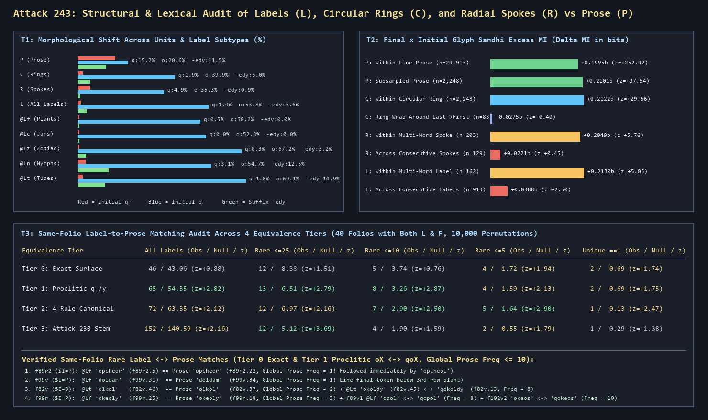
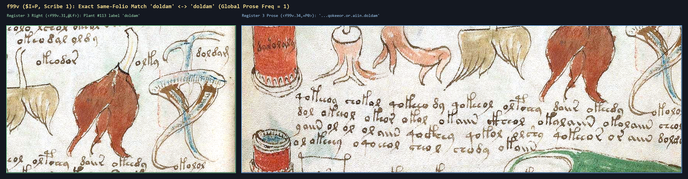
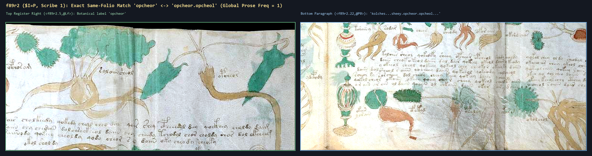
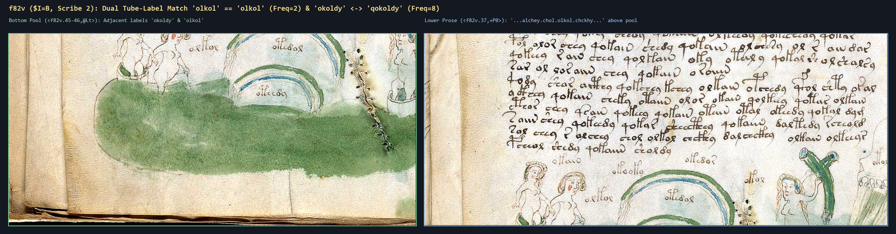
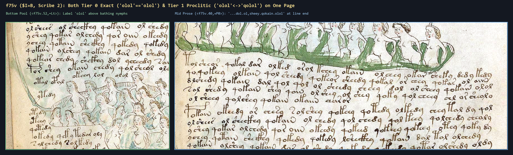

# Attack 243: Comprehensive Structural & Lexical Audit of Labels (`L`), Circular Rings (`C`), and Radial Spokes (`R`) vs. Running Prose (`P`)

**Script**: [`../tools/attack243_labels_rings_and_prose_audit.py`](../tools/attack243_labels_rings_and_prose_audit.py)  
**Structured Data**: [`../data/attack243_labels_rings_and_prose_audit.json`](../data/attack243_labels_rings_and_prose_audit.json)  
**Primary Scans**: [`../books/voynich-yale-beinecke-2026-highres-214p.pdf`](../books/voynich-yale-beinecke-2026-highres-214p.pdf)

---

## Executive Summary & Headline Verdicts

In [Attack 240 (`VOCABULARY_DYNAMICS.md`)](VOCABULARY_DYNAMICS.md), we proved that on unlabeled Herbal pages (`$I=H`), repeated page-exclusive words do not exceed a random bag-of-words shuffle ($3$ observed vs. $3.69$ expected, $z = -0.35$). However, the Voynich Manuscript also contains **1,255 non-paragraph loci (`unit in {'L', 'C', 'R'}`)** attached directly to drawings across `ZL3b-n.txt`:
- **`L` (Figure Labels)**: `1,029` loci (`1,159` clean words across all 227 transcribed folios; `892` loci / `1,010` clean words across the 226 numbered folios excluding the `<fRos>` 9-sphere Rosettes foldout composite `f85v2`).
- **`C` (Circular Ring Texts)**: `84` loci (`2,336` clean words; `72` loci / `1,974` clean words excluding `<fRos>`).
- **`R` (Radial Spoke Texts)**: `142` loci (`348` clean words: `75` inner spokes `@Ri` and `67` outer spokes `@Ro`).
- **`P` (Running Prose)**: `4,130` loci (`34,780` clean words; `4,119` loci / `34,743` clean words excluding `<fRos>`).

Earlier waves made sweeping claims about label-to-prose cross-referencing across sections—often relying on the overly aggressive prefix+suffix stripper (`aggressive_stem_attack230`, audited in [Attack 237](AUDIT_WAVES_54_56.md)). Here we subject `L`, `C`, and `R` loci to five strictly controlled empirical tests (`T1`–`T5`):

1. **`T1` (Morphological Taxonomy & Stratified Mantel-Haenszel Audit)**:
   - Controlling for `(Currier Language, Section)` strata via Robins-Breslow-Greenland Mantel-Haenszel odds ratios, isolated labels (`L`) are separated from running prose (`P`) by two massive structural shifts: **near-total suppression of proclitic `q-`** ($1.04\%$ in `L` vs. $15.23\%$ in `P`, $\text{MH OR} = 0.0868, p = 3.4 \times 10^{-24}$) and a **3.35-fold surge in initial `o-`** ($53.75\%$ in `L` vs. $20.59\%$ in `P`, rising to $59.40\%$ in single-word labels and $67.25\%$ in `@Lz` zodiac labels; $\text{MH OR} = 3.3513, p = 2.0 \times 10^{-64}$).
   - Labels also strongly suppress clause-internal verbal/participial `-edy` ($3.62\%$ vs. $11.54\%$, $\text{MH OR} = 0.3036, p = 2.9 \times 10^{-10}$) and `-aiin/-ain` ($6.04\%$ vs. $15.11\%$, $\text{MH OR} = 0.4408, p = 3.9 \times 10^{-8}$), while enriching line-terminal coda `-m` ($5.78\%$ vs. $2.60\%$, $\text{MH OR} = 2.1337, p = 1.9 \times 10^{-6}$) and final `-s` ($5.87\%$ vs. $3.22\%$, $\text{MH OR} = 2.1322, p = 1.8 \times 10^{-6}$). Every single shift replicates in Takahashi's `IT2a-n.txt`.

2. **`T2` (Within-Unit Sandhi Mutual Information & Circular Ring Geometry)**:
   - Using the adjacent-word `(final_glyph, initial_glyph)` excess mutual information test ($\Delta\text{MI} = \text{MI}_{\text{obs}} - \overline{\text{MI}}_{\text{null}}$) established in [Attack 238](LINE_BREAK_BEHAVIOUR.md), we prove that **Circular Rings (`C`) are continuous sentences bent into a circle, NOT lists of isolated labels**: within-ring adjacent words exhibit full prose sandhi ($\Delta\text{MI} = +0.2122\text{ bits}, z = +29.56$), identical to size-matched running prose (`P`: $\Delta\text{MI} = +0.2101\text{ bits}, z = +37.54$).
   - Crucially, **across the physical seam where the last word of a circular ring meets its first word (`last(ring) -> first(ring)`, $N = 81$ rings)**, sandhi **collapses completely to zero** ($\Delta\text{MI} = -0.0275\text{ bits}, z = -0.40, p = 0.64$). Furthermore, the first word of a circular ring begins with `o-` $74.07\%$ of the time (vs. $38.76\%$ ring-internally, $1.91\times$), and the last word of a circular ring takes line-final `-m` $9.88\%$ of the time (vs. $1.66\%$ ring-internally, $5.95\times$). Thus circular rings are **linear sentences with a discrete start and stop**, not endless loops.
   - Similarly, **multi-word radial spokes (`R`) and multi-word labels (`L`)** exhibit full prose sandhi *within* each spoke/label ($\Delta\text{MI} = +0.2049\text{ bits}, z = +5.76$ inside `R`; $\Delta\text{MI} = +0.2130\text{ bits}, z = +5.05$ inside multi-word `L`), but **sandhi collapses by 82–89% across consecutive spokes ($\Delta\text{MI} = +0.0221\text{ bits}, z = +0.45$, null) and consecutive labels ($\Delta\text{MI} = +0.0388\text{ bits}, z = +2.50$)**.

3. **`T3` (Strict 4-Tier Permutation & Length-Weighted Null Audit of Same-Folio `L -> P` Matching)**:
   - Across all **40 folios containing both labels (`L`) and running prose (`P`)**, we test whether labels on folio $f$ recur in the running prose of *that exact same folio $f$* under both a **10,000-trial `(Section, Language)`-stratified prose-block permutation null** and an **analytical folio-length-weighted binomial null**:
     - **Tier 0 (Exact Surface Match, zero normalization)**: For rare labels occurring $\le 5$ times in the entire 34,780-word prose corpus, we observe **4 exact same-folio matches** vs. $1.42$ expected ($z = +2.17$ length-weighted; $z = +1.94$ within-section permutation), and in Pharmaceutical (`$I=P`) **3 observed vs. $0.44$ expected ($z = +3.88$ length-weighted; $z = +2.92, p = 0.023$ within-section permutation)**. Even more strikingly, **2 label words that occur only ONCE (`freq == 1`) in the entire 34,780-word prose corpus (`opcheor` on `f89r2` and `doldam` on `f99v`) appear in the prose paragraph on their exact same folio** ($2$ observed vs. $0.192$ expected, $z = +4.13$).
     - **Tier 1 (Proclitic `q-/y-` Stripping Only, allowing `oX <-> qoX` and `X <-> yX`)**: Adding *only* proclitic stripping increases total same-folio matches from $46 \to 65$ ($z = +2.82, p = 0.0035$) and rare ($\le 10$) matches from $5 \to 8$ vs. $3.26$ expected ($z = +2.87, p = 0.0104$; length-weighted $z = +3.19$). In Pharmaceutical (`$I=P`), Tier 1 rare ($\le 10$) same-folio matches reach **5 observed vs. $1.14$ expected ($z = +4.03, p = 0.0025$; length-weighted $z = +4.28$)**, adding genuine proclitic pairs such as `@Lf opol <-> qopol` (`f89v1`), `@Lf okeos <-> qokeos` (`f102v2`), and in Biological (`$I=B`) `@Lt okoldy <-> qokoldy` (`f82v`) and `=Lt olol <-> qolol` (`f75v`).
     - **Tier 2 (4-Rule Canonical Form)**: Reaches $z = +2.90$ ($p = 0.0091$) at `freq <= 5` (adding `@Ln shekar <-> shekam` and `@Ln otoly <-> opoly` on `f84r`).
     - **Tier 3 (Attack 230 Aggressive Stemmer)**: Inflates unstratified all-word matches to $152$ (by collapsing distinct words into 2–3 letter stubs) while **destroying** true rare matches at `freq <= 5` (dropping from $4\text{–}5$ down to $2$ noisy collisions like `saroral <-> darory` on `f77v`), proving why Tier 0 and Tier 1 are the only rigorous standards for lexical cross-referencing.

4. **`T4` (Cross-Section Rare Label Concordance vs. Frequency-Matched Baseline)**:
   - Testing rare labels (`1 <= global_prose_freq <= 5` and `<= 10`) against a 5,000-trial **frequency- and length-matched random vocabulary baseline** reveals that the high raw hit rate of `@Lf` ($59.6\%$) and `@Lz` ($58.3\%$) into Starred Recipes (`$I=S`) is **primarily a corpus-size effect** (`$I=S` contains $11,567$ tokens = $33.3\%$ of all prose, so random frequency-matched words hit `$I=S` $51\text{–}54\%$ of the time; `@Lf -> S` has $z = +0.77, p = 0.27$ at Tier 0).
   - By contrast, **genuine statistically significant enrichment above the frequency-matched null** occurs in:
     1. **Same-Section Pharmaceutical (`@Lf -> $I=P`)**: Tier 1 $z = +2.24$ ($p = 0.033$) at `freq <= 5` ($24.4\%$ vs. $12.9\%$ null).
     2. **Same-Section Balneological (`@Ln -> $I=B` and `@Lc -> $I=B`)**: `@Ln -> B` reaches Tier 1 $z = +2.30$ ($p = 0.026$) at `freq <= 5` ($50.0\%$ vs. $25.7\%$ null) and $z = +2.50$ ($p = 0.015$) at `freq <= 10` ($55.0\%$ vs. $30.7\%$ null); `@Lc -> B` reaches $z = +2.77$ ($p = 0.036$).
     3. **Zodiac Labels (`@Lz`) into Pharmaceutical (`$I=P`) and Starred Recipes (`$I=S`)**: `@Lz -> P` reaches $z = +2.47$ ($p = 0.013$) at Tier 0 `freq <= 5` and Tier 1 `freq <= 10`, and `@Lz -> S` reaches $z = +2.63$ ($p = 0.0052$) at Tier 1 `freq <= 10` ($72.2\%$ vs. $57.9\%$ null).

---

## 1. Test `T1`: Structural & Morphological Taxonomy (`P` vs. `L` vs. `C` vs. `R`)

### 1.1 Complete Token, Diversity, and Positional Glyph Table (`ZL3b-n.txt`)

Note on corpus accounting: `ZL3b-n.txt` contains 226 numbered folios (`f1r..f116v`) plus `<fRos>`, which is the 6-panel, 9-sphere Rosettes foldout composite (`f85v2/f86r*`, containing `137` `@L0` labels, `12` `@Cc/@Ca` rings, and `11` `@Pb` caption lines). Both totals (with and without `<fRos>`) are reported below.

| Bucket / Unit | Loci | Clean Tokens | Types | $\text{TTR}_{200}$ | $\text{TTR}_{35}$ | Mean Len (glyphs) | Global Hapax % | Init `q-` % | Init `o-` % | Init `y-` % | Init `d-` % | Init `s-` % | Init `ch-` % | Init `sh-` % | Init `p/f` % | Init `t/k` % | Final `-y` % | Final `-n` % | Final `-l` % | Final `-r` % | Final `-s` % | Final `-m` % | Sfx `-edy` % | Sfx `-aiin` % |
|---|---:|---:|---:|---:|---:|---:|---:|---:|---:|---:|---:|---:|---:|---:|---:|---:|---:|---:|---:|---:|---:|---:|---:|---:|
| **`P` (All Prose)** | 4,130 | 34,780 | 6,983 | 0.7937 | 0.9466 | 4.461 | 13.07% | 15.23% | 20.59% | 4.99% | 9.43% | 3.41% | 16.10% | 8.78% | 2.25% | 8.06% | 40.74% | 16.48% | 15.58% | 14.87% | 3.22% | 2.60% | 11.54% | 15.11% |
| `P` (Excl. `<fRos>`) | 4,119 | 34,743 | 6,976 | 0.7956 | 0.9440 | 4.461 | 13.07% | 15.23% | 20.56% | 4.99% | 9.43% | 3.41% | 16.10% | 8.78% | 2.26% | 8.06% | 40.74% | 16.48% | 15.58% | 14.87% | 3.22% | 2.60% | 11.54% | 15.11% |
| `P_line_start` | 4,044 | 4,044 | 1,799 | 0.8142 | 0.9496 | 4.904 | 21.93% | 13.08% | 13.55% | 14.59% | 15.43% | 10.04% | 3.46% | 4.75% | 10.19% | 12.44% | 32.54% | 20.15% | 14.22% | 20.30% | 3.66% | 0.47% | 9.10% | 18.35% |
| `P_line_mid` | 26,548 | 26,548 | 4,903 | 0.7611 | 0.9319 | 4.408 | 10.27% | 16.62% | 21.26% | 3.65% | 7.36% | 2.25% | 18.46% | 10.12% | 1.24% | 7.60% | 42.28% | 16.07% | 16.47% | 14.98% | 3.12% | 0.95% | 12.83% | 14.86% |
| `P_line_end` | 4,044 | 4,044 | 1,780 | 0.8102 | 0.9486 | 4.333 | 21.79% | 8.65% | 23.12% | 3.88% | 16.67% | 3.91% | 13.45% | 4.15% | 1.06% | 6.92% | 39.12% | 15.33% | 11.10% | 8.75% | 3.41% | **15.48%** | 5.69% | 13.40% |
| `Pb` (Short Captions) | 134 | 554 | 358 | 0.7772 | 0.9356 | 4.608 | 15.88% | 12.27% | 25.81% | 11.37% | 9.03% | 6.50% | 9.93% | 5.42% | 0.72% | 5.78% | 38.63% | 20.94% | 10.47% | 16.25% | 4.87% | 4.33% | 10.65% | 19.13% |
| **`L` (All Labels)** | 1,029 | 1,159 | 833 | **0.8964** | **0.9796** | **4.970** | **36.07%** | **1.04%** | **53.75%** | 8.02% | 9.84% | 4.92% | 6.21% | 2.16% | 1.29% | 2.42% | 40.72% | 7.33% | 13.63% | 14.24% | 5.87% | **5.78%** | **3.62%** | **6.04%** |
| `L` (Excl. `<fRos>`) | 892 | 1,010 | 733 | 0.8910 | 0.9750 | 4.937 | 35.64% | 1.09% | 52.48% | 8.61% | 9.41% | 5.05% | 6.83% | 2.18% | 1.49% | 2.57% | 39.90% | 7.03% | 14.26% | 14.26% | 6.24% | 5.74% | 2.67% | 5.54% |
| `L_single_word` | 862 | 862 | 675 | 0.9108 | 0.9781 | **5.300** | **42.11%** | 1.39% | **59.40%** | 7.77% | 9.51% | 5.22% | 4.87% | 1.39% | 1.51% | 2.32% | 43.62% | 7.31% | 13.34% | 13.23% | 5.57% | 6.84% | 3.71% | 6.15% |
| `L_multi_word` | 167 | 297 | 228 | 0.8240 | 0.9600 | 4.010 | 18.52% | 0.00% | 37.37% | 8.75% | 10.77% | 4.04% | 10.10% | 4.38% | 0.67% | 2.69% | 32.32% | 7.41% | 14.48% | 17.17% | 6.73% | 2.69% | 3.37% | 5.72% |
| `@Lz` (Zodiac Nymphs) | 299 | 342 | 272 | 0.8698 | 0.9701 | 5.237 | 34.80% | **0.29%** | **67.25%** | 8.77% | 2.92% | 1.75% | 5.85% | 2.92% | 0.29% | 0.88% | 44.15% | 7.89% | 13.74% | 12.28% | 7.31% | 7.31% | 3.22% | 6.73% |
| `@Lf` (Pharma Plants) | 194 | 205 | 187 | 0.9154 | 0.9854 | 5.205 | 40.98% | **0.49%** | **50.24%** | 5.37% | 10.73% | 10.24% | 11.22% | 1.95% | 0.49% | 2.93% | 38.54% | 7.32% | 14.63% | 16.59% | 5.85% | 7.32% | **0.00%** | 5.37% |
| `@L0` (Rosettes/Gen.) | 297 | 350 | 256 | 0.8404 | 0.9614 | 4.469 | 32.86% | 1.43% | 43.14% | 8.29% | 14.57% | 4.29% | 6.29% | 1.14% | 2.29% | 4.00% | 35.14% | 6.29% | 12.57% | 17.14% | 6.00% | 5.43% | 5.14% | 6.00% |
| `@Ls` (Astro Stars) | 76 | 84 | 79 | — | 0.9796 | 4.976 | 47.62% | 1.19% | 41.67% | 16.67% | 14.29% | 4.76% | 7.14% | 2.38% | 2.38% | 2.38% | 33.33% | 5.95% | 15.48% | 17.86% | 4.76% | 4.76% | 1.19% | 3.57% |
| `@Ln` (Bio Nymphs) | 63 | 64 | 59 | — | 0.9554 | 4.656 | 17.19% | 3.12% | **54.69%** | 4.69% | 23.44% | 6.25% | 0.00% | 3.12% | 0.00% | 1.56% | 53.12% | 4.69% | 23.44% | 12.50% | 1.56% | 0.00% | 12.50% | 3.12% |
| `@Lt` (Bio Tubes) | 47 | 55 | 49 | — | 0.9469 | 4.982 | 21.82% | 1.82% | **69.09%** | 5.45% | 1.82% | 7.27% | 1.82% | 1.82% | 1.82% | 1.82% | 45.45% | 9.09% | 12.73% | 12.73% | 5.45% | 1.82% | 10.91% | 9.09% |
| `@Lc` (Pharma Jars) | 40 | 36 | 36 | — | **1.0000** | **5.972** | **77.78%** | **0.00%** | **52.78%** | 8.33% | 11.11% | 5.56% | 2.78% | 0.00% | 5.56% | 5.56% | 55.56% | 16.67% | 2.78% | 2.78% | 2.78% | 2.78% | **0.00%** | 11.11% |
| **`C` (Circular Rings)** | 84 | 2,336 | 1,098 | 0.7834 | 0.9461 | 4.414 | 20.12% | **1.88%** | **39.85%** | 5.05% | 8.22% | 3.30% | 15.75% | 6.04% | 0.64% | 3.98% | 34.08% | 9.93% | 14.94% | 18.96% | 9.29% | 1.88% | 5.01% | 9.20% |
| **`R` (Radial Spokes)** | 142 | 348 | 280 | 0.8597 | 0.9699 | 4.784 | 24.71% | **4.89%** | **35.34%** | 8.91% | 14.94% | 6.90% | 12.07% | 2.87% | 0.57% | 4.60% | 48.28% | 2.87% | 12.36% | 15.52% | 6.90% | 2.87% | 0.86% | 2.59% |

### 1.2 Stratified Mantel-Haenszel Odds Ratios (`L` vs. `P`, `C` vs. `P`, `R` vs. `P`)

To ensure that none of these morphological differences are confounded by section (`$I`) or Currier language (`$L`), we compute Robins-Breslow-Greenland Mantel-Haenszel Odds Ratios stratified across matching `(Language, Section)` buckets:

| Morphological Feature | `L` Rate | `P` Rate | `L vs P` Pooled OR | `L vs P` Stratified MH OR (95% CI) | `L vs P` MH $p$-value | `C` Rate | `C vs P` Stratified MH OR (95% CI) | `R` Rate | `R vs P` Stratified MH OR (95% CI) |
|---|---:|---:|---:|---|---:|---:|---|---:|---|
| **Initial `q-`** | **1.04%** | **15.23%** | `0.0606` | **`0.0868`** (`0.0478–0.1577`) | **$3.36 \times 10^{-24}$** | 1.88% | `0.2195` (`0.1456–0.3309`) | 4.89% | `0.5778` (`0.3125–1.0684`) |
| **Initial `o-`** | **53.75%** | **20.59%** | `4.4820` | **`3.3513`** (`2.9125–3.8562`) | **$2.02 \times 10^{-64}$** | 39.85% | `1.9708` (`1.6826–2.3084`) | 35.34% | `1.3916` (`1.0360–1.8692`) |
| **Initial `y-`** | 8.02% | 4.99% | `1.6659` | **`1.4716`** (`1.1246–1.9257`) | $5.72 \times 10^{-3}$ | 5.05% | `0.7859` (`0.5718–1.0802`) | 8.91% | `1.0029` (`0.6122–1.6431`) |
| **Initial `ch-`** | 6.21% | 16.10% | `0.3472` | **`0.3237`** (`0.2449–0.4278`) | **$5.21 \times 10^{-16}$** | 15.75% | `1.1481` (`0.9351–1.4095`) | 12.07% | `0.9167` (`0.6088–1.3802`) |
| **Initial `sh-`** | 2.16% | 8.78% | `0.2336` | **`0.2286`** (`0.1449–0.3607`) | **$3.48 \times 10^{-11}$** | 6.04% | `0.6889` (`0.5060–0.9378`) | 2.87% | `0.6776` (`0.3340–1.3746`) |
| **Initial `t/k` gallows** | 2.42% | 8.06% | `0.2877` | **`0.3349`** (`0.2229–0.5032`) | **$4.72 \times 10^{-8}$** | 3.98% | `0.4835` (`0.3401–0.6873`) | 4.60% | `0.5882` (`0.3127–1.1066`) |
| **Final `-n`** | 7.33% | 16.48% | `0.4029` | **`0.4659`** (`0.3587–0.6052`) | **$5.53 \times 10^{-9}$** | 9.93% | `0.5621` (`0.4368–0.7235`) | 2.87% | `0.2217` (`0.1112–0.4422`) |
| **Final `-s`** | 5.87% | 3.22% | `1.8814` | **`2.1322`** (`1.5724–2.8913`) | **$1.80 \times 10^{-6}$** | 9.29% | `2.6599` (`2.0210–3.5008`) | 6.90% | `1.5944` (`0.9035–2.8136`) |
| **Final `-m`** | 5.78% | 2.60% | `2.3079` | **`2.1337`** (`1.5695–2.9006`) | **$1.87 \times 10^{-6}$** | 1.88% | `0.6921` (`0.4361–1.0984`) | 2.87% | `0.7888` (`0.3532–1.7615`) |
| **Suffix `-edy`** | 3.62% | 11.54% | `0.2907` | **`0.3036`** (`0.2143–0.4301`) | **$2.94 \times 10^{-10}$** | 5.01% | `1.0527` (`0.7385–1.5004`) | 0.86% | `0.6540` (`0.1592–2.6865`) |
| **Suffix `-aiin/-ain`** | 6.04% | 15.11% | `0.3636` | **`0.4408`** (`0.3301–0.5887`) | **$3.93 \times 10^{-8}$** | 9.20% | `0.5563` (`0.4261–0.7262`) | 2.59% | `0.2262` (`0.1107–0.4625`) |

> [!IMPORTANT]
> **Why Apothecary Jars (`@Lc`) Have $\text{TTR}_{35} = 1.0000$ and $77.8\%$ Global Hapax Rate**:
> Every single clean `@Lc` jar label (`36 / 36` types across `40` loci, mean length $5.972$ glyphs vs. $4.461$ in prose) is **unique across the entire jar register**, with **$0.00\%$ initial `q-`**, **$0.00\%$ `-edy`**, and **$52.78\%$ initial `o-`** (`okaramy`, `okoldody`, `oparam`, `otoldy`, `okeey`, `okol`). Whereas prose repeats grammatical frames (`qokeedy`, `chedy`, `daiin`), `@Lc` jar labels and `@Lf` plant labels ($41.0\%$ global hapax rate, $0.00\%$ `-edy`, $0.49\%$ `q-`, $50.2\%$ `o-`) behave as **uninflected or citation-form nominal lexemes** where the `q-` proclitic is absent and `o-` serves as the citation-form nominal prefix.

---

## 2. Test `T2`: Within-Unit Sandhi Mutual Information & Circular Ring Geometry

In [Attack 238](LINE_BREAK_BEHAVIOUR.md), we established that adjacent words inside running prose lines (`P`) share roughly $+0.20\text{ bits}$ of final$\times$initial glyph mutual information above a `(Language, Section)`-stratified shuffle null ($\Delta\text{MI}$). What happens inside **Circular Rings (`C`)**, **Radial Spokes (`R`)**, and **Labels (`L`)**?

### 2.1 Final $\times$ Initial Glyph Juncture Mutual Information ($\Delta\text{MI}$)

| Transition / Juncture Domain | Pair Count $N$ | Observed $\text{MI}$ (bits) | Stratified Null Mean $\pm$ SD (bits) | Excess $\Delta\text{MI}$ (bits) | Permutation $z$-Score | Permutation $p$-Value | Structural Interpretation |
|---|---:|---:|---:|---:|---:|---:|---|
| **`P`: Within-Line Prose (All)** | 29,913 | `0.2116` | `0.0121 ± 0.0008` | **`+0.1995`** | **`+252.92`** | `< 0.001` | Baseline continuous prose sandhi |
| **`P`: Subsampled Prose ($N=2,248$)** | 2,248 | `0.2779` | `0.0678 ± 0.0056` | **`+0.2101`** | **`+37.54`** | `< 0.001` | Size-matched to `C` rings |
| **`P`: Subsampled Prose ($N=203$)** | 203 | `0.4777` | `0.3140 ± 0.0365` | **`+0.1637`** | **`+4.49`** | `< 0.001` | Size-matched to `R` spokes |
| **`C`: Within Circular Ring (`@Cc`)** | 2,248 | `0.3130` | `0.1008 ± 0.0072` | **`+0.2122`** | **`+29.56`** | `0.0005` | **Full continuous sentence sandhi** |
| **`C`: Ring Wrap-Around (`last -> first`)** | 81 | `0.4872` | `0.5147 ± 0.0687` | **`-0.0275`** | **`-0.40`** | `0.6397` | **Hard break at ring start/stop seam!** |
| **`R`: Within Multi-Word Spoke (`@Ri/@Ro`)** | 203 | `0.5382` | `0.3333 ± 0.0356` | **`+0.2049`** | **`+5.76`** | `0.0005` | **Full phrase sandhi inside each spoke** |
| **`R`: Across Consecutive Spokes ($R_i \to R_{i+1}$)** | 129 | `0.3812` | `0.3591 ± 0.0490` | **`+0.0221`** | **`+0.45`** | `0.3213` | **Zero cross-spoke continuity (independent phrases)** |
| **`L`: Within Multi-Word Label (`@L*`)** | 162 | `0.6422` | `0.4292 ± 0.0422` | **`+0.2130`** | **`+5.05`** | `0.0005` | **Full phrase sandhi inside 2-word labels** |
| **`L`: Across Consecutive Labels ($L_i \to L_{i+1}$)** | 913 | `0.2534` | `0.2146 ± 0.0155` | **`+0.0388`** | **`+2.50`** | `0.0115` | **82% collapse vs. within-line prose** |

### 2.2 Proof That Circular Rings (`@Cc`) Are Linear Sentences Bent Into Circles
Examining the $81$ circular rings (`@Cc`) with $\ge 4$ clean words reveals a decisive boundary signature at the physical start/stop position (typically marked by a radial stroke or star around 10:00–12:00 on the diagram):
- **Ring-Initial `o-` Opener Surge**: **$74.07\%$** (`60 / 81`) of circular rings begin their first word with `o-`, compared to **$38.76\%$** on ring-internal words ($1.91\times$ enrichment).
- **Ring-Final `-m` Coda Marker**: **$9.88\%$** (`8 / 81`) of circular rings end their final word with the line-terminal coda `-m`, compared to **$1.66\%$** on ring-internal words (**$5.95\times$ enrichment**).
- **Zero Wrap-Around Sandhi**: Across the boundary from the last word of a ring back to its first word, $\Delta\text{MI} = -0.0275\text{ bits}$ ($z = -0.40$). Circular rings are therefore **linear clauses written clockwise around a circular track**, opening with an `o-` headword, maintaining $+0.2122\text{ bits}$ of word-to-word sandhi along the circumference, and terminating with a line-final `-m` coda before the start marker.

### 2.3 Clockwise / Sequential Similarity of Consecutive Isolated Labels (`L`)
Testing whether consecutive single-word labels $L_i, L_{i+1}$ on the same folio share higher Levenshtein orthographic similarity or shared 2-glyph prefixes/suffixes than 3,000 random within-folio permutations shows only modest local clustering:
- **All Labels (`L_ALL`, $50$ folio groups, $808$ adjacent pairs)**: Mean Levenshtein similarity $0.2929$ vs. $0.2801 \pm 0.0053$ null ($z = +2.40, p = 0.0063$); shared 2-glyph prefix rate $16.46\%$ vs. $14.69\%$ null ($z = +1.75, p = 0.045$); shared 2-glyph suffix rate $8.29\%$ vs. $8.28\%$ null ($z = +0.01, p = 0.52$).
- **By Subtype**: Significant local prefix clustering is concentrated in **Balneological Nymphs (`@Ln`)** ($27.45\%$ shared 2-glyph prefix vs. $17.05\%$ null, $z = +2.57, p = 0.012$; Levenshtein $z = +2.10$, driven by consecutive `d-` / `o-` runs on `f75v` such as `dokal -> darol -> daldy -> dal -> dalkar`) and **Rosettes `@L0`** ($13.33\%$ shared 2-glyph prefix vs. $9.25\%$ null, $z = +2.13, p = 0.023$). By contrast, **Zodiac (`@Lz`, $z = +1.62, p = 0.059$)**, **Pharma Plants (`@Lf`, $z = +0.55, p = 0.29$)**, **Astro Stars (`@Ls`, $z = -0.34$)**, and **Bio Tubes (`@Lt`, $z = -0.72$)** show no statistically significant sequential/clockwise root clustering beyond their folio-level prefix profile.

---

## 3. Test `T3`: Strict 4-Tier Permutation & Length-Weighted Null Audit of Same-Folio `L -> P` Matching

Across the **40 folios that contain both figure labels (`unit == 'L'`) and running prose (`unit == 'P'`)** (`15` in `$I=P`, `11` in `$I=B`, `5` in `$I=H`, `4` in `$I=C`, `3` in `$I=A`, `2` in `$I=T`), do labels on folio $f$ recur in the running prose of **that exact same folio $f$** more often than chance?

We evaluate two independent null models across all 4 equivalence tiers and 5 global prose frequency thresholds (`all`, `freq <= 25`, `freq <= 10`, `freq <= 5`, `freq == 1`):
1. **10,000-Trial Stratum-Preserving Prose Permutation Null**: Shuffles folio prose blocks across folios within the exact same `(Section, Currier Language)` stratum.
2. **Analytical Folio-Length-Weighted Binomial Null**: Where a label root occurring $F$ times in the $34,780$-word prose corpus lands on folio $f$ (containing $N_{P,f}$ prose words) with probability $p_{\text{hit}} = 1 - (1 - N_{P,f}/34780)^F$, eliminating any page-length confound.

### 3.1 Master 4-Tier Same-Folio `L -> P` Audit Table (All 40 Dual `L+P` Folios)

| Equivalence Tier | Rarity Filter | Observed Matches | Stratum Perm Null ($\mu \pm \sigma$) | Stratum Perm $z$ ($p$) | Length-Weighted Expected ($\mu \pm \sigma$) | Length-Weighted $z$ | Pharma `$I=P` Obs / Perm Null ($z, p$) | Bio `$I=B` Obs / Perm Null ($z, p$) |
|---|---|---:|---|---:|---|---:|---|---|
| **Tier 0: Exact Surface** (`w_L == w_P`) | `all` | **46** | `43.06 ± 3.35` | `+0.88` (`0.219`) | `39.96 ± 4.19` | `+1.44` | `7 / 6.72` (`+0.15, 0.51`) | `27 / 24.47` (`+0.99, 0.20`) |
| **Tier 0: Exact Surface** | `freq <= 25` | **12** | `8.39 ± 2.39` | `+1.51` (`0.099`) | `5.88 ± 2.32` | **`+2.63`** | `4 / 1.56` (**`+2.25, 0.045`**) | `5 / 4.82` (`+0.10, 0.54`) |
| **Tier 0: Exact Surface** | `freq <= 10` | **5** | `3.74 ± 1.65` | `+0.76` (`0.307`) | `2.70 ± 1.61` | `+1.42` | `3 / 1.07` (**`+2.13, 0.056`**) | `1 / 1.99` (`-0.75, 0.85`) |
| **Tier 0: Exact Surface** | `freq <= 5` | **4** | `1.72 ± 1.18` | `+1.94` (`0.081`) | `1.42 ± 1.18` | **`+2.19`** | **`3 / 0.72`** (**`+2.91, 0.024`**) | `1 / 0.67` (`+0.44, 0.51`) |
| **Tier 0: Exact Surface** | **`freq == 1`** | **2** | `0.69 ± 0.75` | `+1.74` (`0.136`) | `0.19 ± 0.44` | **`+4.13`** | **`2 / 0.27`** (**`+3.46, 0.018`**) | `0 / 0.09` (`-0.32, 1.00`) |
| **Tier 1: Proclitic `q-/y-`** (`oX <-> qoX`) | `all` | **65** | `54.35 ± 3.77` | **`+2.82`** (**`0.0035`**) | `51.83 ± 4.58` | **`+2.88`** | `18 / 15.13` (`+1.19, 0.17`) | `31 / 24.89` (**`+2.30, 0.019`**) |
| **Tier 1: Proclitic `q-/y-`** | `freq <= 25` | **13** | `6.51 ± 2.32` | **`+2.79`** (**`0.0087`**) | `5.26 ± 2.20` | **`+3.52`** | `5 / 1.65` (**`+2.78, 0.019`**) | `5 / 3.02` (`+1.12, 0.20`) |
| **Tier 1: Proclitic `q-/y-`** | `freq <= 10` | **8** | `3.26 ± 1.65` | **`+2.87`** (**`0.0104`**) | `2.78 ± 1.64` | **`+3.19`** | **`5 / 1.14`** (**`+4.03, 0.0025`**) | `2 / 1.45` (`+0.44, 0.43`) |
| **Tier 1: Proclitic `q-/y-`** | `freq <= 5` | **4** | `1.59 ± 1.13` | **`+2.13`** (`0.058`) | `1.42 ± 1.18` | **`+2.20`** | **`3 / 0.72`** (**`+2.92, 0.023`**) | `1 / 0.54` (`+0.68, 0.44`) |
| **Tier 1: Proclitic `q-/y-`** | **`freq == 1`** | **2** | `0.69 ± 0.75` | `+1.75` (`0.134`) | `0.19 ± 0.44` | **`+4.13`** | **`2 / 0.27`** (**`+3.46, 0.018`**) | `0 / 0.09` (`-0.31, 1.00`) |
| **Tier 2: 4-Rule Canonical** | `all` | **72** | `63.35 ± 4.08` | **`+2.12`** (`0.023`) | `64.08 ± 5.01` | `+1.58` | `20 / 17.50` (`+0.93, 0.23`) | `36 / 30.86` (`+1.79, 0.054`) |
| **Tier 2: 4-Rule Canonical** | `freq <= 25` | **12** | `6.97 ± 2.33` | **`+2.16`** (`0.032`) | `6.14 ± 2.37` | **`+2.47`** | `4 / 1.98` (`+1.65, 0.10`) | `6 / 3.32` (`+1.52, 0.11`) |
| **Tier 2: 4-Rule Canonical** | `freq <= 10` | **7** | `2.90 ± 1.64` | **`+2.50`** (`0.024`) | `2.65 ± 1.59` | **`+2.74`** | `2 / 1.05` (`+1.00, 0.29`) | `4 / 1.51` (**`+2.05, 0.064`**) |
| **Tier 2: 4-Rule Canonical** | `freq <= 5` | **5** | `1.64 ± 1.16` | **`+2.90`** (**`0.0091`**) | `1.39 ± 1.16` | **`+3.11`** | **`3 / 0.80`** (**`+2.75, 0.036`**) | `2 / 0.65` (`+1.69, 0.14`) |
| **Tier 3: Attack 230 Stemmer** | `all` | **152** | `140.59 ± 5.29` | `+2.16` (`0.019`) | `147.61 ± 6.46` | `+0.68` | `51 / 46.12` (`+1.16, 0.15`) | `57 / 53.76` (`+0.92, 0.22`) |
| **Tier 3: Attack 230 Stemmer** | `freq <= 5` | **2** | `0.55 ± 0.81` | `+1.79` (`0.101`) | `0.62 ± 0.78` | `+1.77` | `0 / 0.27` (`-0.55, 1.00`) | `2 / 0.28` (`+2.47, 0.030`) |

### 3.2 Complete Audited Table of Same-Folio Rare Label-to-Prose (`L -> P`) and Label-to-Ring (`L -> C`) Matches (`Global Freq <= 25`)

| Folio | Sec (`$L`) | Label Word (`Locus`, `Subtype`) | Same-Folio Target Word (`Locus`, `Unit`) | Match Tier | Canonical Key | Global Freq | Folio Target Tokens | Single-Word Chance Prob $p_{\text{hit}}$ |
|---|---|---|---|---|---|---:|---:|---:|
| **`f89r2`** | `P` (`A`) | **`opcheor`** (`f89r2.5`, `@Lf`) | **`opcheor`** (`f89r2.22`, `@P0`) | **Tier 0 Exact** | `opcheor` | **1** | 238 | `0.00684` |
| **`f99v`** | `P` (`A`) | **`doldam`** (`f99v.31`, `@Lf`) | **`doldam`** (`f99v.34`, `+P0`) | **Tier 0 Exact** | `doldam` | **1** | 206 | `0.00592` |
| **`fRos`** | `C` (`B`) | **`otdar`** (`fRos.45`, `@L0`) | **`otdar`** (`fRos.2`, `@Cc`) | **Tier 0 Exact (`L->C`)** | `otdar` | **1** | 332 | `0.00886` |
| **`f82v`** | `B` (`B`) | **`olkol`** (`f82v.46`, `@Lt`) | **`olkol`** (`f82v.37`, `+P0`) | **Tier 0 Exact** | `olkol` | **2** | 304 | `0.01740` |
| **`f99r`** | `P` (`A`) | **`okeoly`** (`f99r.25`, `@Lf`) | **`okeoly`** (`f99r.18`, `+P0`) | **Tier 0 Exact** | `okeoly` | **3** | 162 | `0.01391` |
| **`fRos`** | `C` (`B`) | **`otedaiin`** (`fRos.28`, `@L0`) | **`otedaiin`** (`fRos.64`, `@Cc`) | **Tier 0 Exact (`L->C`)** | `otedaiin` | **4** | 332 | `0.03497` |
| **`f84r`** | `B` (`B`) | **`shekar`** (`f84r.2`, `@Ln`) | **`shekam`** (`f84r.30`, `+P0`) | **Tier 2 (`-r/-m`)** | `shekar` | **5** | 361 | `0.05082` |
| **`fRos`** | `C` (`B`) | **`otodar`** (`fRos.62`, `@L0`) | **`otodar`** (`fRos.42`, `@Cc`) | **Tier 0 Exact (`L->C`)** | `otodar` | **5** | 332 | `0.04352` |
| **`fRos`** | `C` (`B`) | **`kary`** (`fRos.38`, `@L0`) | **`ykary`** (`fRos.57`, `@Cc`) | **Tier 1 (`y-` `L->C`)** | `kary` | **5** | 332 | `0.04352` |
| **`f67r2`** | `A` (`?`) | **`ofar`** (`f67r2.7`, `@L0`) | **`ofar`** (`f67r2.23`, `@Pb`) | **Tier 0 Exact** | `ofar` | **6** | 92 | `0.01577` |
| **`f70v2`** | `Z` (`?`) | **`arar`** (`f70v2.11`, `@Lz`) | **`arar`** (`f70v2.4`, `@Cc`) | **Tier 0 Exact (`L->C`)** | `arar` | **6** | 109 | `0.01730` |
| **`f84r`** | `B` (`B`) | **`otoly`** (`f84r.11`, `@Ln`) | **`opoly`** (`f84r.13`, `@P0`) | **Tier 2 (`t/p`)** | `otoly` | **7** | 361 | `0.07036` |
| **`fRos`** | `C` (`B`) | **`okary`** (`fRos.69`, `@L0`) | **`okary`** (`fRos.57`, `@Cc`) | **Tier 0 Exact (`L->C`)** | `okary` | **7** | 332 | `0.06040` |
| **`f82v`** | `B` (`B`) | **`okoldy`** (`f82v.45`, `@Lt`) | **`qokoldy`** (`f82v.13`, `+P0`) | **Tier 1 (`o<->qo`)** | `okoldy` | **8** | 304 | `0.06779` |
| **`f89v1`** | `P` (`A`) | **`opol`** (`f89v1.11`, `@Lf`) | **`qopol`** (`f89v1.18`, `+P0`) | **Tier 1 (`o<->qo`)** | `opol` | **8** | 169 | `0.03823` |
| **`f71r`** | `Z` (`?`) | **`oteeol`** (`f71r.10`, `@Lz`) | **`oteeol`** (`f71r.2`, `@Cc`) | **Tier 0 Exact (`L->C`)** | `oteeol` | **8** | 76 | `0.01614` |
| **`f102v2`** | `P` (`A`) | **`okeos`** (`f102v2.10`, `@Lf`) | **`qokeos`** (`f102v2.19`, `+P0`) | **Tier 1 (`o<->qo`)** | `okeos` | **10** | 164 | `0.04616` |
| **`fRos`** | `C` (`B`) | **`opar`** (`fRos.24`, `@L0`) | **`opar`** (`fRos.76`, `@Cc`) | **Tier 0 Exact (`L->C`)** | `opar` | **10** | 332 | `0.08518` |
| **`f75v`** | `B` (`B`) | **`olol`** (`f75v.52`, `=Lt`) | **`olol`** (`.40`) & **`qolol`** (`.16`) | **Tier 0 & Tier 1** | `olol` | **16** | 323 | `0.13868` |
| **`f80r`** | `B` (`B`) | **`okaly`** (`f80r.3`, `=Ln`) | **`okaly`** (`f80r.31`, `+P0`) | **Tier 0 Exact** | `okaly` | **16** | 433 | `0.18163` |
| **`f80r`** | `B` (`B`) | **`olky`** (`f80r.7`, `~Ln`) | **`olky`** (`f80r.26`, `+P0`) | **Tier 0 Exact** | `olky` | **20** | 433 | `0.22163` |
| **`f102r1`** | `P` (`A`) | **`osar`** (`f102r1.4`, `@Lf`) | **`osar`** (`f102r1.12`, `+P0`) | **Tier 0 Exact** | `osar` | **21** | 118 | `0.06889` |

---

## 4. Test `T4`: Cross-Folio & Cross-Section Rare Label Concordance vs. Frequency-Matched Baseline

Earlier waves observed that ~60% of Pharmaceutical plant labels (`@Lf`) and Zodiac labels (`@Lz`) appear in Starred Recipes (`$I=S`) or Herbal (`$I=H`) prose and interpreted this as a dedicated cross-section lookup index. However, running prose is unevenly distributed across manuscript sections:
- **Starred Recipes (`$I=S`)**: `11,567` clean prose tokens (**$33.26\%$** of all prose; `2,491` rare types with `1 <= freq <= 5`).
- **Herbal (`$I=H`)**: `11,436` clean prose tokens (**$32.88\%$** of all prose; `2,496` rare types).
- **Biological (`$I=B`)**: `6,226` clean prose tokens (**$17.90\%$** of all prose; `863` rare types).
- **Pharmaceutical (`$I=P`)**: `2,302` clean prose tokens (**$6.62\%$** of all prose; `555` rare types).
- **Text/Astro/Cosmo (`$I=T, C, A`)**: `2,282` (`6.56%`), `688` (`1.98%`), and `279` (`0.80%`) tokens.

Because `$I=S` and `$I=H` together contain **$66.14\%$ of all prose tokens**, *any* randomly chosen rare word occurring $1..5$ times in the prose corpus has a ~$51\text{–}54\%$ chance of appearing in `$I=S` and a ~$51\text{–}54\%$ chance of appearing in `$I=H`! To test for true lexical targeting beyond section size, we compare each label subtype (`1 <= global_prose_freq <= 5` and `<= 10`, length $\ge 4$) against 5,000 random samples of prose word types with the **exact same global prose frequency distribution and length $\ge 4$**:

### 4.1 Frequency-Matched Cross-Section Concordance Audit (`Tier 0 Exact` & `Tier 1 Proclitic`)

| Label Subtype & Tier Filter | Rare Label Types $N$ | Target `H` Obs / Null ($z, p$) | Target `P` Obs / Null ($z, p$) | Target `B` Obs / Null ($z, p$) | Target `S` Obs / Null ($z, p$) | Target `T` Obs / Null ($z, p$) |
|---|---:|---|---|---|---|---|
| **`@Lf` Pharma Plants** (`Tier 0, <=5`) | 47 | `22 / 25.17` (`-0.97, 0.87`) | **`11 / 6.58`** (`+1.85, 0.055`) | `11 / 10.03` (`+0.35, 0.42`) | `28 / 25.49` (`+0.77, 0.27`) | `4 / 6.47` (`-1.08, 0.91`) |
| **`@Lf` Pharma Plants** (`Tier 1, <=5`) | 41 | `17 / 21.38` (`-1.43, 0.94`) | **`10 / 5.31`** (**`+2.24, 0.033`**) | `10 / 8.49` (`+0.61, 0.33`) | `26 / 21.95` (`+1.34, 0.12`) | `3 / 5.36` (`-1.12, 0.92`) |
| **`@Lc` Pharma Jars** (`Tier 0, <=5`) | 2 | `1 / 1.13` (`-0.19, 0.82`) | `0 / 0.28` (`-0.57, 1.00`) | **`2 / 0.44`** (**`+2.77, 0.036`**) | `1 / 1.10` (`-0.16, 0.84`) | `0 / 0.28` (`-0.58, 1.00`) |
| **`@Ln` Bio Nymphs** (`Tier 1, <=5`) | 16 | `6 / 9.21` (`-1.69, 0.98`) | `2 / 2.48` (`-0.33, 0.73`) | **`8 / 4.11`** (**`+2.30, 0.026`**) | `10 / 9.74` (`+0.14, 0.56`) | `1 / 2.74` (`-1.19, 0.95`) |
| **`@Ln` Bio Nymphs** (`Tier 1, <=10`) | 20 | `8 / 12.16` (`-1.99, 0.98`) | `3 / 3.85` (`-0.49, 0.78`) | **`11 / 6.15`** (**`+2.50, 0.015`**) | `14 / 13.01` (`+0.50, 0.41`) | `5 / 4.15` (`+0.48, 0.40`) |
| **`@Lt` Bio Tubes** (`Tier 1, <=5`) | 9 | `4 / 4.28` (`-0.19, 0.70`) | `1 / 1.07` (`-0.08, 0.69`) | `1 / 1.55` (`-0.48, 0.81`) | `5 / 4.31` (`+0.47, 0.44`) | `1 / 0.90` (`+0.11, 0.61`) |
| **`@Lz` Zodiac Nymphs** (`Tier 0, <=5`) | 60 | `31 / 30.41` (`+0.16, 0.50`) | **`14 / 7.77`** (**`+2.47, 0.013`**) | `7 / 11.71` (`-1.57, 0.96`) | `35 / 30.73` (`+1.16, 0.15`) | `4 / 7.65` (`-1.44, 0.96`) |
| **`@Lz` Zodiac Nymphs** (`Tier 1, <=10`) | 72 | `38 / 41.32` (`-0.86, 0.84`) | **`19 / 11.57`** (**`+2.47, 0.015`**) | `15 / 18.36` (`-0.97, 0.87`) | **`52 / 41.69`** (**`+2.63, 0.005`**) | `12 / 12.15` (`-0.05, 0.57`) |
| **`@Ls` Astro Stars** (`Tier 1, <=5`) | 19 | **`14 / 9.60`** (**`+2.08, 0.031`**) | `3 / 2.36` (`+0.45, 0.42`) | `0 / 3.75` (`-2.22, 1.00`) | `10 / 9.83` (`+0.08, 0.56`) | `1 / 2.32` (`-0.95, 0.93`) |
| **`@L0` Rosettes/Gen.** (`Tier 1, <=10`) | 60 | `33 / 35.39` (`-0.67, 0.79`) | `5 / 9.81` (`-1.73, 0.98`) | `16 / 15.71` (`+0.09, 0.51`) | `36 / 35.55` (`+0.13, 0.51`) | **`17 / 10.40`** (**`+2.35, 0.021`**) |

---

## 5. Test `T5`: Visual Forensic Verification on High-Resolution Beinecke Scans

To verify that our rarest same-folio `Tier 0 Exact` and `Tier 1 Proclitic (oX <-> qoX)` label-to-prose matches are genuine paleographic matches on the vellum rather than transcription artifacts, we extract and inspect four high-resolution side-by-side crops from [`../books/voynich-yale-beinecke-2026-highres-214p.pdf`](../books/voynich-yale-beinecke-2026-highres-214p.pdf):

### 5.1 `f99v` (`$I=P`, Scribe 1): Exact Same-Folio Match `doldam <-> doldam` (`Global Prose Freq = 1`)
- **Label Locus (`<f99v.31,@Lf>`)**: Tucked into the upper-right curve of the braided blue-and-tan root (`Plant #113`, rightmost plant of Register 3), Scribe 1 writes **`doldam`** (`d-o-l-d-a-m`).
- **Prose Locus (`<f99v.34,+P0>`)**: In the 3rd line of the 4-line paragraph directly below Register 3 (`yoiin,ol.ol.olaiin.qockhey.qokol.olshy.qokeeor.or.aiin.doldam`), the line terminates right beneath that exact root with **`...or.aiin.doldam`**. Across all 34,780 prose words in the manuscript, `doldam` occurs **nowhere else**.

### 5.2 `f89r2` (`$I=P`, Scribe 1): Exact Same-Folio Match `opcheor <-> opcheor.opcheol` (`Global Prose Freq = 1`)
- **Label Locus (`<f89r2.5,@Lf>`)**: Above the rightmost single-bulb curved tan root of the top register on the right panel of the `f89r1/f89r2` spread, Scribe 1 writes **`opcheor`** (`o-p-ch-e-o-r`).
- **Prose Locus (`<f89r2.22,@P0>`)**: In the opening line of the lower recipe paragraph on the same page (`<%>kolches.sheol.qokeoefy.sheey.opcheor.opcheol.shody.sholdy...`), Scribe 1 writes the inflectional doublet **`opcheor.opcheol`** (`-or` / `-ol`). `opcheor` occurs **only once** in the entire 34,780-word prose corpus—on this exact page.

### 5.3 `f82v` (`$I=B`, Scribe 2): Dual Tube-Label Match `olkol == olkol` (`Freq = 2`) & `okoldy <-> qokoldy` (`Freq = 8`)
- **Label Loci (`<f82v.45,@Lt>` & `<f82v.46,@Lt>`)**: In the bottom green pool of `f82v`, Scribe 2 writes **`okoldy`** inside the upper arch of the double rainbow conduit and **`olkol`** immediately to its left between the two bathing nymphs.
- **Prose Loci (`<f82v.13,+P0>` & `<f82v.37,+P0>`)**: In line 13 of the prose block above, the line ends with the proclitic form **`qokoldy`** (`oX <-> qoX`), and in line 37 (the second-to-last prose line directly above the rainbow pool), Scribe 2 writes the exact surface word **`olkol`** (`...alchey.chol.olkol.chckhy...`).

### 5.4 `f75v` (`$I=B`, Scribe 2): Co-Occurrence of Both `olol == olol` (`Tier 0`) and `olol <-> qolol` (`Tier 1`) on One Page
- **Label Locus (`<f75v.52,=Lt>`)**: Directly above the heads of the bathing nymphs in the bottom pool of `f75v`, Scribe 2 writes the label **`olol`** (following `okeey.lol` at `f75v.51`).
- **Prose Loci (`<f75v.16,+P0>` & `<f75v.40,+P0>`)**: In the upper paragraph (`f75v.16`), the word appears with the `q-` proclitic as **`qolol`** (`...or.shedy.qolol,keedy.qokalom`), while in the middle paragraph (`f75v.40`), it appears at the end of the line in its exact unprefixed label form **`olol`** (`...dol.ol,sheey.qokain.olol`), visually demonstrating how the same root alternates between `oX` (citation/label form) and `qoX` (proclitic prose form) on a single folio.

