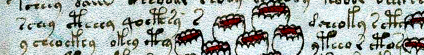
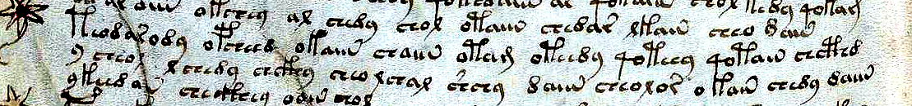
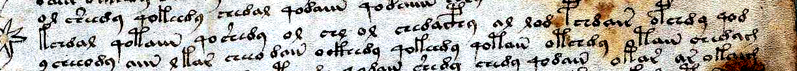

# Attack 238: Line-Break Behaviour Analysis — Is the Line a Functional Unit, and Are Words Ever Split Across Lines?

**Script:** [`tools/attack238_line_break_behaviour.py`](../tools/attack238_line_break_behaviour.py)  
**Data Output:** [`data/attack238_line_break_behaviour.json`](../data/attack238_line_break_behaviour.json)  
**Visual Forensics:** [`pages/lb238_f87v_cth_y_break_enh.png`](../pages/lb238_f87v_cth_y_break_enh.png), [`pages/lb238_f112v_chcthd_y_break_enh.png`](../pages/lb238_f112v_chcthd_y_break_enh.png), [`pages/lb238_f104r_qod_y_break_enh.png`](../pages/lb238_f104r_qod_y_break_enh.png)

---

## Executive Summary

Currier (1976) famously proposed that the **written line in the Voynich Manuscript acts as a self-contained functional unit**: certain glyphs cluster at the start or end of lines, cross-line transitions behave as if reset at the line break, and words never appear to be hyphenated across line endings. However, a naive test of line-edge morphology can easily be confounded by:
1. **Paragraph boundaries** (`para_first` lines naturally carry paragraph-opening gallows `p/f`, and `para_last` lines carry paragraph-closing markers).
2. **Drawing intrusions** (`<->`), where text wraps around botanical or biological figures mid-line.
3. **Currier language (`A` vs `B`) and section (`$I`) heterogeneity**, which shifts word lengths and suffix inventories across quires.

In **Attack 238**, we subject all **4,120 running-text paragraph lines** (`unit == 'P'`, excluding right-justified titles `unit_sub == 't'`; **742 paragraphs**, **35,053 words** in `ZL3b-n`) to five stratified, permutation-controlled statistical tests (`T1`–`T5`), strictly isolating **paragraph-internal lines** (`para_internal`) and excluding words flanking drawing intrusions (`<->`), with full cross-transliteration replication on Takahashi (`IT2a-n`) and Glen Claston (`GC2a-n`, v101 alphabet).

### Core Verdicts
1. **T1 (Line-Edge Morphology Is Real and Not a Paragraph-Boundary Artifact):** Even when restricted strictly to **paragraph-internal lines** (`n_edge = 2,548`, `n_internal = 17,102`), both line-final and line-initial words exhibit massive, stratum-wide morphological divergence from line-internal words (`perm_z = 272.31` for final glyphs; `perm_z = 288.40` for initial glyphs under within-line word-order shuffles, $p = 0.004975$). Line-final words are overwhelmingly enriched for `-g` ($\text{OR} = 32.04$), `-m` ($\text{OR} = 18.97$), and `-d` ($\text{OR} = 2.34$), while line-initial words on paragraph-internal lines are enriched for `p-` ($\text{OR} = 7.64$), `s-` ($\text{OR} = 5.93$), `y-` ($\text{OR} = 5.59$), `t-` ($\text{OR} = 3.42$), and `d-` ($\text{OR} = 2.57$) and strongly depleted of `a-` ($\text{OR} = 0.049$), `ch-` ($\text{OR} = 0.140$), `cth-` ($\text{OR} = 0.159$), and `k-` ($\text{OR} = 0.194$).
2. **T2 (Words Are Never Split / Hyphenated Across Line Breaks):** Across **3,231 paragraph-internal line breaks**, concatenating the last word of line $i$ with the first word of line $i+1$ produces an attested corpus word ($\text{freq} \ge 1$) in only **73 cases (2.26%)**, statistically indistinguishable from randomly re-pairing line breaks within the same `language × section` stratum (**2.18%**, $z = +0.31$, $p = 0.379$, $\text{obs/null} = 1.034\times$) and **4.16× lower** than within-line adjacent word pairs (**9.40%**). For $\text{freq} \ge 2$, the observed rate is **1.36% (44 hits)** vs **1.30% null** ($z = +0.36$, $p = 0.388$) and **6.68% within-line** ($0.204\times$). Among **1,125 breaks** where at least one side is a hapax legomenon, **only 1 break (0.089%)** concatenates into an attested word ($\text{freq} \ge 2$), compared to **0.176% (11 / 6,245)** for within-line pairs.
3. **T3 (Right-Margin Compression in Language B, and `-m/-g` Are Boundary Markers Rather Than Space-Saving Abbreviations):** On paragraph-internal lines, Language B exhibits significant right-margin word-length compression: the last word of a line is **0.38 glyphs shorter** than the line's own vocabulary ($4.20$ vs $4.57$ glyphs, $z = -9.33$), and its length correlates more negatively with the fullness of the rest of the line ($\rho_{\text{last}} = -0.441$) than the first word does ($\rho_{\text{first}} = -0.302$, $\Delta\rho = -0.139$, 95% bootstrap CI $[-0.212, -0.068]$). In Language A, last-word length does not compress ($z = -0.02$, $\Delta\rho = -0.071$, 95% CI $[-0.175, +0.033]$). Crucially, in **neither** language does the `-m/-g` line-ending rate increase when a line is fuller (Mann-Whitney $z = -0.23$ in A, $+0.36$ in B; flat across fullness quartiles), proving that `-m/-g` is a **structural line-termination marker**, not a scribal space-saving abbreviation triggered by running out of room.
4. **T4 (Complete Cross-Line Reset of Glyph-Juncture Dependency):** Within a line, the final glyph of word $k$ strongly predicts the initial glyph of word $k+1$ (excess mutual information $\Delta\text{MI} = 0.2036\text{ bits}$, $z = +45.45$ in interior pairs; $\Delta\text{MI} = 0.2097\text{ bits}$, $z = +46.59$ at line start; $\Delta\text{MI} = 0.2028\text{ bits}$, $z = +42.31$ at line end). Across a line break ($\text{last}_i \to \text{first}_{i+1}$), glyph-juncture excess mutual information **collapses to exactly zero** ($\Delta\text{MI} = -0.0012\text{ bits}$, $z = -0.32$, ratio $-0.6\%$). Word-type excess MI likewise drops by **94.5%** across the line break ($\Delta\text{MI} = 0.0033\text{ bits}$, $z = +0.56$ cross-line vs $0.0605\text{ bits}$, $z = +9.96$ within-line).
5. **T5 (Full Replication Across Independent Transliterations and Alphabets):** Every result replicates on Takahashi (`IT2a-n`, EVA) and Glen Claston (`GC2a-n`, v101 character alphabet): `T1` para-internal permutation $z > 212$ across all three files; `T2` split-word $z = +0.35$ (`IT2a`) and $-0.46$ (`GC2a`); `T4` cross-line glyph-juncture excess MI $z = -0.45$ (`IT2a`) and $+0.77$ (`GC2a`) vs within-line $z = 42.22$ (`IT2a`) and $35.47$ (`GC2a`).

---

## Test 1 (`T1`): Line-Final and Line-Initial Glyph Distributions

### Methodology
For every clean word (`no ?'*`) on running-text lines (`unit == 'P'`, `unit_sub != 't'`) with at least 3 words and Currier language `A` or `B`:
- **Edge words:** Position `n - 1` (for `final` glyph test) or position `0` (for `initial` glyph test, parsing multi-character EVA glyphs `cth, ckh, cph, cfh, ch, sh` as single units).
- **Internal baseline:** Words at positions $0 < i < n - 1$, **strictly excluding** any word immediately before or after a drawing intrusion (`<->`).
- **Stratification & Null Model:** Counts are stratified across all `Currier language (A/B) × section ($I)` buckets. We compute Mantel-Haenszel (`MH`) pooled odds ratios with Robins-Breslow-Greenland 95% confidence intervals, summed stratified $\chi^2$, and a **200-trial within-line permutation test** that randomly shuffles word order within each line (preserving every line's exact vocabulary while destroying positional order).
- **Paragraph-Boundary Control:** We run `T1` twice: once on **all lines** (`T1_*_all_lines`) and once restricted strictly to **paragraph-internal lines** (`T1_*_para_internal`, excluding single-line paragraphs, paragraph-first lines, and paragraph-last lines).

### 1.1 Overall Stratified Divergence (`ZL3b-n`)

| Test Condition | Edge Words ($n_1$) | Internal Words ($n_2$) | Pooled $\chi^2$ ($\text{df}$) | Cramér's $V$ | TVD | Stratified $\sum \chi^2$ | Within-Line Perm Null ($\mu \pm \sigma$) | Perm $z$ |
| :--- | :---: | :---: | :---: | :---: | :---: | :---: | :---: | :---: |
| **Final Glyph — All Lines** | 3,913 | 25,019 | 3,207.17 (14) | 0.3329 | 0.1871 | 3,509.93 | $56.82 \pm 10.63$ | **+324.95** |
| **Final Glyph — Para-Internal Only** | 2,548 | 17,102 | 2,419.93 (10) | 0.3509 | 0.2160 | 2,544.37 | $47.55 \pm 9.17$ | **+272.31** |
| **Initial Glyph — All Lines** | 3,896 | 25,019 | 5,407.19 (18) | 0.4324 | 0.4570 | 6,341.21 | $88.22 \pm 13.73$ | **+455.38** |
| **Initial Glyph — Para-Internal Only** | 2,549 | 17,102 | 2,689.80 (16) | 0.3700 | 0.4013 | 3,356.77 | $73.83 \pm 11.38$ | **+288.40** |

Even after removing paragraph-opening and paragraph-closing lines, the total variation distance (`TVD`) between line-edge and line-interior glyph distributions is **21.6%** at line ends and **40.1%** at line starts, holding across every individual `language × section` stratum (`A/H`, `A/P`, `A/S`, `B/B`, `B/C`, `B/H`, `B/S`, `B/T`).

### 1.2 Per-Glyph Mantel-Haenszel Odds Ratios (Paragraph-Internal Lines Only, `ZL3b-n`)

#### Word-Final Glyphs at Line End (`T1_final_glyph_para_internal`)

| Final Glyph | Edge Rate (`n=2,548`) | Internal Rate (`n=17,102`) | Observed / Expected | MH Odds Ratio (95% CI) | MH $\chi^2$ | $p$-value | Role |
| :---: | :---: | :---: | :---: | :---: | :---: | :---: | :--- |
| **`-g`** | **2.71%** (69) | 0.08% (13) | 69 / 12.4 | **32.04** $[17.42, 58.93]$ | 304.48 | $< 10^{-15}$ | Extreme line-final marker |
| **`-m`** | **16.92%** (431) | 0.98% (168) | 431 / 77.9 | **18.97** $[15.76, 22.84]$ | 1,930.06 | $< 10^{-15}$ | Dominant line-final marker |
| **`-d`** | **3.14%** (80) | 1.33% (228) | 80 / 41.8 | **2.34** $[1.80, 3.04]$ | 40.83 | $< 10^{-9}$ | Enriched at line end |
| **`-s`** | **3.73%** (95) | 2.98% (509) | 95 / 84.6 | **1.16** $[0.92, 1.45]$ | 1.43 | $0.232$ | Neutral |
| **`-n`** | **15.19%** (387) | 16.60% (2,839) | 387 / 414.1 | **0.91** $[0.81, 1.02]$ | 2.39 | $0.122$ | Near-neutral |
| **`-y`** | **36.26%** (924) | 42.16% (7,211) | 924 / 1,032.7 | **0.81** $[0.74, 0.88]$ | 22.83 | $2 \times 10^{-6}$ | Mildly displaced by `-m/-g` |
| **`-l`** | **11.73%** (299) | 17.04% (2,915) | 299 / 422.3 | **0.63** $[0.56, 0.72]$ | 50.44 | $< 10^{-11}$ | Depleted at line end |
| **`-r`** | **8.08%** (206) | 14.73% (2,519) | 206 / 353.3 | **0.51** $[0.44, 0.59]$ | 83.17 | $< 10^{-15}$ | Strongly depleted at line end |
| **`-o`** | **1.33%** (34) | 3.01% (514) | 34 / 79.2 | **0.38** $[0.27, 0.54]$ | 31.34 | $< 10^{-7}$ | Strongly depleted at line end |

#### Word-Initial Glyphs at Line Start (`T1_initial_glyph_para_internal`)

| Initial Glyph | Edge Rate (`n=2,549`) | Internal Rate (`n=17,102`) | Observed / Expected | MH Odds Ratio (95% CI) | MH $\chi^2$ | $p$-value | Role |
| :---: | :---: | :---: | :---: | :---: | :---: | :---: | :--- |
| **`p-`** | **1.26%** (32) | 0.18% (30) | 32 / 7.6 | **7.64** $[4.62, 12.62]$ | 86.58 | $< 10^{-15}$ | Enriched even mid-paragraph (all-lines $\text{OR} = 21.69$) |
| **`s-`** | **11.69%** (298) | 2.05% (350) | 298 / 86.2 | **5.93** $[5.05, 6.96]$ | 627.54 | $< 10^{-15}$ | Primary line-initial marker |
| **`y-`** | **16.52%** (421) | 3.30% (564) | 421 / 134.3 | **5.59** $[4.88, 6.41]$ | 762.67 | $< 10^{-15}$ | Primary line-initial proclitic/marker |
| **`t-`** | **6.90%** (176) | 1.96% (336) | 176 / 70.8 | **3.42** $[2.84, 4.13]$ | 187.84 | $< 10^{-15}$ | Enriched line-initial gallows |
| **`d-`** | **18.44%** (470) | 7.20% (1,231) | 470 / 241.0 | **2.57** $[2.29, 2.89]$ | 286.12 | $< 10^{-15}$ | Strongly enriched at line start |
| **`q-`** | **16.36%** (417) | 17.45% (2,984) | 417 / 423.1 | **0.98** $[0.87, 1.10]$ | 0.11 | $0.745$ | Completely neutral on para-internal lines |
| **`o-`** | **15.65%** (399) | 20.85% (3,565) | 399 / 490.3 | **0.75** $[0.67, 0.84]$ | 24.28 | $1 \times 10^{-6}$ | Mildly depleted at line start |
| **`sh-`** | **5.85%** (149) | 9.53% (1,629) | 149 / 234.7 | **0.57** $[0.48, 0.68]$ | 39.88 | $< 10^{-9}$ | Depleted at line start |
| **`l-`** | **1.80%** (46) | 4.17% (713) | 46 / 83.9 | **0.50** $[0.37, 0.68]$ | 19.92 | $8 \times 10^{-6}$ | Depleted at line start |
| **`r-`** | **0.27%** (7) | 1.33% (228) | 7 / 28.7 | **0.22** $[0.10, 0.47]$ | 18.29 | $1.9 \times 10^{-5}$ | Strongly avoids line start |
| **`k-`** | **0.86%** (22) | 3.90% (667) | 22 / 94.3 | **0.19** $[0.13, 0.30]$ | 67.07 | $< 10^{-15}$ | Sharp asymmetry vs `t-` ($\text{OR} = 3.42$) |
| **`cth-`** | **0.35%** (9) | 1.61% (275) | 9 / 49.3 | **0.16** $[0.08, 0.31]$ | 41.00 | $< 10^{-9}$ | Bench-gallows avoids line start |
| **`ch-`** | **3.57%** (91) | 19.65% (3,361) | 91 / 461.9 | **0.14** $[0.11, 0.17]$ | 428.26 | $< 10^{-15}$ | Core bench `ch-` avoids line start ($5.5\times$ drop) |
| **`a-`** | **0.24%** (6) | 5.25% (897) | 6 / 99.8 | **0.049** $[0.02, 0.11]$ | 105.45 | $< 10^{-15}$ | Virtually forbidden at line start ($22\times$ drop) |

> [!IMPORTANT]
> **Notice the `t-` vs `k-` and `s-/y-/d-` vs `ch-` split at line starts:** While `ch-` accounts for **19.65%** of line-internal words, it initiates only **3.57%** of paragraph-internal lines ($\text{OR} = 0.14$). Conversely, `d-` ($18.44\%$), `y-` ($16.52\%$), `q-` ($16.36\%$), `o-` ($15.65\%$), `s-` ($11.69\%$), and `t-` ($6.90\%$) account for **85.6%** of all paragraph-internal line openings. Notably, `t-` is strongly enriched at line starts ($\text{OR} = 3.42$) whereas `k-` is strongly depleted ($\text{OR} = 0.19$), and `ckh-` never occurs at line start ($0\%$ vs $0.67\%$ internal).

---

## Test 2 (`T2`): Split-Word (Hyphenation) Test & Edge Hapax Forensics

### 2.1 Concatenation Across Line Breaks vs Null & Within-Line Baselines
If scribes ever split words across a line break ($\text{word}_{\text{last}} + \text{word}_{\text{first}} = \text{concatenated word}$), then across the **3,231 paragraph-internal line breaks** in `ZL3b-n`, the concatenation $a + b$ should form an attested Voynich word significantly more often than when line-ending words $a$ and line-opening words $b$ are randomly re-paired within the same `language × section` stratum.

| Criterion | Observed Cross-Line Hits (`n=3,231`) | Stratum-Permuted Null (1,000 trials) | Obs / Null Ratio | Perm $z$ ($p_{\text{upper}}$) | Reweighted Within-Line Pair Rate | Obs / Within-Line Ratio |
| :--- | :---: | :---: | :---: | :---: | :---: | :---: |
| **Concat Attested ($\text{freq} \ge 1$)** | **73 (2.259%)** | $2.184\% \pm 0.240\%$ | **$1.034\times$** | $+0.31$ ($p = 0.379$) | **9.396%** | **$0.240\times$** |
| **Concat Attested ($\text{freq} \ge 2$)** | **44 (1.362%)** | $1.298\% \pm 0.177\%$ | **$1.050\times$** | $+0.36$ ($p = 0.388$) | **6.682%** | **$0.204\times$** |
| **Hapax Side + Concat ($\text{freq} \ge 2$)** | **1 / 1,125 (0.089%)** | — | — | — | **11 / 6,245 (0.176%)** | **$0.505\times$** |

- **Zero Excess Over Chance:** The observed cross-line concatenation rate is within $0.36\sigma$ of random re-pairing of independent line endings and line beginnings.
- **4× to 5× Lower Than Within-Line Pairs:** Because line endings favor `-m/-g/-d` and line beginnings favor `d-/y-/s-/t-`, cross-line concatenations actually form attested words **4 to 5 times less often** than adjacent words inside the same line.

### 2.2 Follow-Up Tests for Unattested Rare Split Words (`T2b`)
What if a scribe split a *longer, rarer* word whose full form happens not to be attested elsewhere in the corpus? Such a split would leave two hapax fragments at the same break (`both_sides_hapax`), and line-final hapaxes would look like short proper prefixes of attested words while line-initial hapaxes would look like short proper suffixes. All three predictions are decisively falsified:

1. **Co-occurrence of Hapaxes Across a Break (`both_sides_hapax`):** Among 3,231 breaks, 720 have a hapax at the end of line $i$ and 539 have a hapax at the start of line $i+1$. Both sides are hapaxes at **134 breaks**, compared to a stratum-permuted null of **$123.81 \pm 8.71$** ($z = +1.17$, $\text{obs/null} = 1.08\times$, non-significant).
2. **Hapax Length & Prefix/Suffix Shape (`hapax_fragment_shape_para_internal`):**
   - **Line-final hapaxes** (`n=512`) have a mean length of **5.72 glyphs** (longer than regular words, not short stubs!) and are proper prefixes of attested words (`freq >= 2`) only **3.13%** of the time — *lower* than interior hapaxes (**5.18%**, `n=1,466`, mean length **5.88 glyphs**).
   - **Line-initial hapaxes** (`n=418`) have a mean length of **6.11 glyphs** and are proper suffixes of attested words only **0.72%** of the time — *7× lower* than interior hapaxes (**4.98%**).
3. **Why Are Line-Edge Words More Often Hapaxes (`T2_position_perm_test` & `hapax_rate_controls`)?**
   - Within-line permutations show that on paragraph-internal lines, hapax rates are elevated at line ends (Language A: **22.65%** vs **14.31%** null, $z = +8.98$; Language B: **18.26%** vs **8.89%** null, $z = +13.26$) and at line starts (Language A: **18.58%** vs **14.37%** null, $z = +4.24$; Language B: **14.84%** vs **8.90%** null, $z = +9.05$).
   - Even after excluding `-m/-g` words at line end and gallows-initial (`p/f/t/k`) words at line start, the hapax rate remains elevated (`A`: $19.60\%$ final, $17.67\%$ initial vs $10.47\%$ interior; `B`: $16.70\%$ final, $14.46\%$ initial vs $6.73\%$ interior) because rare line-edge allographs/affixes (`-g`, `-m`, `-d`, initial `y-`, `s-`, `d-`) combinatorially diversify the surface word types at line boundaries without shortening words into fragments.

### 2.3 Visual Forensics of the Top 3 Candidate Loci on the High-Res Beinecke Scans
We ranked all 44 cross-line pairs where $\text{freq}(a+b) \ge 2$ by $\text{score} = \frac{\text{freq}(a+b)}{(\text{freq}(a)+1)(\text{freq}(b)+1)}$ and inspected the top 3 candidates directly on the Yale Beinecke high-resolution scans (`books/voynich-yale-beinecke-2026-highres-214p.pdf`):

#### 1. `f87v.2` $\to$ `f87v.3` (`cth` + `y` $\to$ `cthy`, Score `0.08415`, Herbal `A/H`)

- **Quantitative profile:** `cth` ($\text{freq} = 3$) at the end of `f87v.2` (`para_internal`) + `y` ($\text{freq} = 305$) at the start of `f87v.3` (`para_internal`), where `cthy` has $\text{freq} = 103$.
- **Visual inspection:** Line 2 (`sory cthdar qocthedy cth`) is written in a narrow text column to the left of the painted red-and-brown stepped botanical root crowns. The scribe writes `cth` right up against the left contour of the root crown and stops cleanly. Line 3 begins at the left margin with a standalone `y` followed by a generous inter-word space before `cheocthy` (`y cheocthy otedy cthy`). Moreover, the intact word `cthy` is written at the end of line 3 itself.

#### 2. `f112v.39` $\to$ `f112v.40` (`chcthd` + `y` $\to$ `chcthdy`, Score `0.01144`, Stars/Recipes `B/S`)

- **Quantitative profile:** `chcthd` ($\text{freq} = 1$, hapax) at the end of `f112v.39` (`para_first`) + `y` ($\text{freq} = 305$) at the start of `f112v.40` (`para_internal`), where `chcthdy` has $\text{freq} = 7$. This is the **single break out of 1,125 hapax-side breaks** in the entire manuscript whose concatenation is attested ($\text{freq} \ge 2$).
- **Visual inspection:** Line 39 (`pchedody... qotched qotaiin chcthd`) runs to the right vellum margin; the preceding word `qotched` on the very same line also ends in `-d` without `-y`, showing that `-d` is an intentional suffix choice here (`d` is $2.34\times$ enriched at line ends). Line 40 starts at the left margin beneath `pchedody` with standalone `y` followed by a clear word gap before `cheor`.

#### 3. `f104r.5` $\to$ `f104r.6` (`qod` + `y` $\to$ `qody`, Score `0.00794`, Stars/Recipes `B/S`)

- **Quantitative profile:** `qod` ($\text{freq} = 6$) at the end of `f104r.5` (`para_first`) + `y` ($\text{freq} = 305$) at the start of `f104r.6` (`para_internal`), where `qody` has $\text{freq} = 17$.
- **Visual inspection:** Line 5 ends near the right edge of the vellum with `... otchedy qod` (no continuation mark or crowding). Line 6 starts at the left margin (just right of the marginal star's bottom rays) with standalone `y` (`y cheody aiin...`), separated by a wide word space from `cheody`. In all top 3 cases, the apparent concatenation is simply the coincidence of a `-d` or `-cth` line-final word followed on the next line by the ubiquitous line-initial particle `y` ($16.5\%$ of all paragraph-internal line starts start with `y-`, and $305$ tokens are standalone `y`).

---

## Test 3 (`T3`): Line-Length Compensation & Right-Margin Fullness

### 3.1 Word Length and Hapax Profile Across Line Positions (`n >= 7` words, `para_internal`)

| Position in Line | Language A Mean Glyphs (`n`) | Language A Hapax Rate | Language B Mean Glyphs (`n`) | Language B Hapax Rate | Combined Mean Glyphs (`n`) | Combined Hapax Rate |
| :---: | :---: | :---: | :---: | :---: | :---: | :---: |
| **`+1` (1st word)** | **4.52** (666) | **17.87%** | **4.92** (1,371) | **14.95%** | **4.78** (2,037) | **15.91%** |
| **`+2` (2nd word)** | 3.80 (672) | 9.52% | 4.36 (1,378) | 5.66% | 4.18 (2,050) | 6.93% |
| **`+3` (3rd word)** | 4.00 (669) | 10.46% | 4.67 (1,379) | 7.25% | 4.45 (2,048) | 8.30% |
| **`mid` (Interior)** | 4.01 (2,115) | 10.17% | 4.48 (6,265) | 7.01% | 4.36 (8,380) | 7.80% |
| **`-3` (3rd from end)** | 3.95 (667) | 10.94% | 4.49 (1,371) | 7.51% | 4.31 (2,038) | 8.64% |
| **`-2` (2nd from end)** | 3.97 (663) | 10.11% | 4.51 (1,373) | 6.26% | 4.33 (2,036) | 7.51% |
| **`-1` (Last word)** | **4.10** (667) | **22.64%** | **4.16** (1,364) | **18.33%** | **4.14** (2,031) | **19.74%** |

- **Line-Initial Expansion (`+1`) and Post-Initial Dip (`+2`):** In both Language A and Language B, the first word of a paragraph-internal line is significantly **longer** than interior words (`A`: $+0.45\text{ glyphs}$, $z = +9.62$; `B`: $+0.36\text{ glyphs}$, $z = +8.98$ in within-line permutations), followed immediately by a dip at position `+2` (`3.80` in A, `4.36` in B).
- **Line-Final Compression in Language B (`-1`):** In Language B, the final word of a paragraph-internal line drops sharply to **4.16 glyphs** (`all para_internal`: $4.20$ vs $4.57$ null, $z = -9.33$), whereas in Language A the final word does not shorten ($4.15$ vs $4.15$ null, $z = -0.02$).

### 3.2 Correlation With Remaining Line Fullness & Test of `-m/-g` as a Space-Saving Abbreviation
Within each paragraph, we measure how a line's last-word length (`last`), first-word length (`first`), and middle-word length (`mid`) correlate with the deviation of the *rest of the line's length* from that paragraph's mean (`T3_compensation`):

| Metric | Currier Language A (`n=624` lines) | Currier Language B (`n=1,149` lines) |
| :--- | :---: | :---: |
| **Mean Line Total Length (CV)** | $36.37\text{ glyphs}$ ($\text{CV} = 0.407$) | $54.40\text{ glyphs}$ ($\text{CV} = 0.217$) |
| **Spearman $\rho(\text{last}, \text{rest of line})$** | $-0.2548$ | **$-0.4408$** |
| **Spearman $\rho(\text{first}, \text{rest of line})$** | $-0.1838$ | $-0.3020$ |
| **Spearman $\rho(\text{mid}, \text{rest of line})$** | $-0.2147$ | $-0.3459$ |
| **Asymmetry $\Delta\rho = \rho_{\text{last}} - \rho_{\text{first}}$ (95% CI)** | $-0.0709$ $[-0.1750, +0.0330]$ | **$-0.1388$ $[-0.2122, -0.0678]$** |
| **Rest-of-Line Deviation When Ending in `-m/-g` vs Other** | $+0.029$ vs $-0.004$ ($z_{\text{MW}} = -0.23$) | $-0.058$ vs $+0.015$ ($z_{\text{MW}} = +0.36$) |
| **`-m/-g` Rate Across Rest-of-Line Fullness Quartiles (Q1..Q4)** | $14.7\%, 12.2\%, 12.8\%, 14.1\%$ | $19.9\%, 19.5\%, 22.6\%, 20.8\%$ |

- **Active Right-Margin Fitting in Language B:** Because Language B lines are much longer and more tightly justified to the right margin ($\text{CV} = 0.217$ vs $0.407$ in Herbal-heavy Language A), when the preceding words of a line run long, the scribe selects a shorter final word ($\Delta\rho = -0.139$, 95% CI excludes zero).
- **`-m/-g` Is a Line-Boundary Marker, NOT a Cramped-Margin Abbreviation:** If `-m` or `-g` were a scribal abbreviation used when running out of vellum space at the right margin, `-m/-g` endings would spike in the fullest lines (Q4). Instead, the `-m/-g` rate is **completely flat across all four fullness quartiles** ($19.9\% \to 20.8\%$ in B; $14.7\% \to 14.1\%$ in A, Mann-Whitney $|z| < 0.37$).
- **Paragraph-Last Lines (`line_end_m_by_line_role` & `T3b`):** In Language B, `-m/-g` occurs on **21.7%** of `para_first` line ends and **22.3%** of `para_internal` line ends, but drops to **8.4%** on `para_last` line ends (`mean_len_last_word` rises from $4.20$ to $4.97$ glyphs). In Language A, `-m/-g` occurs on **15.5%** of `para_internal` lines and **12.1%** of `para_last` lines (and **10.2%** even on short `para_last` lines $\le 50\%$ of paragraph median width where plenty of blank vellum remains).
- **Line-Initial Strip Test (`T3b`):** Stripping the first glyph from a paragraph-internal line-initial word produces a common corpus word ($\text{freq} \ge 5$) at **the exact same rate** as stripping the same first glyph from a line-interior word (Mantel-Haenszel $\text{OR} = 1.0009$, 95% CI $[0.887, 1.129]$, $p = 0.987$). Thus line-initial words are not formed by mechanically prepending a dummy margin character onto an arbitrary interior word; rather, prefix/word selection shifts at the start of a line.

---

## Test 4 (`T4`): Cross-Line vs Within-Line Mutual Information & Glyph Junctures

### 4.1 Excess Mutual Information ($\text{Observed MI} - \text{Stratum-Shuffled Null MI}$)
To test whether adjacent words across a line break ($\text{last}_i \to \text{first}_{i+1}$) share lexical or phonological/orthographic continuity, we compute the excess mutual information above a 100-trial within-stratum shuffle across **3,231 paragraph-internal line breaks**, compared against equal-sized subsamples ($N = 3,231$) of within-line adjacent pairs at line start (`word 0 -> word 1`), line end (`word n-2 -> word n-1`), and line interior:

| Pair Position (`ZL3b-n`, $N=3,231$) | Word-Type Excess MI (bits) | Word-Type $z$-score | Final $\times$ Initial Glyph Excess MI (bits) | Glyph-Juncture $z$-score |
| :--- | :---: | :---: | :---: | :---: |
| **Within-Line Start (`word 0 -> 1`)** | $+0.0517$ | **+8.73** | $+0.2097$ | **+46.59** |
| **Within-Line Interior (`word i -> i+1`)** | $+0.0605$ | **+9.96** | $+0.2036$ | **+45.45** |
| **Within-Line End (`word n-2 -> n-1`)** | $+0.0463$ | **+7.40** | $+0.2028$ | **+42.31** |
| **Cross-Line Break (`last_i -> first_{i+1}`)** | **$+0.0033$** | **+0.56** (NS) | **$-0.0012$** | **$-0.32$** (NS) |
| **Cross-Line / Interior Ratio** | **5.5%** | — | **$-0.6\%$ (0%)** | — |

### 4.2 Breakdown by Currier Language (`T4b_by_language`)
- **Currier Language A (`n_cross = 1,280`):**
  - Glyph-juncture excess MI: **$+0.0040\text{ bits}$ ($z = +0.51$) cross-line** vs **$+0.1232\text{ bits}$ ($z = +12.06$) within-line interior**.
  - Word-type excess MI: **$-0.0010\text{ bits}$ ($z = -0.13$) cross-line** vs **$+0.0291\text{ bits}$ ($z = +3.65$) within-line interior**.
- **Currier Language B (`n_cross = 1,951`):**
  - Glyph-juncture excess MI: **$-0.0016\text{ bits}$ ($z = -0.27$) cross-line** vs **$+0.2431\text{ bits}$ ($z = +42.32$) within-line interior**.
  - Word-type excess MI: **$+0.0116\text{ bits}$ ($z = +1.89$) cross-line** vs **$+0.0604\text{ bits}$ ($z = +8.56$) within-line interior**.

### 4.3 How the Cross-Line Reset Breaks Within-Line Sandhi (`juncture_table`)
Inside a line, the final glyph of word $k$ strongly conditions the initial glyph of word $k+1$:
- After **`-y`** (`n_cross = 1,223`): Within a line, the next word begins with **`q-` 30.4%** of the time (the classic `-y -> qo-` chain); after **`-n`**, `q-` is only **9.0%** and **`o-` is 31.1%** (`ch-` **26.3%**); after **`-r`**, **`o-` is 27.2%** and `q-` is only **6.0%**.
- **Across a line break**, this conditioning **vanishes completely**: regardless of whether line $i$ ended in `-y`, `-n`, `-l`, `-r`, `-m`, or `-s`, the next line starts with `q-` at a flat **14%–18%** (`-y -> q-`: $16.2\%$, `-n -> q-`: $16.3\%$, `-l -> q-`: $15.5\%$, `-r -> q-`: $14.1\%$), with `d-` at a flat **15%–20%**, with `y-` at a flat **16%–20%**, and with `ch-` at a flat **2%–5%**. Every new line resets its initial-glyph state to the global line-initial prior!

---

## Test 5 (`T5`): Cross-Transliteration & Alphabet Robustness (`ZL3b` vs `IT2a` vs `GC2a`)

To verify that none of our findings depend on Zandbergen-Landini's word-space segmentation or EVA multi-character conventions, we re-ran `T1`, `T2`, and `T4` on **Takahashi (`IT2a-n`, EVA)** and **Glen Claston (`GC2a-n`, v101 single-character alphabet)**:

| Metric | `ZL3b-n` (EVA) | `IT2a-n` (Takahashi EVA) | `GC2a-n` (Claston v101) |
| :--- | :---: | :---: | :---: |
| **Running-Text Lines / Paragraphs / Words** | 4,120 / 742 / 35,053 | 4,108 / 772 / 34,469 | 4,120 / 775 / 36,680 |
| **`T1` Para-Internal Final Glyph $\sum\chi^2$ (Perm $z$)** | 2,544.37 (**$z = +272.31$**) | 2,465.55 (**$z = +265.45$**) | 2,209.03 (**$z = +212.20$**) |
| **`T1` Para-Internal Initial Glyph $\sum\chi^2$ (Perm $z$)** | 3,356.77 (**$z = +288.40$**) | 3,244.85 (**$z = +258.79$**) | 3,129.16 (**$z = +235.50$**) |
| **`T1` Top Line-Final Enriched Glyph (Para-Internal)** | `-g` ($\text{OR} = 32.0$), `-m` ($\text{OR} = 19.0$) | `-g` ($\text{OR} = 56.8$), `-m` ($\text{OR} = 19.0$) | `-p` (`=EVA m`, $\text{OR} = 19.8$), `-N` ($\text{OR} = 4.0$) |
| **`T1` Top Line-Initial Enriched Glyphs (Para-Internal)** | `p-` ($7.6$), `s-` ($5.9$), `y-` ($5.6$), `t-` ($3.4$), `d-` ($2.6$) | `p-` ($7.4$), `s-` ($6.0$), `y-` ($5.7$), `t-` ($3.4$), `d-` ($2.5$) | `g-` (`=EVA p`, $8.4$), `9-` (`=EVA y`, $5.3$), `s-` ($4.9$), `k-` (`=EVA t`, $3.6$), `8-` (`=EVA d`, $2.4$) |
| **`T2` Cross-Line Breaks Tested** | 3,231 | 3,254 | 3,098 |
| **`T2` Concat Attested ($\text{freq} \ge 1$) Obs vs Null ($z$)** | 2.26% vs 2.18% (**$z = +0.31$**) | 1.75% vs 1.68% (**$z = +0.35$**) | 2.16% vs 2.27% (**$z = -0.46$**) |
| **`T2` Concat Attested ($\text{freq} \ge 2$) Obs vs Null ($z$)** | 1.36% vs 1.30% (**$z = +0.36$**) | 1.08% vs 1.03% (**$z = +0.29$**) | 1.03% vs 1.28% (**$z = -1.32$**) |
| **`T2` Hapax-Side Concat Hits ($\text{freq} \ge 2$)** | **1 / 1,125 (0.089%)** | **1 / 1,109 (0.090%)** | **1 / 1,190 (0.084%)** |
| **`T4` Within-Line Interior Glyph-Juncture Excess MI ($z$)** | $+0.2036\text{ bits}$ (**$z = +45.45$**) | $+0.1819\text{ bits}$ (**$z = +42.22$**) | $+0.2366\text{ bits}$ (**$z = +35.47$**) |
| **`T4` Cross-Line Glyph-Juncture Excess MI ($z$)** | $-0.0012\text{ bits}$ (**$z = -0.32$**) | $-0.0019\text{ bits}$ (**$z = -0.45$**) | $+0.0053\text{ bits}$ (**$z = +0.77$**) |
| **`T4` Within-Line Interior Word-Type Excess MI ($z$)** | $+0.0605\text{ bits}$ (**$z = +9.96$**) | $+0.0563\text{ bits}$ (**$z = +9.99$**) | $+0.0602\text{ bits}$ (**$z = +11.11$**) |
| **`T4` Cross-Line Word-Type Excess MI ($z$)** | $+0.0033\text{ bits}$ (**$z = +0.56$**) | $+0.0085\text{ bits}$ (**$z = +1.55$**) | $+0.0043\text{ bits}$ (**$z = +0.79$**) |

---

## Implications for Voynich Manuscript Production Models

1. **The Physical Line Is a Hard State-Reset Boundary:** Any generative, linguistic, or cryptographic model of Voynichese must account for the fact that **within-line word-to-word juncture transitions ($\Delta\text{MI} \approx 0.20\text{ bits}$, $z \approx 45$) reset completely to zero ($\Delta\text{MI} \approx 0\text{ bits}$, $|z| < 0.8$) at every line break**, even in the middle of a multi-line paragraph.
2. **Zero Word Hyphenation Across Lines:** Scribes never split a word across a line break. When approaching the right margin (especially in the dense, justified text blocks of Language B), the scribe selected shorter complete words ($\Delta\rho = -0.139$) and/or applied the dedicated line-final terminal markers `-m` ($\text{OR} = 18.97$) and `-g` ($\text{OR} = 32.04$).
3. **Line-Initial State Selection:** Starting a new paragraph-internal line triggers a distinct initial-state grammar where `y-` ($\text{OR} = 5.59$), `s-` ($\text{OR} = 5.93$), `t-` ($\text{OR} = 3.42$), and `d-` ($\text{OR} = 2.57$) are strongly preferred, while line-interior staples `ch-` ($\text{OR} = 0.14$), `cth-` ($\text{OR} = 0.16$), `k-` ($\text{OR} = 0.19$), and `a-` ($\text{OR} = 0.049$) are systematically suppressed.
