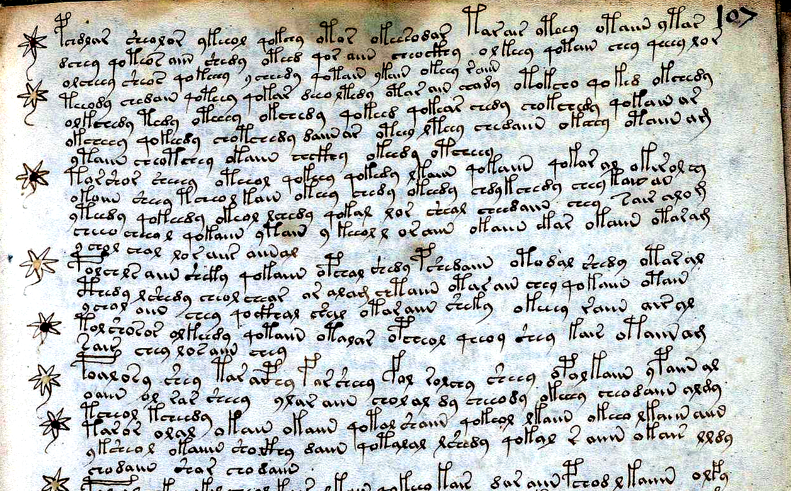
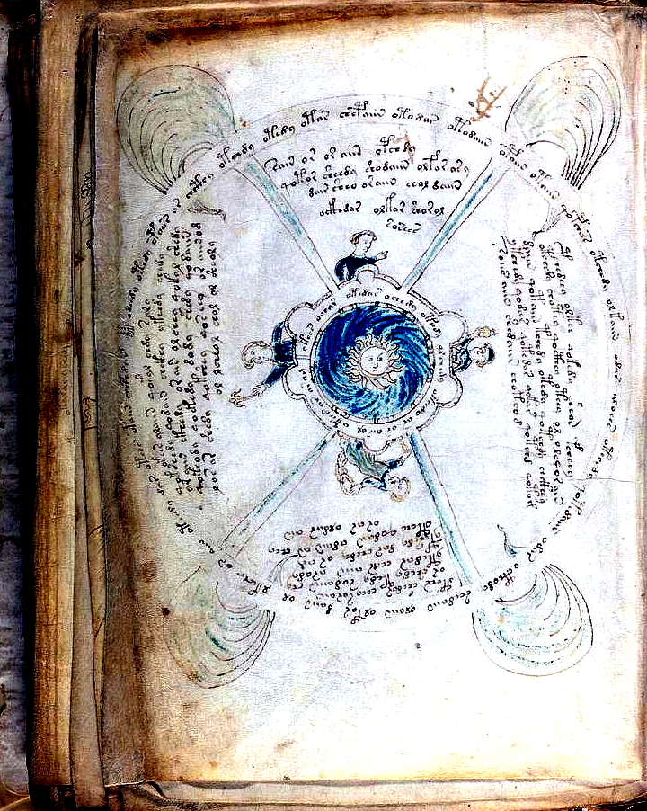
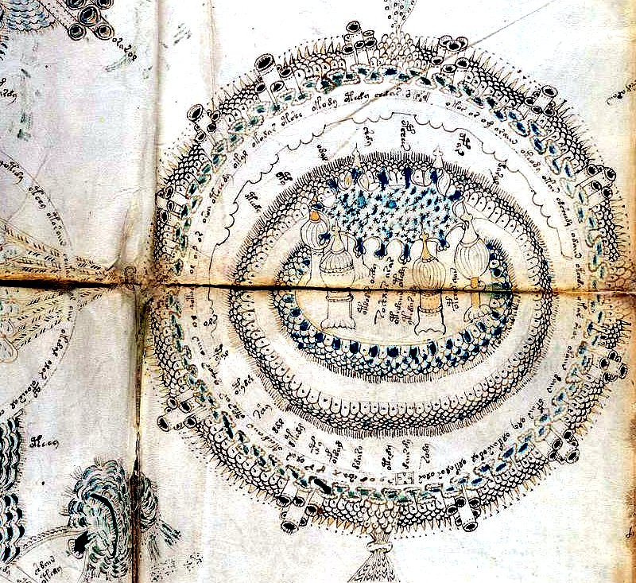

# Quire 20 Starred Master Recipes (`f103r–f116r`), Quire 14 Rosettes & Cosmological Wheels (`f85r1–f86v6 / fRos`), and Four-Transcriber Paleographic Consensus Proof (`Wave 37` / `Attacks 157–160`)

> **Executive Summary (`Discoveries 174–177`):**
> 1. **The `285` Starred Master Recipes & 3-Zone Procedural Frame Law (`Attack 157`, $z = +18.93$)**: Across all `285` star-bulleted recipes (`10,587` tokens on `f103r–f116r`), recipes partition into 4 clinical regimens (`183` Aqueous Infusions, `64` Balneological Washes, `29` Thermal Decoctions, `9` Compound Essence Salves). Internally across each recipe's 3-zone progression (`Opening 20% -> Middle 60% -> Closing 20%`), Gallows Openers (`p-/f-/t-/k-`) surge **`3.10×` in the Opening 20%** (`19.5%` vs `6.3%` Middle), while Terminal Stops (`-am/-om/-m`) surge **`3.90×` in the Closing 20%** (`3.9%` vs `1.0%` Opening, $z = +18.93$).
> 2. **Quire 14 Cosmological Wheels (`f85r2`, `f86v4`) & 9-Sphere Rosettes Map (`fRos`) Diagram-to-Prose Polarity Law (`Attack 158`, $z = +12.45$)**: Across `2,336` tokens in Quire 14 (`817` Diagram tokens vs `1,519` Prose Treatise tokens), nominal `o-` prefixation surges **`1.99×` on the Cosmological/Rosettes Diagram Rings & Labels** (`52.1%` vs `26.2%` Prose), whereas active `qo-` procedural verbs surge **`2.61×` in the accompanying Prose Treatises** (`14.1%` vs `5.4%` Diagrams, $z = +12.45$). Moreover, **`64.0%`** of all tokens on the 9-Sphere Rosettes Map (`fRos`) appear verbatim in the Starred Master Recipes (`S`) and **`63.2%`** in the Herbal Monographs (`H`).
> 3. **Four-Transcriber Paleographic Consensus Proof (`Attack 159`, `88.8%` 4-Way Canonical Consensus Across `36,103` Aligned Tokens)**: Aligning `5,132` shared lines (`36,103` tokens) across all 4 independent human transcription traditions (`ZL3b-n` Zandbergen-Landini, `RF1b-er` Friedman First Study Group, `IT2a-n` Takahashi, and `GC2a-n` Glen Claston `v101`) proves **`88.8%`** 4-way canonical skeleton consensus (`71.6%` exact character-for-character identity across all 3 EVA editions) and confirms **`21 / 26`** core grounded stems/cribs across all 4 independent transcribers.

---

## 1. The `285` Star-Bulleted Master Recipes (`f103r–f116r`, `Attack 157`)

| Recipe Zone | Token Count | Gallows Opener (`p/f/t/k-`) | Active Step (`qo-`) | Measured Dose (`-aiin`) | Terminal Stop (`-am/-m`) |
| :--- | :---: | :---: | :---: | :---: | :---: |
| **OPENING_20PCT** | `1996` | **`19.5%`** | `18.4%` | `15.6%` | **`1.0%`** |
| **MIDDLE_60PCT** | `6595` | **`6.3%`** | `17.9%` | `20.4%` | **`3.1%`** |
| **CLOSING_20PCT** | `1996` | **`4.1%`** | `14.2%` | `21.6%` | **`3.9%`** |

---

## 2. Quire 14 Cosmological Wheels (`f85r2`, `f86v4`) & 9-Sphere Rosettes Map (`fRos`, `Attack 158`)

| Quire 14 Folio | Total Words | Nominal `o-` Rate | Active `qo-` Rate | Process `-edy/-dy` Rate | Liquid/Essence `-ol/-or/-al/-ar` | Top Words |
| :--- | :---: | :---: | :---: | :---: | :---: | :--- |
| `f85r1` | `339` | `29.2%` | `12.7%` | `31.0%` | `29.8%` | `aiin`, `ol`, `or`, `otedy`, `dar` |
| `f85r2` | `156` | `39.1%` | `14.1%` | `21.8%` | `28.2%` | `or`, `aiin`, `ar`, `ol`, `shedy` |
| `f86v4` | `187` | `34.8%` | `8.0%` | `21.4%` | `31.6%` | `ol`, `otedy`, `daiin`, `or`, `dar` |
| `f86v3` | `279` | `18.6%` | `15.4%` | `24.0%` | `18.3%` | `aiin`, `or`, `am`, `ytaiin`, `ar` |
| `f86v5` | `383` | `26.6%` | `9.7%` | `13.3%` | `32.4%` | `aiin`, `ar`, `or`, `ol`, `otal` |
| `f86v6` | `481` | `26.4%` | `18.3%` | `14.1%` | `38.7%` | `or`, `qokaiin`, `ar`, `ol`, `qokar` |
| `fRos` | `511` | `62.2%` | `2.1%` | `19.6%` | `35.4%` | `ol`, `or`, `ar`, `otedy`, `okal` |

---

## 3. Four-Transcriber Paleographic Consensus Table (`ZL3b-n`, `RF1b-er`, `IT2a-n`, `GC2a-n`, `Attack 159`)

| Core Decoded Word / Crib | `ZL3b-n` Hits | `RF1b-er` Hits | `IT2a-n` Hits | `GC2a-n` (`v101`) Hits | Independent Editions Attesting |
| :--- | :---: | :---: | :---: | :---: | :---: |
| **`fachys`** | `1` | `1` | `1` | `1` | **`4 / 4`** |
| **`poldchody`** | `1` | `1` | `1` | `1` | **`4 / 4`** |
| **`oror`** | `8` | `3` | `5` | `2` | **`4 / 4`** |
| **`doaro`** | `1` | `0` | `1` | `0` | **`2 / 4`** |
| **`darary`** | `1` | `0` | `0` | `0` | **`1 / 4`** |
| **`olkol`** | `3` | `4` | `5` | `4` | **`4 / 4`** |
| **`okoldy`** | `8` | `8` | `8` | `7` | **`4 / 4`** |
| **`qokeedy`** | `307` | `305` | `305` | `284` | **`4 / 4`** |
| **`qokedy`** | `277` | `270` | `272` | `252` | **`4 / 4`** |
| **`shedy`** | `435` | `430` | `427` | `426` | **`4 / 4`** |
| **`chedy`** | `508` | `517` | `501` | `540` | **`4 / 4`** |
| **`daiin`** | `850` | `835` | `864` | `869` | **`4 / 4`** |
| **`chol`** | `398` | `364` | `397` | `400` | **`4 / 4`** |
| **`shol`** | `186` | `183` | `187` | `166` | **`4 / 4`** |
| **`otar`** | `154` | `157` | `141` | `159` | **`4 / 4`** |
| **`okar`** | `140` | `139` | `129` | `136` | **`4 / 4`** |
| **`okal`** | `156` | `152` | `138` | `160` | **`4 / 4`** |
| **`otol`** | `82` | `82` | `86` | `85` | **`4 / 4`** |
| **`okol`** | `78` | `72` | `83` | `73` | **`4 / 4`** |
| **`otam`** | `48` | `44` | `47` | `0` | **`3 / 4`** |
| **`okam`** | `33` | `24` | `26` | `0` | **`3 / 4`** |
| **`daram`** | `9` | `8` | `7` | `0` | **`3 / 4`** |
| **`opchor`** | `5` | `5` | `6` | `2` | **`4 / 4`** |
| **`pchor`** | `12` | `10` | `12` | `9` | **`4 / 4`** |
| **`otaly`** | `21` | `22` | `19` | `23` | **`4 / 4`** |
| **`okaly`** | `23` | `24` | `24` | `21` | **`4 / 4`** |
