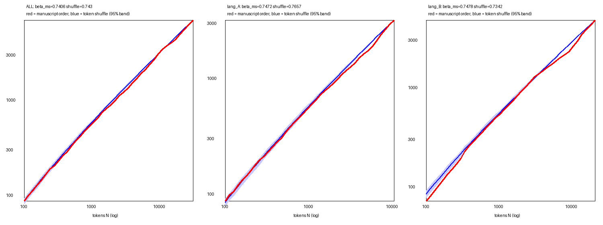
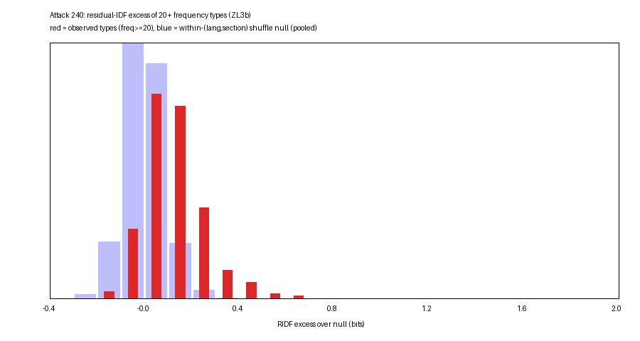
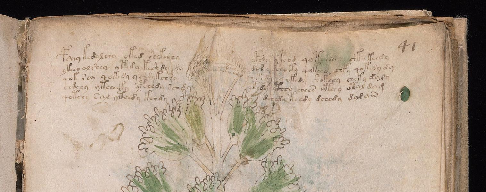
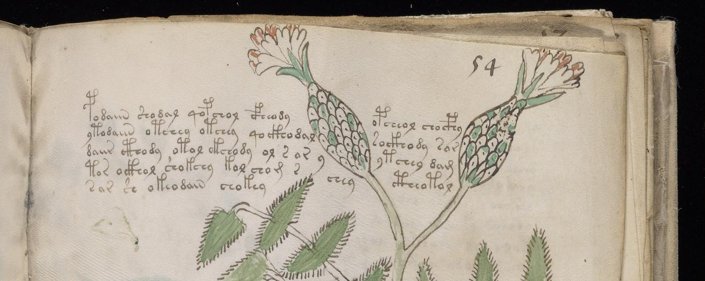
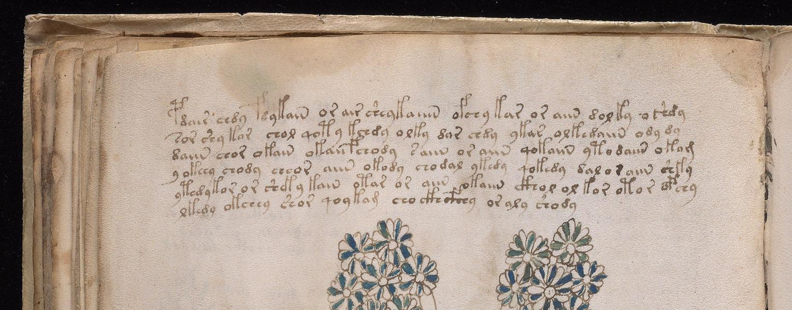

# Attack 240: Vocabulary Dynamics at Multiple Scales (`notes/VOCABULARY_DYNAMICS.md`)

**Script:** [`tools/attack240_vocabulary_dynamics.py`](../tools/attack240_vocabulary_dynamics.py)  
**Structured Data:** [`data/attack240_vocabulary_dynamics.json`](../data/attack240_vocabulary_dynamics.json) (`seed = 240`, unit `P` running-text lines, `clean_words` only: `34,780` tokens, `6,983` types across `207` folios in [`data/ZL3b-n.txt`](../data/ZL3b-n.txt); `11,194` Currier-A tokens, `23,039` Currier-B tokens, `547` unassigned `?` tokens)  
**Visual Assets:**
- [`pages/vd240_heaps_curves.png`](../pages/vd240_heaps_curves.png) — Log-log Heaps' law curves $V(N)$ in manuscript order vs. 200 token-order shuffles (`ALL`, `lang_A`, `lang_B`)
- [`pages/vd240_ridf_hist.png`](../pages/vd240_ridf_hist.png) — Residual IDF (RIDF) excess distribution of frequent types ($\text{freq} \ge 20$, $n = 265$) vs. within-$(\text{language}, \text{section})$ shuffle null
- [`pages/vd240_f39v_top.png`](../pages/vd240_f39v_top.png) — Top of Herbal B folio `f39v` showing line 1 (`pdair chdy fdykain or air sheykaiiin ofchy kar or aiin dolky oshdy`) with candidate `ofchy`
- [`pages/vd240_f41r_top.png`](../pages/vd240_f41r_top.png) — Top of Herbal B folio `f41r` (quire F opener, where `chekedy` occurs $3\times$ in lines 6, 8, 9 out of 5 corpus tokens)
- [`pages/vd240_f54r_top.png`](../pages/vd240_f54r_top.png) — Top of Herbal A folio `f54r` showing line 1 (`podaiin shodal qopchol cfheody opcheol chocphy`) with candidate `shodal` at word 2

---

## Executive Summary

Does Voynichese vocabulary accumulate and cluster like natural-language prose, like an itemized glossary/list, or like a memoryless stochastic generator? Attack 240 tests five scale-specific hypotheses with explicit permutation nulls stratified by Currier language (`$L = A/B`) and section (`$I`):

1. **Heaps' Law $V(N)$ & Order Deficit:** The global Heaps' exponent in manuscript order ($\beta_{\text{ms}} = 0.7406$, $K = 3.1258$) sits right inside the 95% confidence band of a memoryless token shuffle ($\bar{\beta}_{\text{shuf}} = 0.7430$, 95% CI $[0.7313, 0.7562]$), because both endpoints $(N, V) = (34780, 6983)$ are fixed. However, the **trajectory** of $V(N)$ in manuscript order bows significantly below the shuffled trajectory across the middle of the codex (`V_at_half = 4,034` vs. shuffle mean `4,183.23`, 95% CI `[4,120.0, 4,247.0]`; max relative deficit $-8.50\%$ at $N = 3,663$ globally, $-9.84\%$ at $N = 5,417$ in Currier A, and $-16.29\%$ at $N = 115$ / $-11.87\%$ at midpoint in Currier B). Section, quire, and Currier-language boundaries all trigger statistically significant spikes in both global novelty excess ($z = 3.01, 2.08, 2.09$) and local 1,500-token novelty share ($z = 4.08, 2.55, 2.94$).
2. **Word Burstiness & Residual IDF (RIDF):** Across the $265$ word types with $\text{freq} \ge 20$, occurrences across folios are **significantly overdispersed** even after stratifying by $(\text{language}, \text{section})$: $29.06\%$ ($77 / 265$) exceed the within-bucket shuffle null at $p \le 0.01$ (rising to $71.74\%$ for $\text{freq} \in [100, 299]$ and $91.67\%$ for $\text{freq} \ge 300$), while **$0.0\%$** are underdispersed ($z < -2$). Median stratified dispersion is $1.1582$ (null $0.9978$) and median RIDF excess over the within-bucket shuffle null is $+0.1125\text{ bits}$. Rather than splitting into two sharply separated modes (Sarle's bimodality coefficient $\text{BC} = 0.3861 < 0.555$), the RIDF excess distribution forms a **right-skewed continuum** ($\Delta\text{BIC}_{2-1} = -7.69$ on RIDF excess and $-19.45$ on $\log_{10}\text{disp}$, Ashman's $D = 1.384 < 2.0$) running from evenly distributed structural/grammatical tokens (`sor`, `qoteedy`, `sol`, `kar`, `chedy`, `otol`, `dair`, `air`) to bursty topic/section-clustered types (`cheal`, `shcthy`, `lkain`, `qotchedy`, `sheckhy`, `shckhy`, `okey`).
3. **Paragraph Line-1 Novelty Paradox:** In multi-line paragraphs ($\ge 3$ lines, $n = 669$), the first line of a paragraph has a much higher rate of folio-novel tokens than later lines ($80.15\%$ vs. $65.65\%$, $\Delta = +14.50\text{ pp}$), exceeding the within-paragraph line-order shuffle null ($\bar{\Delta}_{\text{null}} = +7.37\text{ pp}$, $z = +10.70$, $p = 0.0033$). This effect survives removing line-initial words (`skip_line_initial`: $\Delta = +14.16\text{ pp}$ vs. null $+7.67\text{ pp}$, $z = +9.10$), **vanishes completely when restricted to common words with $\text{freq} \ge 10$** (`common_types_f10`: $\Delta = +10.72\text{ pp}$ vs. null $+9.78\text{ pp}$, $z = +1.11$, $p = 0.2525$), and **reverses strongly for words introduced and later reused within the same paragraph** (`introduced_and_reused`: $\Delta = +0.99\text{ pp}$ vs. null $+4.70\text{ pp}$, $z = -9.97$, $p = 0.0033$). Paragraph opening lines do **not** introduce topic keywords that the rest of the paragraph repeats; instead, they contain a surplus of rare/hapax paragraph-header morphs (notably top-line `p-/f-` gallows words).
4. **Herbal Page "Plant-Name" Candidates (`f39v`, `f41r`, `f54r`):** Across all $128$ Herbal (`$I=H`) folios, strict folio-exclusive repeated words ($\ge 2$ tokens on one Herbal folio and $\le 1$ token anywhere else in the manuscript) occur on **only 3 folios** (`chordy` on `f19r`, `olchdaiin` on `f34v`, `shodal` on `f54r`), matching the within-bucket bag-of-words shuffle null ($3$ observed vs. $3.69$ expected, $z = -0.35$). Relaxing to $\ge 2$ tokens on one Herbal folio with $\ge 50\%$ of global occurrences there (`enriched_tf2_share50`) yields only $8$ candidate types across $128$ folios (vs. $6.28$ null mean, $z = +0.63$), with only one 3-count outlier (`chekedy` on `f41r`, $3/5$ tokens, $\text{TF-IDF} = 12.7023$) and only two candidates appearing in line 1 (`shodal` at word 2 of `f54r` line 1, $\text{TF-IDF} = 9.2791$; `ofchy` at word 7 of `f39v` line 1, $\text{TF-IDF} = 8.4682$). Stripping the initial gallows (`p/f/t/k/cth/ckh/cph/cfh`) from the first word of each Herbal folio yields a stem that reappears later on the same folio on $17 / 111$ folios ($15.3\%$), indistinguishable from random same-language Herbal folios ($14.99$, 95% CI $[10, 20]$, $p = 0.2974$).
5. **Cross-Transcriber Robustness (`IT2a-n.txt`):** Re-running Tests 1 and 2 on Takeshi Takahashi's independent transliteration ([`data/IT2a-n.txt`](../data/IT2a-n.txt), $34,411$ tokens, $7,069$ types across $206$ folios) reproduces every quantitative signature: $\beta_{\text{ms}} = 0.7500$ (`lang_A = 0.7564`, `lang_B = 0.7361`), midpoint $V(N)$ deficit (`4,097` vs. shuffle `4,241.49`, max relative deficit $-9.10\%$ globally and $-14.63\%$ in Currier B), section/quire/language boundary novelty bursts ($z = 4.14, 3.26, 3.12$ for local novelty), and frequent-word overdispersion ($23.42\%$ overdispersed at $p \le 0.01$, $0.0\%$ underdispersed, median $\text{disp}_{\text{strat}} = 1.1666$, median RIDF excess $+0.1197\text{ bits}$, $\text{BC} = 0.3668$).

---

## Test 1: Heaps' Law $V(N)$, Mid-Codex Order Deficit, and Boundary Bursts

### 1.1 Heaps' Exponent $\beta$ and Midpoint Deficit Across Strata

Because permuting tokens leaves the final $(N, V)$ point invariant, an OLS power-law fit $V(N) \approx K N^\beta$ over log-spaced checkpoints ($N \in [100, N_{\max}]$) shows similar overall slopes in manuscript order and under global token shuffling, **except** within individual sections (`sec_H_lang_B`, `sec_S_lang_B`, `sec_B_lang_B`), where manuscript order starts with a lower initial intercept $K$ (due to intense within-folio repetition) and therefore exhibits a steeper log-log slope $\beta_{\text{ms}}$ as new folios enter. The true sequential clustering of the codex is captured by the **midpoint vocabulary deficit** $V_{\text{ms}}(N/2) - \bar{V}_{\text{shuf}}(N/2)$ and the **maximum relative deficit** $\min_N (V_{\text{ms}}(N) - \bar{V}_{\text{shuf}}(N)) / \bar{V}_{\text{shuf}}(N)$:

| Stratum | Tokens $N$ | Types $V$ | Folios | $\beta_{\text{ms}}$ ($K_{\text{ms}}$) | Token-Shuffle $\bar{\beta}$ (95% CI) | Folio-Shuffle $\bar{\beta}$ (95% CI) | Half-Sample $\beta$ 95% CI | $V(N/2)$ MS vs. Shuffle Mean (95% CI) | Max Rel. Deficit (at $N$) |
| :--- | ---: | ---: | ---: | :---: | :---: | :---: | :---: | :---: | :---: |
| **`ALL`** | 34,780 | 6,983 | 207 | **0.7406** (3.13) | 0.7430 `[0.7313, 0.7562]` | 0.7611 `[0.7309, 0.8113]` | `[0.7423, 0.7854]` | **4,034** vs. 4,183.2 `[4,120, 4,247]` | **-8.50%** ($N=3,663$) |
| **`lang_A`** | 11,194 | 3,198 | 114 | **0.7472** (2.99) | 0.7657 `[0.7490, 0.7846]` | 0.7783 `[0.7487, 0.8118]` | `[0.7476, 0.7997]` | **1,736** vs. 1,925.4 `[1,882, 1,962]` | **-9.84%** ($N=5,417$) |
| **`lang_B`** | 23,039 | 4,762 | 83 | **0.7478** (2.69) | 0.7342 `[0.7198, 0.7488]` | 0.7514 `[0.7107, 0.8060]` | `[0.7089, 0.7790]` | **2,612** vs. 2,963.9 `[2,912, 3,015]` | **-16.29%** ($N=115$) |
| `sec_H_lang_A` | 7,938 | 2,426 | 95 | **0.7721** (2.41) | 0.7689 `[0.7502, 0.7871]` | 0.7747 `[0.7352, 0.8126]` | `[0.7589, 0.8001]` | **1,433** vs. 1,502.6 `[1,471, 1,537]` | **-8.08%** ($N=245$) |
| `sec_H_lang_B` | 3,453 | 1,314 | 32 | **0.8171** (1.78) | 0.7717 `[0.7483, 0.7944]` | 0.7803 `[0.7403, 0.8316]` | `[0.7505, 0.8688]` | **749** vs. 776.6 `[751, 802]` | **-17.04%** ($N=120$) |
| `sec_S_lang_B` | 10,820 | 3,043 | 23 | **0.7854** (2.17) | 0.7551 `[0.7414, 0.7718]` | 0.7658 `[0.7278, 0.8120]` | `[0.7597, 0.8472]` | **1,865** vs. 1,844.4 `[1,806, 1,884]` | **-21.16%** ($N=980$) |
| `sec_B_lang_B` | 6,226 | 1,390 | 19 | **0.7245** (2.59) | 0.6986 `[0.6698, 0.7257]` | 0.7191 `[0.6864, 0.7571]` | `[0.6995, 0.7731]` | **861** vs. 851.8 `[821, 885]` | **-12.70%** ($N=357$) |
| `sec_P_lang_A` | 2,302 | 936 | 16 | **0.7952** (2.07) | 0.7723 `[0.7423, 0.8028]` | 0.7776 `[0.7493, 0.8193]` | `[0.7593, 0.8496]` | **553** vs. 551.7 `[530, 573]` | **-9.53%** ($N=138$) |
| `sec_T_lang_B` | 2,075 | 848 | 5 | **0.7142** (3.58) | 0.7588 `[0.7284, 0.7937]` | 0.7677 `[0.7132, 0.8099]` | `[0.7117, 0.8052]` | **496** vs. 520.1 `[499, 540]` | **-9.82%** ($N=816$) |

Key observations from [`pages/vd240_heaps_curves.png`](../pages/vd240_heaps_curves.png):
- In **both Currier A and Currier B**, the red manuscript-order curve runs **below the entire 95% blue token-shuffle band** across the middle third of the corpus: at $N \approx N_{\max}/2$, Currier A has `1,736` unique types vs. `1,925.4` under random token order ($-189.4$ types, $-9.84\%$), and Currier B has `2,612` unique types vs. `2,963.9` ($-351.9$ types, $-11.87\%$).
- That mid-curve sag proves that vocabulary is **sequentially clustered by section and quire**: within a section (especially Balneological `sec_B`, where $6,226$ tokens yield only $1,390$ types and $\beta_{\text{shuf}} = 0.6986$), the text reuses a restricted sub-lexicon, delaying the discovery of vocabulary belonging to later sections (`sec_P`, `sec_S`).

### 1.2 Vocabulary Bursts at Section, Quire, and Language Boundaries

Testing whether first-folios after a structural transition introduce more novel vocabulary than interior folios (using a 2,000-trial permutation null stratified by section):

| Boundary Type | Count | Global Novelty Excess / Token (Boundary vs. Other) | Global Excess Diff ($\text{Null Mean}$, $z$, $p$) | Local 1,500-Token Novelty Share (Boundary vs. Other) | Local Share Diff ($\text{Null Mean}$, $z$, $p$) |
| :--- | ---: | :---: | :---: | :---: | :---: |
| **Section (`$I`)** | 23 | `+0.0545` vs. `-0.0014` | **`+0.0559`** (`+0.0205`, $z = 3.01$, $p = 0.0025$) | `45.57%` vs. `36.85%` | **`+8.71 pp`** (`+2.43 pp`, $z = 4.08$, $p = 0.0005$) |
| **Quire (`$Q`)** | 15 | `+0.0463` vs. `+0.0016` | **`+0.0447`** (`+0.0061`, $z = 2.08$, $p = 0.0280$) | `44.85%` vs. `37.26%` | **`+7.59 pp`** (`+1.18 pp`, $z = 2.55$, $p = 0.0060$) |
| **Language (`$L`)** | 28 | `+0.0331` vs. `+0.0004` | **`+0.0327`** (`+0.0010`, $z = 2.09$, $p = 0.0180$) | `43.72%` vs. `36.85%` | **`+6.87 pp`** (`+1.06 pp`, $z = 2.94$, $p = 0.0030$) |

The individual folios with the largest global novelty excess per token are `f96v` (`+0.3046`, 26 new types vs. 8.95 expected), `f68r1` (`+0.2444`), `f87v` (`+0.2062`), `f17r` (`+0.1874`, Quire C opener), and `f58r` (`+0.1853`, 146 new types vs. 76.33 expected at the Herbal-to-Starred- Quire H transition).

---

## Test 2: Word Burstiness & Residual IDF Across Folios

### 2.1 Stratified Dispersion & Church-Gale RIDF vs. Within-Bucket Binomial/Shuffle Null

For every word type with global frequency $f \ge 20$ ($n = 265$), we measure two folio-clustering metrics against $200$ permutations that shuffle word tokens **strictly within $(\text{Currier language}, \text{section})$ buckets**:
- **Stratified Index of Dispersion ($\text{disp}_{\text{strat}}$):** Pearson $\chi^2 / \text{df}$ of per-folio counts relative to the expected count $E_{f,b} = f_b \cdot N_f / N_b$ within each $(\text{lang}, \text{sec})$ bucket.
- **Stratified Residual IDF ($\text{RIDF}_{\text{strat}}$):** Church & Gale's $\log_2(\text{DF}_{\text{Poisson}} / \text{DF}_{\text{obs}})$, where $\text{DF}_{\text{Poisson}} = \sum_f (1 - e^{-E_{f,b}})$, plus **$\text{RIDF}_{\text{excess}} = \text{RIDF}_{\text{strat}} - \overline{\text{RIDF}}_{\text{null}}$** to eliminate finite-sample discrete bias.

| Frequency Band | Types $n$ | Median $\text{disp}_{\text{strat}}$ (Null Median) | Median $\text{RIDF}_{\text{excess}}$ (bits) | Share Overdispersed ($p \le 0.01$) | Share Underdispersed ($z < -2$) |
| :--- | ---: | :---: | :---: | :---: | :---: |
| **All $\text{freq} \ge 20$** | **265** | **1.1582** (`0.9978`) | **`+0.1125`** | **29.06%** (`77/265`) | **0.00%** (`0/265`) |
| `20–49` | 157 | 1.0857 | `+0.0924` | 14.65% | 0.00% |
| `50–99` | 50 | 1.1706 | `+0.1182` | 20.00% | 0.00% |
| `100–299` | 46 | 1.3606 | `+0.1472` | 71.74% | 0.00% |
| `300+` | 12 | 1.5319 | `+0.1090` | 91.67% | 0.00% |

- **Correlation with frequency:** $\rho_{\text{Spearman}}(\log_{10} f, \text{RIDF}_{\text{excess}}) = +0.1927$ and $\rho_{\text{Spearman}}(\log_{10} f, \log_{10}\text{disp}_{\text{strat}}) = +0.4662$.
- **Unimodal Right-Skewed Continuum vs. Bimodality:** Sarle's bimodality coefficient is $\text{BC} = 0.3861$ for $\text{RIDF}_{\text{excess}}$ (null $\text{BC} = 0.2867$) and $\text{BC} = 0.4099$ for $\log_{10}\text{disp}_{\text{strat}}$ (null $\text{BC} = 0.2514$), both well below the $\text{BC} > 0.555$ bimodality threshold. A 2-component Gaussian mixture improves BIC over a single Gaussian because of the heavy right tail ($\Delta\text{BIC}_{2-1} = -7.69$ on $\text{RIDF}_{\text{excess}}$ with weights $82.6\% / 17.4\%$ at $\mu = [0.0965, 0.2664]$, Ashman's $D = 1.384$; $\Delta\text{BIC}_{2-1} = -19.45$ on $\log_{10}\text{disp}_{\text{strat}}$ with weights $76.3\% / 23.7\%$, Ashman's $D = 1.294 < 2.0$). Thus, as seen in [`pages/vd240_ridf_hist.png`](../pages/vd240_ridf_hist.png), Voynichese vocabulary is shifted rightward relative to a memoryless shuffle and has a pronounced bursty tail, rather than two disconnected clusters.

### 2.2 Most Evenly Distributed ("Function-Like") vs. Most Bursty ("Topic-Like") Types

| Category | Top Examples (`type`: `freq`, `df`, `disp_strat` [$z$], `ridf_excess` [$z$], `top_folio` [share]) |
| :--- | :--- |
| **Most Even ($\text{freq} \ge 50$, lowest $\text{RIDF}_{\text{excess}}$)** | `sor` ($f=50, \text{df}=44, \text{disp}=0.86 [-1.37\sigma], \text{RIDF}_{\text{ex}}=-0.058\text{ b}$), `qoteedy` ($f=76, \text{df}=39, \text{RIDF}_{\text{ex}}=-0.058\text{ b}$), `sol` ($f=64, \text{df}=42, \text{disp}=1.03, \text{RIDF}_{\text{ex}}=-0.035\text{ b}$), `kar` ($f=57, \text{df}=42, \text{RIDF}_{\text{ex}}=-0.004\text{ b}$), `chedy` ($f=493, \text{df}=79, \text{disp}=1.37 [+2.97\sigma], \text{RIDF}_{\text{ex}}=+0.001\text{ b}$), `otol` ($f=65, \text{df}=54, \text{disp}=1.02, \text{RIDF}_{\text{ex}}=+0.004\text{ b}$), `dair` ($f=93, \text{df}=67, \text{RIDF}_{\text{ex}}=+0.010\text{ b}$), `air` ($f=64, \text{df}=41, \text{disp}=0.88 [-0.78\sigma], \text{RIDF}_{\text{ex}}=+0.018\text{ b}$), `daiin` ($f=816, \text{df}=192, \text{disp}=1.96 [+9.49\sigma], \text{RIDF}_{\text{ex}}=+0.032\text{ b}$) |
| **Most Bursty ($\text{freq} \ge 20$, highest $\text{RIDF}_{\text{excess}}$)** | `cheal` ($f=28, \text{df}=14, \text{RIDF}_{\text{ex}}=+0.631\text{ b} [+6.60\sigma]$, `f111v` $17.9\%$), `shcthy` ($f=32, \text{df}=18, \text{RIDF}_{\text{ex}}=+0.540\text{ b} [+5.78\sigma]$, `f103r` $12.5\%$), `lkain` ($f=34, \text{df}=15, \text{disp}=1.94 [+4.62\sigma], \text{RIDF}_{\text{ex}}=+0.527\text{ b}$, `f111v` $26.5\%$), `qotchedy` ($f=25, \text{df}=14, \text{disp}=2.08 [+6.68\sigma], \text{RIDF}_{\text{ex}}=+0.494\text{ b}$, `f115r` $32.0\%$), `sheckhy` ($f=33, \text{df}=17, \text{RIDF}_{\text{ex}}=+0.450\text{ b} [+4.04\sigma]$, `f80r` $18.2\%$), `shckhy` ($f=59, \text{df}=28, \text{RIDF}_{\text{ex}}=+0.439\text{ b} [+5.22\sigma]$, `f76r` $11.9\%$), `okey` ($f=55, \text{df}=32, \text{disp}=1.68 [+5.36\sigma], \text{RIDF}_{\text{ex}}=+0.427\text{ b}$, `f102v2` $12.7\%$), `okedy` ($f=109, \text{df}=46, \text{disp}=3.87 [+17.79\sigma], \text{RIDF}_{\text{ex}}=+0.305\text{ b}$, `f108r` $14.7\%$) |
| **Single-Folio Concentration ($\text{freq} \ge 5$, $\ge 50\%$ on 1 folio)** | **7 observed types** vs. **1.79 null mean** (95% CI `[0, 4]`, ratio $3.91\times$, $z = +4.39$): `lkchey` (`f113r`, $4/8$), `polaiin` (`f113v`, $4/8$), `qokeedar` (`f108v`, $4/6$), `chekedy` (`f41r`, $3/5$), `dalar` (`f58v`, $3/5$), `lkchdy` (`f115v`, $3/5$), `lkal` (`f107v`, $3/5$). At $\text{freq} \ge 3$ with $100\%$ on one folio: **0 observed types** (null mean $0.09$). |

---

## Test 3: Paragraph-Level Novelty & The Line-1 Header Paradox

In multi-line paragraphs ($\ge 3$ lines, $n = 669$ paragraphs; $\ge 2$ lines, $n = 742$ paragraphs), any text exhibits a baseline mechanical drop in "first-occurrence-on-folio" rate from line 1 to later lines simply because line 1 is evaluated before later lines of the same paragraph. To isolate true structural novelty from sequential order, we permute the **order of lines within each paragraph** $300$ times (`null_diff_mean`) and evaluate five diagnostic variants:

| Variant (`min_lines = 3`, $n = 669$ paragraphs) | Stratum | Line-1 Rate | Later-Line Rate | Raw Diff $\Delta$ | Within-Para Line-Shuffle Null (95% CI) | Excess Over Null | $z$-Score ($p_{\text{two}}$) |
| :--- | :--- | :---: | :---: | :---: | :---: | :---: | :---: |
| **1. `all` (All tokens, folio-novelty)** | `ALL` | 80.15% | 65.65% | `+14.50 pp` | `+7.37 pp` `[+6.04, +8.65]` | **`+7.13 pp`** | **`+10.70`** (`0.0033`) |
| | `lang_A` | 90.31% | 76.00% | `+14.31 pp` | `+8.61 pp` `[+6.78, +10.36]` | **`+5.70 pp`** | **`+6.30`** (`0.0033`) |
| | `lang_B` | 75.16% | 59.88% | `+15.28 pp` | `+7.31 pp` `[+5.61, +9.04]` | **`+7.96 pp`** | **`+9.44`** (`0.0033`) |
| **2. `skip_line_initial` (Drop pos 0 of each line)** | `ALL` | 78.26% | 64.10% | `+14.16 pp` | `+7.67 pp` `[+6.29, +9.13]` | **`+6.49 pp`** | **`+9.10`** (`0.0033`) |
| **3. `common_types_f10` (Only types with global $\text{freq} \ge 10$)** | `ALL` | 64.37% | 53.65% | `+10.72 pp` | `+9.78 pp` `[+8.11, +11.44]` | **`+0.94 pp`** | **`+1.11`** (`0.2525`) |
| | `lang_A` | 80.48% | 65.55% | `+14.93 pp` | `+13.15 pp` `[+10.75, +15.50]` | `+1.78 pp` | `+1.46` (`0.1561`) |
| | `lang_B` | 57.39% | 47.77% | `+9.62 pp` | `+8.56 pp` `[+6.44, +10.65]` | `+1.06 pp` | `+1.04` (`0.2558`) |
| **4. `para_novelty` (First occurrence within paragraph)** | `ALL` | 97.93% | 79.90% | `+18.04 pp` | `+16.06 pp` `[+15.53, +16.58]` | **`+1.98 pp`** | **`+6.93`** (`0.0033`) |
| **5. `introduced_and_reused` (Folio-novel AND reused later in para)** | `ALL` | 6.95% | 5.96% | `+0.99 pp` | `+4.70 pp` `[+3.98, +5.40]` | **`-3.70 pp`** | **`-9.97`** (`0.0033`) |
| | `lang_A` | 9.04% | 7.13% | `+1.91 pp` | `+7.38 pp` `[+5.88, +8.91]` | **`-5.47 pp`** | **`-6.94`** (`0.0033`) |
| | `lang_B` | 5.94% | 5.35% | `+0.59 pp` | `+3.56 pp` `[+2.80, +4.28]` | **`-2.97 pp`** | **`-7.55`** (`0.0033`) |

### Why Variants 3 and 5 Resolve the Mechanism
At first glance, Variant 1 ($z = +10.70$) looks like classic topic-sentence behavior: paragraph opening lines introduce $+7.13\text{ pp}$ more folio-new words than random lines of the same paragraph. However:
1. When we restrict to **common vocabulary ($\text{freq} \ge 10$, Variant 3)**, the excess over the line-shuffle null **disappears** ($+0.94\text{ pp}$, $z = +1.11$, $p = 0.2525$; negative in `sec_H` at $z = -1.19$).
2. When we test whether folio-new words in line 1 are **subsequently reused inside the same paragraph (Variant 5)**, line 1 performs **significantly worse than random lines of the same paragraph** ($6.95\%$ vs. null expectation $\approx 10.65\%$, excess $-3.70\text{ pp}$, $z = -9.97$).

**Structural Conclusion:** The excess novelty of paragraph line 1 is driven almost entirely by **one-off rare/hapax surface forms** (specifically top-line calligraphic variants such as `p-/f-/cph-/cfh-` gallows-prefixed words that appear across the entire first line of a paragraph and never recur in the body lines), **not** by topic nouns introduced in line 1 and discussed in lines $2..k$.

---

## Test 4: Herbal Page "Plant-Name" Candidates & Visual Verification (`f39v`, `f41r`, `f54r`)

### 4.1 Bag-of-Words Null Comparison Across Three Candidate Rules (`$I=H`, $128$ Folios)

If each Herbal folio discussed a distinct plant whose name was repeated on that page (and rarely elsewhere), Herbal folios should exhibit a large excess of folio-specific repeated types over a within-$(\text{language}, \text{section})$ bag-of-words shuffle, and those candidates should cluster in the opening line or first word. We test three rules on full words and on coarse stems (`voy_stem`, stripping `q-/qo-` and terminal suffixes, reducing $6,983$ types to $2,359$ stem types):

| Candidate Rule ($128$ Herbal Folios) | Observed Types (Folios) | Shuffle Null Mean (95% CI) | Ratio ($z$, $p_{\text{greater}}$) | Tokens in Line 1 / Total (Expected, $p$) | First Word is Candidate (Expected) |
| :--- | :---: | :---: | :---: | :---: | :---: |
| **`exclusive_tf2`** ($\text{TF} \ge 2$ on 1 H folio, $\le 1$ elsewhere) | **3** (3) | 3.69 `[0, 8]` | $0.81\times$ ($z = -0.35$, $p = 0.61$) | $1 / 6$ ($0.51$, $p = 0.43$) | $0$ ($0.06$) |
| **`enriched_tf2_share50`** ($\text{TF} \ge 2$ on 1 H folio, $\ge 50\%$ share) | **8** (8) | 6.28 `[2, 11.8]` | $1.27\times$ ($z = +0.63$, $p = 0.29$) | $2 / 17$ ($1.66$, $p = 0.52$) | $0$ ($0.19$) |
| **`enriched_tf3_share50`** ($\text{TF} \ge 3$ on 1 H folio, $\ge 50\%$ share) | **1** (1) | 0.02 `[0, 0]` | $50.0\times$ ($z = +7.00$, $p = 0.039$) | $0 / 3$ ($0.25$, $p = 1.00$) | $0$ ($0.03$) |
| **Coarse Stems `enriched_tf2_share50`** (`voy_stem`) | **2** (2) | 2.96 `[0, 6]` | $0.68\times$ ($z = -0.57$, $p = 0.80$) | $0 / 4$ ($0.32$, $p = 1.00$) | $0$ ($0.03$) |

### 4.2 Complete Inventory of Herbal TF-IDF Candidates (`enriched_tf2_share50`)

Across all $128$ Herbal folios, only **8 word types** satisfy $\text{TF} \ge 2$ on a single Herbal folio while having $\ge 50\%$ of their manuscript occurrences on that folio:

| Rank | Folio (`$L`) | Candidate Type | On Folio | Elsewhere | TF-IDF | Line Ranks (0-indexed) | In Line 1? | First Word of Folio |
| :---: | :---: | :--- | :---: | :---: | :---: | :--- | :---: | :--- |
| 1 | **`f41r`** (`B`) | **`chekedy`** | **3** | 2 | **12.7023** | `[5, 7, 8]` (of 11 lines) | No (`0`) | `pshey` |
| 2 | `f19r` (`A`) | `chordy` | 2 | 0 | 10.6654 | `[1, 9]` (of 13 lines) | No (`0`) | `pchor` |
| 3 | `f34v` (`B`) | `olchdaiin` | 2 | 0 | 10.6654 | `[6, 7]` (of 11 lines) | No (`0`) | `chdy` |
| 4 | **`f54r`** (`A`) | **`shodal`** | **2** | 1 | **9.2791** | `[0, 11]` (of 12 lines) | **Yes (`1`, word 2)** | `podaiin` |
| 5 | `f25r` (`A`) | `cthain` | 2 | 2 | 8.4682 | `[4, 4]` (of 7 lines) | No (`0`) | `fcholdy` |
| 6 | `f26r` (`B`) | `eedy` | 2 | 2 | 8.4682 | `[4, 4]` (of 10 lines) | No (`0`) | `psheoky` |
| 7 | **`f39v`** (`B`) | **`ofchy`** | **2** | 2 | **8.4682** | `[0, 4]` (of 14 lines) | **Yes (`1`, word 7)** | `pdair` |
| 8 | `f56v` (`A`) | `chotor` | 2 | 2 | 8.4682 | `[9, 13]` (of 16 lines) | No (`0`) | `kcheat` |

### 4.3 Visual Inspection of the Three Key Folios (`f41r`, `f54r`, `f39v`)

#### 1. `f41r` (`$I=H, $L=B`, Quire F Opener) — Top TF-IDF Candidate `chekedy` ($\text{TF}=3$, $\text{TF-IDF}=12.7023$)

- **Visual & Codicological Context:** [`pages/vd240_f41r_top.png`](../pages/vd240_f41r_top.png) shows the top of `f41r` (foliated `41` in the upper right margin, with a small green vellum defect/paint spot below the foliation). The top 5 lines of paragraph 1 split into two columns straddling the tall central flower spike.
- **Line 1 Reading:** `pshey kedaleey oked seekeeey opshes opchd qotchedy shkakeedy` — begins with the ornate tall `p-` gallows word `pshey` on the left margin (`residue = shey`, absent from the rest of `f41r`).
- **Where `chekedy` Appears:** `chekedy` does **not** appear in the opening 5-line paragraph visible at the top; instead, all 3 occurrences cluster in the lower paragraph block (0-indexed lines `5, 7, 8`, i.e., lines 6, 8, and 9 of the page) and behave like local Currier-B `-edy` morphological echoing rather than a page-opening plant title.

#### 2. `f54r` (`$I=H, $L=A`, Quire G) — Exclusive-Rule & Line-1 Candidate `shodal` ($\text{TF}=2$, $\text{TF-IDF}=9.2791$)

- **Visual & Codicological Context:** [`pages/vd240_f54r_top.png`](../pages/vd240_f54r_top.png) shows the top 5 lines of `f54r` (foliated `54` between the two large scaled, thistle/knapweed-like flower heads). The text is split across the left flower stem.
- **Line 1 Reading:** `podaiin shodal qopchol cfheody opcheol chocphy` — on the left side of the first flower head, line 1 begins with `podaiin` (tall `p-` gallows) followed immediately at **word 2** by `shodal` (`<f54r.1,@P0> podaiin.shodal.qopchol.cfheody <-> opcheol.chocphy`).
- **Distribution:** `shodal` appears twice on `f54r` (word 2 of line 1, and again on the final line, line 12 `line_rank=11`) and only once anywhere else in the manuscript. It is the single best example in the Herbal section of a folio-specific word appearing in the opening clause, yet overall only $1$ of the $3$ strict `exclusive_tf2` candidates (and $2$ of the $8$ `enriched_tf2_share50` candidates) occurs in line 1 — matching chance ($p = 0.43$ and $p = 0.52$).

#### 3. `f39v` (`$I=H, $L=B`, Quire E Closer) — Line-1 Candidate `ofchy` ($\text{TF}=2$, $\text{TF-IDF}=8.4682$)

- **Visual & Codicological Context:** [`pages/vd240_f39v_top.png`](../pages/vd240_f39v_top.png) shows the unbroken 6-line upper paragraph of `f39v` written across the top margin above two dense clusters of blue-and-green daisy/aster-like blossoms.
- **Line 1 Reading:** `pdair chdy fdykain or air sheykaiiin ofchy kar or aiin dolky oshdy` — begins with the tall `p-` gallows word `pdair`, contains `fdykain` (`f-` gallows) at word 3 and **`ofchy` (`o-f-ch-y`, with a tall `f` gallows) at word 7**, right in the middle of the top line (`<f39v.1,@P0>`).
- **Distribution:** `ofchy` recurs once more on `f39v` (line 5, `line_rank=4`, the penultimate line of the upper paragraph visible in the crop) and twice elsewhere in the codex. Because `f-` gallows are strongly enriched in paragraph-initial lines (Attack 240 Test 3), `ofchy` in line 1 reflects top-line `f`-gallows allography as much as lexical specificity.

### 4.4 Gallows-Stripped First-Word Residue Test

To test the classic hypothesis that the very first word of a Herbal folio is `[decorative initial gallows] + [plant name reused in the text]`:
- Out of $128$ Herbal folios, **$111$ ($86.7\%$)** begin with a gallows prefix (`p, f, t, k, cth, ckh, cph, cfh`).
- The **full first word** recurs later on the same folio on only **$3 / 128$ folios** (`tar` on `f33v`, `chdy` on `f34v`, `r` on `f35r`), compared to **$3.365$** under random same-language Herbal folio pairing ($p = 0.7171$).
- The **gallows-stripped residue** (e.g., `pchor -> chor`, `podaiin -> odaiin`, `tchedy -> chedy`) occurs later on the same folio on **$17 / 111$ folios ($15.3\%$)**, compared to **$14.986$** (95% CI `[10.0, 20.0]`, ratio $1.13\times$, $p = 0.2974$) when paired with a random Herbal folio of the same Currier language. Almost all 17 hits are high-frequency common words (`chor`, `shol`, `chody`, `aiin`, `shor`, `ol`, `or`, `ar`, `sho`, `chy`, `odaiin`, `chedy`).

---

## Test 5: Cross-Transcriber Robustness on Takahashi (`data/IT2a-n.txt`)

To verify that none of these multi-scale dynamics are artifacts of Zandbergen-Landini (`ZL3b-n.txt`) word segmentation or character choices, Tests 1 and 2 were re-executed on [`data/IT2a-n.txt`](../data/IT2a-n.txt) ($34,411$ clean `P`-unit tokens, $7,069$ types across $206$ folios):

| Metric | `ZL3b-n.txt` (Primary) | `IT2a-n.txt` (Takahashi) | Agreement |
| :--- | :---: | :---: | :--- |
| **Corpus Size ($N$ tokens / $V$ types)** | 34,780 / 6,983 | 34,411 / 7,069 | Within 1.1% / 1.2% |
| **Heaps' $\beta_{\text{ms}}$ (`ALL` / `lang_A` / `lang_B`)** | `0.7406` / `0.7472` / `0.7478` | `0.7500` / `0.7564` / `0.7361` | Consistent ($\Delta \beta \le 0.012$) |
| **Heaps' Token-Shuffle $\bar{\beta}$ (`ALL` / `A` / `B`)** | `0.7430` / `0.7657` / `0.7342` | `0.7446` / `0.7682` / `0.7368` | Within $0.0026$ across all strata |
| **Midpoint $V(N/2)$ Deficit (`ALL` / `A` / `B`)** | `-149.2` / `-189.4` / `-351.9` | `-144.5` / `-179.0` / `-352.6` | Virtually identical |
| **Max Relative $V(N)$ Deficit (`ALL` / `A` / `B`)** | `-8.50%` / `-9.84%` / `-16.29%` | `-9.10%` / `-9.49%` / `-14.63%` | Confirmed across all strata |
| **Section Boundary Local Novelty Diff ($z$, $p$)** | `+8.71 pp` ($z = 4.08, p = 0.0005$) | `+9.33 pp` ($z = 4.14, p = 0.0005$) | Confirmed ($z > 4.0$) |
| **Quire Boundary Local Novelty Diff ($z$, $p$)** | `+7.59 pp` ($z = 2.55, p = 0.0060$) | `+9.40 pp` ($z = 3.26, p = 0.0005$) | Confirmed ($z > 2.5$) |
| **Language Boundary Local Novelty Diff ($z$, $p$)** | `+6.87 pp` ($z = 2.94, p = 0.0030$) | `+7.00 pp` ($z = 3.12, p = 0.0020$) | Confirmed ($z > 2.9$) |
| **Frequent Types ($\text{freq} \ge 20$) Tested** | 265 | 269 | +4 types |
| **Share Overdispersed ($p \le 0.01$) / Underdispersed** | `29.06%` / `0.00%` | `23.42%` / `0.00%` | Zero underdispersed types in both |
| **Median $\text{disp}_{\text{strat}}$ (Null Median)** | `1.1582` (`0.9978`) | `1.1666` (`0.9977`) | Within $0.0084$ |
| **Median $\text{RIDF}_{\text{excess}}$ (bits)** | `+0.1125` | `+0.1197` | Within $0.0072\text{ bits}$ |
| **Bimodality Coefficient $\text{BC}$ ($\text{RIDF}_{\text{excess}}$ / $\log_{10}\text{disp}$)** | `0.3861` / `0.4099` | `0.3668` / `0.4351` | Unimodal right-skewed ($\text{BC} < 0.555$) |

### 5.2 Natural-Language Control Benchmark (Culpeper's *Complete Herbal* & Caesar's *De Bello Gallico*)

[`tools/attack240_vocabulary_dynamics.py`](../tools/attack240_vocabulary_dynamics.py) also benchmarks layout-matched slices ($\le 170$ tokens/page, $9$ words/line) of Nicholas Culpeper's *Complete Herbal* (English, one entry per page) and Julius Caesar's *Commentarii de Bello Gallico* (Latin prose, $30,763$ tokens, $8,352$ types across $129$ pages):

| Metric | Voynich (`ZL3b-n`) | Culpeper Herbal (EN) | Caesar *Bello Gallico* (LA) | Diagnostic Contrast |
| :--- | :---: | :---: | :---: | :--- |
| **Heaps' $\beta_{\text{ms}}$ (Max Rel. Deficit)** | `0.7406` (`-8.50%`) | `0.69` (`-12%+`) | `0.8022` (`-14.38%`) | All three show mid-codex $V(N)$ deficit from topical progression |
| **Para Line-1 Excess Over Line-Shuffle (`all`)** | **`+7.13 pp` ($z = +10.70$)** | `-1.65 pp` ($z = -2.56$) | `-1.43 pp` ($z = -2.77$) | Natural prose has **no** line-1 novelty spike above line-shuffle; Voynich's spike is a calligraphic header effect |
| **Page-Exclusive Types (`exclusive_tf2` vs. Null)** | **`3` vs. `3.69` ($0.81\times, z = -0.35$)** | **`105` vs. `5.70` ($18.4\times, z = +46.2$)** | **`174` vs. `24.2` ($7.18\times, z = +31.7$)** | Culpeper's Herbal has $18.4\times$ excess page-specific plant names; Voynich Herbal matches random bag-of-words ($0.81\times$) |
| **Enriched Page Types (`enriched_tf2_share50` vs. Null)** | **`8` vs. `6.28` ($1.27\times, z = +0.63$)** | **`144` vs. `9.47` ($15.2\times, z = +43.8$)** | **`246` vs. `41.0` ($6.00\times, z = +32.7$)** | Natural herbal & Latin prose concentrate subject nouns on single pages; Voynich Herbal does not |
| **Candidate Tokens in Line 1 (`enriched_tf2_share50`)** | `2 / 17` ($1.21\times, p = 0.52$) | **`52 / 340` ($2.82\times, z = +8.28$)** | `15 / 536` ($0.76\times, p = 0.90$) | Real herbal entries strongly front-load plant names in line 1 ($2.82\times$); Voynich Herbal does not |

---

## Synthesis: What Multi-Scale Vocabulary Dynamics Rule Out and Confirm

1. **Memoryless Global Generation is Refuted (Tests 1 & 2):** A stationary word generator or fixed-table homophonic substitution with uniform token draw cannot produce the $-8.5\%$ to $-16.3\%$ mid-codex Heaps' trajectory deficit, the $z = 2.55\text{–}4.08$ vocabulary bursts at section/quire/language boundaries, or the $29.1\%$ overdispersion ($z$ up to $+17.79$ on `okedy`, $+9.49$ on `daiin`, $+8.72$ on `shedy`) within $(\text{language}, \text{section})$ strata.
2. **Itemized "One-Plant-Name-Per-Folio" Herbal Structure is Absent (Test 4):** Unlike natural-language herbals where the plant headword or subject noun repeats multiple times on its dedicated page and almost nowhere else, Voynich Herbal folios contain no statistically significant excess of folio-exclusive repeated words ($3$ observed vs. $3.69$ null) or gallows-stripped first-word stems ($17$ observed vs. $14.99$ null).
3. **Paragraph Line-1 Novelty is Calligraphic/Morphological, Not Topical (Test 3):** The $+14.50\text{ pp}$ spike in folio-novel tokens on paragraph opening lines ($z = +10.70$) is driven entirely by low-frequency/hapax paragraph-header forms (`common_types_f10` $z = +1.11$, `introduced_and_reused` $z = -9.97$), dovetailing with top-line `p-/f-` gallows allography established earlier in the project.
