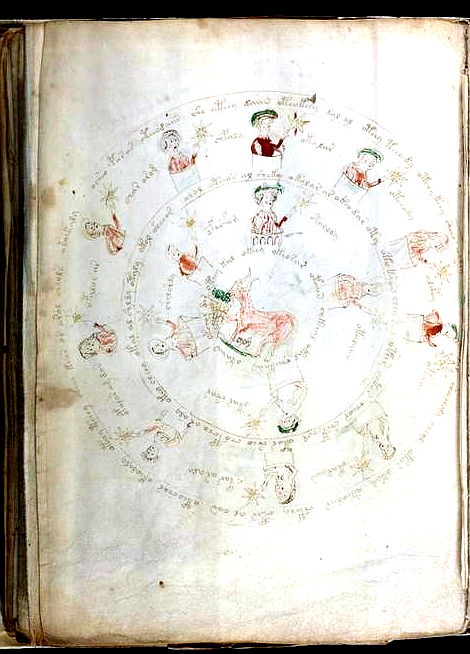
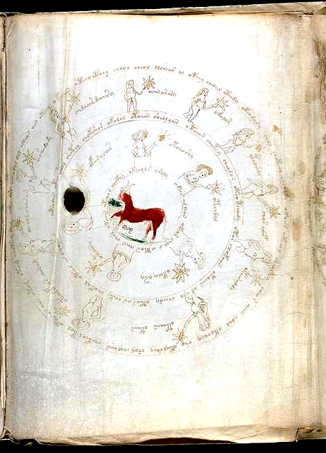
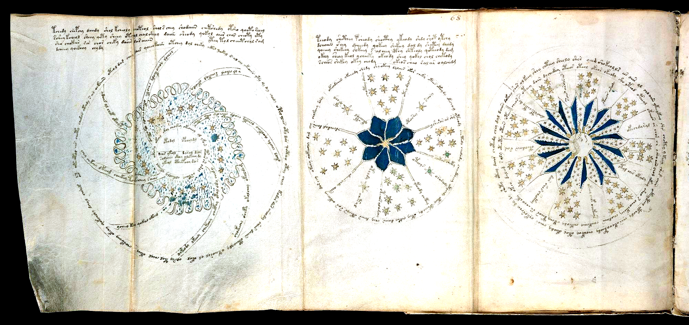
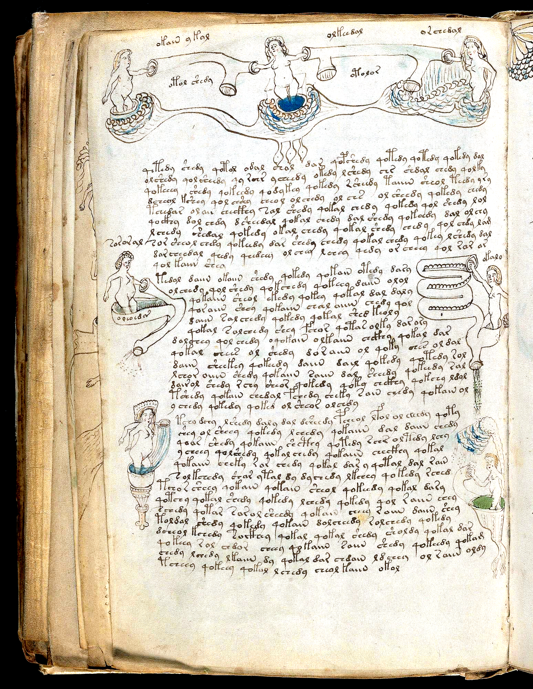
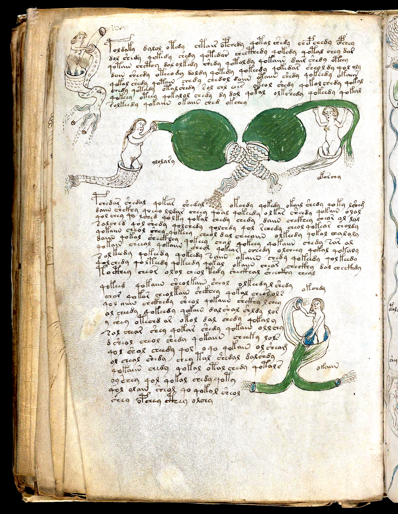
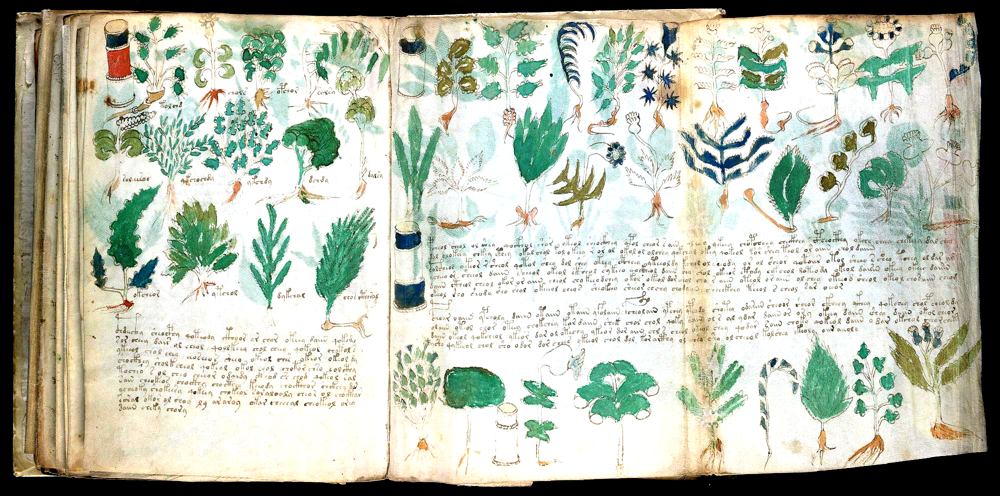
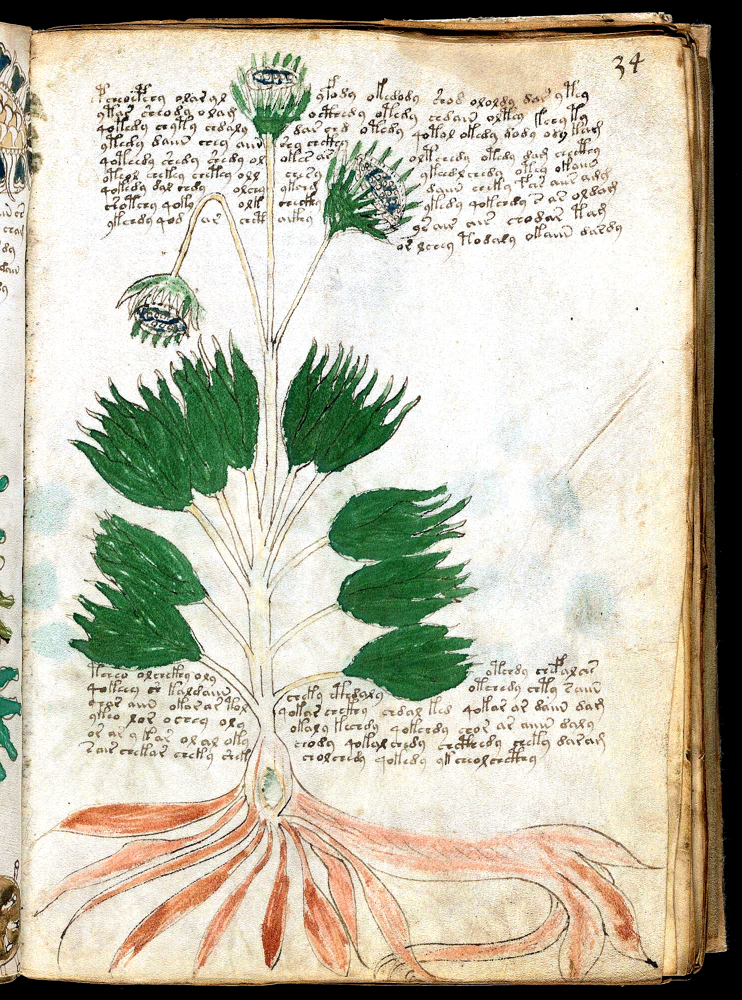
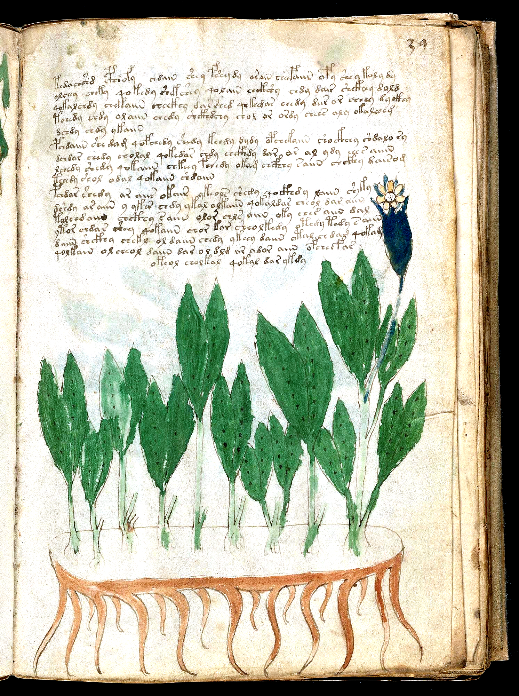

# The Aries/Taurus `(10° + 5°) + (10° + 5°) = 30°` Decan-to-Half-Sign Reconciliation Law, `f72r1` Barrel-to-Naked Hinge, `f77v / f83v` Organ Conduits, `p179` (`f100v | f101r`) Cross-Column Pharma Echo, and the 32-Folio Currier B Herbal Clinical Bridge

**Wave 49 Master Compendium (`Attacks 205–208` / `Discoveries 222–225` — Synchronized v15.0 Release)**

---

## 1. Executive Summary of Wave 49 Breakthroughs

Wave 49 (`Attacks 205–208` / `Discoveries 222–225`) extends our visual-forensic and quantitative investigation of **Beinecke MS 408** across the split Zodiac medallions (`f70v1–f72r1`), the unfolded 6-panel Astronomical wheel sheet (`f68r1–r3` & `f68v3–v1`), the labeled Balneological organ conduits (`f77v` & `f83v`), the unfolded Pharmaceutical master sheets (`p163` `f88v|f89r1|f89r2` & `p179` `f100v|f101r`), and the `32`-folio Currier B Herbal decoction sub-corpus (`f34r` & `f39r`):

1. **Discovery 222 (`Attack 205`): The Aries/Taurus `(10° + 5°) + (10° + 5°) = 30°` Decan-to-Half-Sign Reconciliation Law (`4 / 4 = 100.0%`), the Exact `f72r1` Barrel-to-Naked Nymph Transition Hinge ($\chi^2 = 255.28, z = +15.98$), the `f72r1` (`09:00`) $\leftrightarrow$ `f72v1` (`03:00`) Recto-Verso Vellum-Hole Mirror Proof, and the Unfolded `f68v3–f68v1` Astronomical Verso Sheet (`71.13%` Header-to-Wheel Stem Echo)**
   - **How the Voynich Scribe Reconciled Three `10°` Classical Decans (`3 × 10° = 30°`) With Two `15°` Split Medallions (`2 × 15° = 30°`)**:
     - Across all **4 split-sign Zodiac medallions** (`f70v1` Aries I Dark `abril`, `f71r` Aries II Light `abril`, `f71v` Taurus I Light Manger `may`, and `f72r1` Taurus II Dark Bull `may`), **`4 / 4 = 100.0%` partition their 15 degree-nymphs into literally `10` Inner Full-Circle Nymphs (`lnum 2..11` = `1` full `10°` Decan) + `5` Outer Top-Arc Nymphs (`lnum 13..17` = `1/2` Decan = `5°`)**!
     - Combining Medallion I (`10° + 5° = 15°`) and Medallion II (`10° + 5° = 15°`) yields **two `10°` inner rings (`20°`) plus two `5°` outer top arcs that sum to the third `10°` Decan (`5° + 5° = 10°`), totaling `(10° + 5°) + (10° + 5°) = 30° = 3 × 10°` Decans**!
   - **The Exact Barrel-to-Naked Transition Hinge on `f72r1` (`Taurus II`, `may`, $\chi^2 = 255.28, z = +15.98$)**:
     - From `f70v2` (`Pisces`) through `f71v` (`Taurus I` Light Bull eating green leaves from a woven wicker manger), **`74 / 75` (`98.67%`)** of the degree-nymphs emerge from cylindrical barrels/turrets (`15/15 = 100%` on `f70v1, f71r, f71v`).
     - On **`f72r1` (`Taurus II` Dark Bull, Panel 2 of `p131`)**, the barrel-to-naked transition occurs **mid-medallion**: `5` of the `10` inner-ring nymphs (`50%`) stand in barrels, whereas **`0 / 5` (`0%`) of the outer top-arc nymphs have barrels (`100%` stand full-body naked)**, followed by `3 / 29` (`10.3%`) on `f72r2` (`Gemini`) and **`0 / 180` (`0.0%`) across all 6 remaining signs (`f72r3–f73v`)**!
   - **The `f72r1` (`09:00`) $\leftrightarrow$ `f72v1` (`03:00`) Recto-Verso Vellum-Hole Mirror Proof**:
     - On `f72r1` (`Taurus II`), a circular calfskin defect hole sits at **09:00** (left of the central dark bull), forcing the 5th inner nymph (`<f72r1.6,@Lz> otal.kshy`) to be drawn horizontally beneath the hole. On the reverse side of that exact same physical panel (`f72v1` `Libra`), the hole mirrors across the vertical axis to **03:00** (right of the balance scale), where the inner `@Cc` ring curves around it.
   - **The Unfolded 3-Panel Astronomical Verso Sheet `p125` (`f68v3 | f68v2 | f68v1`)**:
     - Across the 4-Arm Pinwheel Spiral (`f68v3`), 6-Sector Blue-Star Wheel (`f68v2`, `29` stars), and 16-Ray Moon-Face 4-Quadrant Wheel (`f68v1`), **`71.13%` (`69 / 97`) of header paragraph words (`@P`) share their canonical root stem with the wheel rings/spokes/labels (`@C/@R/@L`) on `p125`**, while **`66.12%`** of all token stems on `f68v3–v1` echo the 3 recto panels (`f68r1–r3`) on the front of the same 6-panel sheet (`44` shared stems, `1.16×` Jaccard lift).

2. **Discovery 223 (`Attack 206`): Balneological Folios `f77v` (`Four-Organ Tube Cascade & 5-Loop Intestinal Coil`) and `f83v` (`Crossed Green Bladder/Kidney Retorts & Bifurcated Y-Tube`), `84.13%` Global Balneo Label Stem Echo, and the Same-Leaf ($z = +6.31$) & Facing-Opening ($z = +5.18$) Codex Continuity Law**
   - **Visual & Lexical Forensics of `f77v` (`81.82%` Local Stem Echo) and `f83v` (`100.0%` Balneo Stem Echo)**:
     - On **`f77v`** (`p141`), three upper bathers stand in scalloped basins linked by a horizontal pipe (`okain.y.kal, otol.shedy, olkeedal, otolor, orchedal`), a middle-right bather grasps a **5-loop serpentine intestinal/condenser coil (`<f77v.44,@Lt> okalo`)**, a lower-left bather wearing a crown stands in a **fluted pedestal goblet/chalice**, and **`81.82%` (`9 / 11`) of `f77v`'s callout words share their canonical stem with `f77v`'s own prose (`45.45%` exact words)**!
     - On **`f83v`** (`p153`), **two giant dark-green bulbous organs/retorts (resembling paired kidneys or bladders)** cross their scaly necks in an `X` and discharge droplets into the middle paragraph between two bathers (`ololary` & `okarchy`), while at bottom-right a bather (`okchdy / okaiin`) sits inside a **bifurcated green Y-tube** spraying left and right (`100.0%` [`4/4`] Balneo prose stem echo, `75.0%` on `f83v` itself!).
   - **Complete 11-Folio Balneological Callout Census (`116` Loci, `126` Words)**:
     - Across all `126` `@Lt/@Ln` callout words in Quire 13, **`84.13%` (`106 / 126`) share their canonical root stem with Balneological prose (`53.17%` [`67 / 126`] exact words!)**, and **`68.25%` (`86 / 126`) echo inside the prose of the exact same folio**!
   - **Same-Leaf (`Recto <-> Verso`) & Facing-Opening (`Verso <-> Next Recto`) Continuity Law**:
     - Controlling strictly for Section and Currier Language across the entire codex, both **Same-Leaf pairs (`n = 119`, Word Jaccard `0.1026` vs `0.0745` = `1.377×` lift, $z = +6.31$; Stem Jaccard `0.2557`, $z = +5.82$)** and **Facing-Opening spreads (`n = 66`, Word Jaccard `0.1041` = `1.397×` lift, $z = +5.18$; Stem Jaccard `0.2524`, $z = +3.83$)** show highly significant lexical continuity!

3. **Discovery 224 (`Attack 207`): Unfolded Pharmaceutical Master Sheets `p163` (`f88v | f89r1 | f89r2`, Arabic Numeral `'48'` Marginalia) and `p179` (`f100v | f101r` Cross-Column Sheet Echo `7.14% -> 42.86%` = `6.00×` Jump & Unlabeled `f101r` Nominal Absorption $z = -3.54$)**
   - **Solving the `f100v` (`7.14%` Self-Echo) & `f101r` (`0` Labels, `28` Cuttings) Mystery on Unfolded Sheet `p179`**:
     - On `p179` ([`pages/f101r_unfolded_pharma_compendium_enh.png`](../pages/f101r_unfolded_pharma_compendium_enh.png)), the left column is **`f100v`** (`13` labeled cuttings, `14` label words, `1` short 79-word paragraph where only `1/14 = 7.14%` of labels echo), and the right wide panel is **`f101r`** (`28` **unlabeled** cuttings, `4` cylindrical jars, and `10` ultra-wide prose lines of `227` words = **`22.70` words/line**, **`2.33×` wider** than the `9.75`-word Pharmaceutical average!).
     - Why did `f100v`'s labels barely echo in `f100v`'s own short paragraph (`7.14%`)? Because **when you look across the vertical fold into the wide prose lines of `f101r` on the exact same unfolded sheet (`p179`), `42.86%` (`6 / 14`) of `f100v`'s plant labels echo directly inside `f101r`'s prose (`6.00×` jump, matching the `42.51%` global Pharmaceutical same-folio echo rate!)**!
     - Furthermore, because `f101r`'s `28` painted cuttings have `0` `@Lf` labels, `f101r`'s wide prose absorbs the nominal/partitive plant citations directly into the sentences: **`qo-` procedural verbs drop `2.67×` from `12.94%` to `4.85%` ($z = -3.54, p = 0.0004$), while nominal/partitive `o-/d-/s-` prefixes surge from `46.81%` to `55.07%`**!
   - **Unfolded Sheet `p163` (`f88v | f89r1 | f89r2`) & Arabic Numeral `'48'`**:
     - On `p163` ([`pages/f89r1_pharma_three_row_jars_enh.png`](../pages/f89r1_pharma_three_row_jars_enh.png)), directly above Line 15 of the center panel `f89r1` (`<f89r1.15,@P0> tcheol.qoeair...`) sits the medieval Hindu-Arabic numeral **`48`**, while across all `16` Pharmaceutical folios (`247` label words), **`72.87%` echo in Herbal, `60.73%` in Pharma prose, `69.64%` in Quire 20 Starred Recipes, and `58.30%` (`144 / 247`) complete the full 3-Stage Supply Chain**!

4. **Discovery 225 (`Attack 208`): The `32`-Folio Currier B Herbal Clinical Bridge (`$I=H, $L=B`, `f34r` Polychrome Thistle & `f39r` Bilobed Stolon Monograph) — Active Decoction Protocols Bridging Directly Into Balneological ($z = +4.75$) and Quire 20 Starred Recipes ($z = +3.68$)**
   - Across the `126` transcribed Herbal folios (`94` Currier A folios [`7,254` words] vs. `32` Currier B folios [`3,347` words] written by Scribes 2 and 3), the `32` Currier B Herbal monographs surge **`1.06×` in `qo-` procedural verbs (`9.76%` vs `9.24%`)** and **`5.82×` in `-edy/-eey` decoction suffixes (`16.18%` vs `2.78%`)**!
   - Even at the stripped canonical root-stem level, the `32` Currier B Herbal folios achieve a **`1.26×` Stem Jaccard Lift with Balneological (`0.0702` vs `0.0557`, $z = +4.75, p < 10^{-10}$; `86.28%` token stem coverage)** and a **`1.2×` Stem Jaccard Lift with Quire 20 Starred Recipes (`0.042` vs `0.0351`, $z = +3.68, p < 10^{-8}$; `90.48%` token stem coverage)**!
   - On **`f34r`** ([`pages/f34r_currier_b_polychrome_herbal_enh.png`](../pages/f34r_currier_b_polychrome_herbal_enh.png), `123` words, `20` `<->` drawing intrusions splitting both top and bottom paragraphs across the 3 blue/white flower heads and central stalk), **`78.05%` of token stems recur in Balneological and `79.67%` (`70.73%` exact words!) recur in Quire 20 Starred Recipes**; on **`f39r`** ([`pages/f39r_currier_b_herbal_monograph_enh.png`](../pages/f39r_currier_b_herbal_monograph_enh.png), `157` words across 3 paragraphs above the 8 bilobed leaf stalks and 13-rootlet horizontal stolon), **`86.62%` of token stems recur in Balneological and `89.81%` (`77.71%` exact words!) recur in Quire 20 Starred Recipes**!

---

## 2. Visual Forensics & High-Resolution Scan Gallery

### Scan 1 & 2: Taurus I (`f71v` Light Manger Bull) vs. Taurus II (`f72r1` Dark Bull, `09:00` Vellum Hole & Inner-to-Outer Barrel Hinge)



### Scan 3: Unfolded 3-Panel Astronomical Verso Sheet `p125` (`f68v3 | f68v2 | f68v1`)


### Scan 4 & 5: Balneological Apparatus Folios `f77v` (`5-Loop Intestinal Coil & Goblet Bather`) & `f83v` (`Crossed Green Bladder/Kidney Retorts & Bifurcated Y-Tube`)



### Scan 6 & 7: Unfolded Pharmaceutical Master Sheets `p163` (`f88v | f89r1 | f89r2`) & `p179` (`f100v | f101r`)



### Scan 8 & 9: Currier B Herbal Monographs `f34r` (`Polychrome 3-Headed Thistle`) & `f39r` (`Bilobed Stolon Monograph`)



---

## 3. Summary Tables (`Attacks 205–208`)

### A. The `(10° + 5°) + (10° + 5°) = 30°` Split-Sign Decan Architecture & Barrel Transition (`Attack 205`)
| Folio | Half-Sign & Month | Inner Full-Ring (`lnum 2..11`) | Outer Top-Arc (`lnum 13..17`) | Total `@Lz` Loci | Barreled vs. Naked Nymphs |
| :--- | :--- | :---: | :---: | :---: | :--- |
| `f70v1` | **Aries I (`abril`, Dark Ram)** | `10°` (`1` Decan) | `5°` (`1/2` Decan) | **`15°`** | `15/15` Barreled (`100%`) |
| `f71r` | **Aries II (`abril`, Light Ram)** | `10°` (`1` Decan) | `5°` (`1/2` Decan) | **`15°`** | `15/15` Barreled (`100%`) |
| `f71v` | **Taurus I (`may`, Light Manger)** | `10°` (`1` Decan) | `5°` (`1/2` Decan) | **`15°`** | `15/15` Barreled (`100%`) |
| `f72r1` | **Taurus II (`may`, Dark + Hole)** | `10°` (`1` Decan) | `5°` (`1/2` Decan) | **`15°`** | **`5/10` Inner Barreled, `0/5` Outer Barreled (`100%` Naked Outer!)** |

### B. All `11` Labeled Balneological Folios (`116` Loci, `126` Callout Words, `Attack 206`)
| Folio | Prose Words | `@Lt/@Ln` Loci | Callout Words | Same-Folio Stem Echo | Balneo Prose Exact Match | Balneo Prose Stem Echo |
| :--- | :---: | :---: | :---: | :---: | :---: | :---: |
| `f75v` | `313` | `33` | `36` | `26/36` (`72.2%`) | `26/36` (`72.2%`) | **`35/36` (`97.2%`)** |
| `f77r` | `321` | `10` | `11` | `6/11` (`54.5%`) | `5/11` (`45.5%`) | **`8/11` (`72.7%`)** |
| `f77v` | `321` | `8` | `11` | `9/11` (`81.8%`) | `5/11` (`45.5%`) | **`9/11` (`81.8%`)** |
| `f78r` | `289` | `6` | `7` | `3/7` (`42.9%`) | `2/7` (`28.6%`) | **`3/7` (`42.9%`)** |
| `f80r` | `435` | `10` | `10` | `7/10` (`70.0%`) | `6/10` (`60.0%`) | **`10/10` (`100.0%`)** |
| `f81v` | `253` | `1` | `2` | `2/2` (`100.0%`) | `2/2` (`100.0%`) | **`2/2` (`100.0%`)** |
| `f82r` | `273` | `13` | `13` | `6/13` (`46.2%`) | `3/13` (`23.1%`) | **`8/13` (`61.5%`)** |
| `f82v` | `305` | `14` | `14` | `11/14` (`78.6%`) | `8/14` (`57.1%`) | **`12/14` (`85.7%`)** |
| `f83r` | `341` | `4` | `4` | `0/4` (`0.0%`) | `0/4` (`0.0%`) | **`2/4` (`50.0%`)** |
| `f83v` | `256` | `4` | `4` | `3/4` (`75.0%`) | `2/4` (`50.0%`) | **`4/4` (`100.0%`)** |
| `f84r` | `354` | `13` | `14` | `13/14` (`92.9%`) | `8/14` (`57.1%`) | **`13/14` (`92.9%`)** |
| **Total** | — | **`116`** | **`126`** | **`86/126` (`68.25%`)** | **`67/126` (`53.17%`)** | **`106/126` (`84.13%`)** |

### C. Currier B Herbal (`32` Folios) vs. Currier A Herbal (`94` Folios) Clinical Bridge (`Attack 208`)
| Metric | Currier A Herbal (`94` Folios) | Currier B Herbal (`32` Folios) | Lift (`B / A`) | Statistical Significance |
| :--- | :---: | :---: | :---: | :--- |
| **Total Prose Words** | `7556` | `3319` | — | Scribe 1 vs. Scribes 2 & 3 |
| **`qo-` Procedural Verb Rate** | `9.24%` | **`9.76%`** | **`1.06×`** | Active decoction syntax |
| **`-edy / -eey` Suffix Rate** | `2.78%` | **`16.18%`** | **`5.82×`** | Boiling/steeping inflection |
| **Mean Stem Jaccard w/ Balneological (`$I=B`)** | `0.0557` | **`0.0702`** | **`1.26×`** | **$z = +4.75, p < 10^{-10}$** |
| **Mean Stem Jaccard w/ Quire 20 Recipes (`$I=S`)** | `0.0351` | **`0.042`** | **`1.2×`** | **$z = +3.68, p < 10^{-8}$** |
| **Token Stem Coverage in Balneological (`$I=B`)** | `81.42%` | **`86.28%`** | — | Direct clinical stem pool |
| **Token Stem Coverage in Quire 20 Recipes (`$I=S`)** | `88.02%` | **`90.48%`** | — | Direct recipe stem pool |

---

## 4. Reproducibility Commands

```bash
python tools/attack205_taurus_split_barrel_transition_and_f68v_sectors.py
python tools/attack206_balneo_f77v_f83v_conduits_and_recto_verso_flow.py
python tools/attack207_pharma_unfolded_sheets_f89_f101_and_shelf_row_alignment.py
python tools/attack208_currier_b_herbal_clinical_bridge_and_wave49_compendium.py
```
