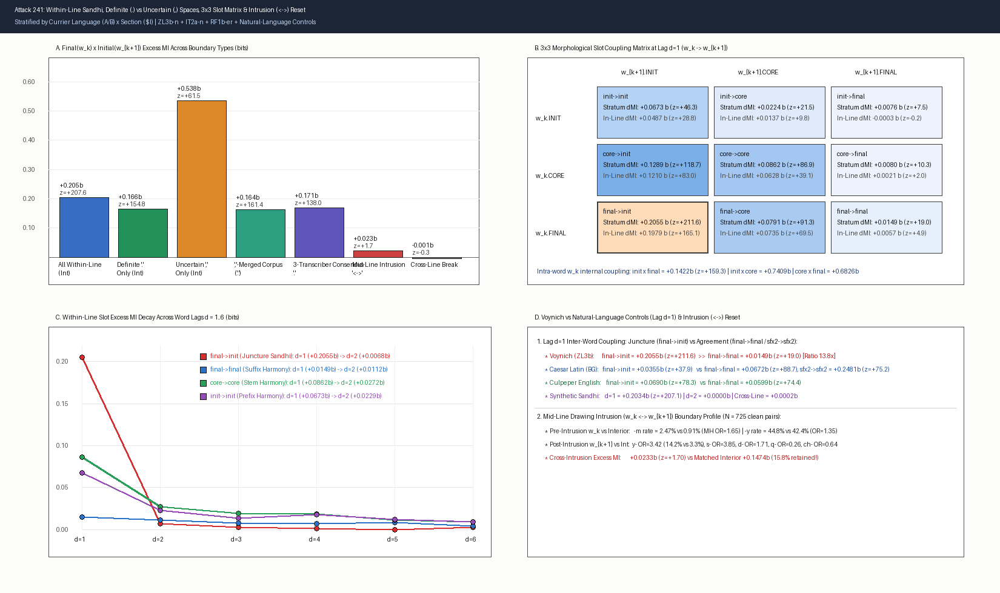
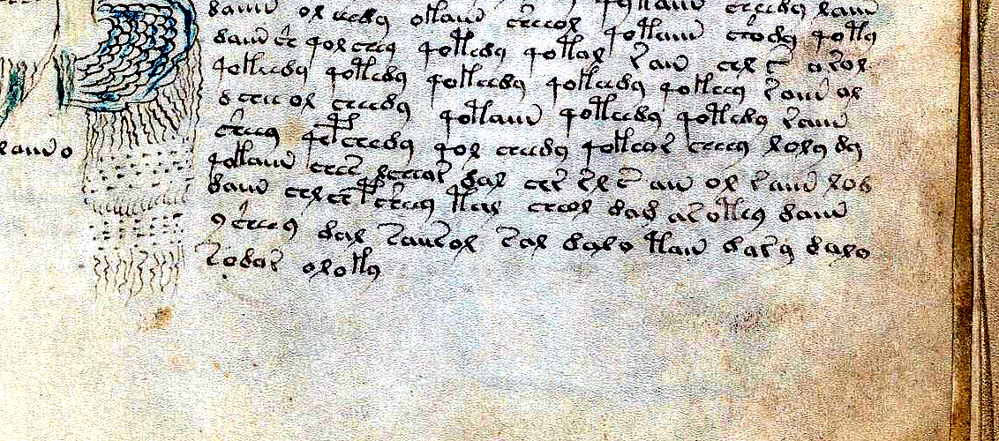
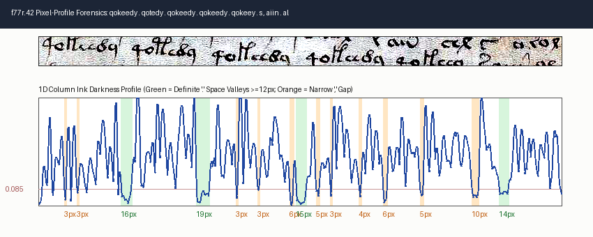
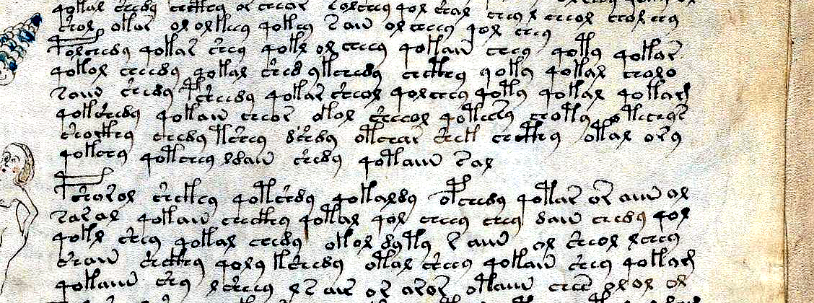
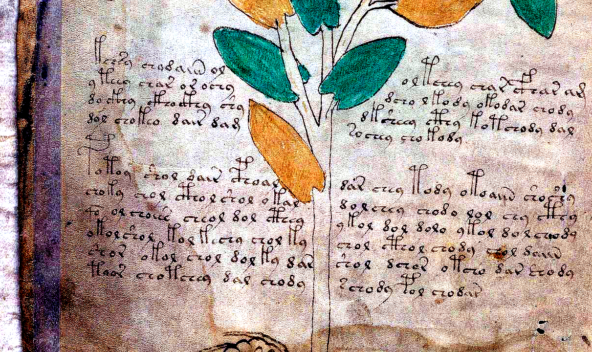
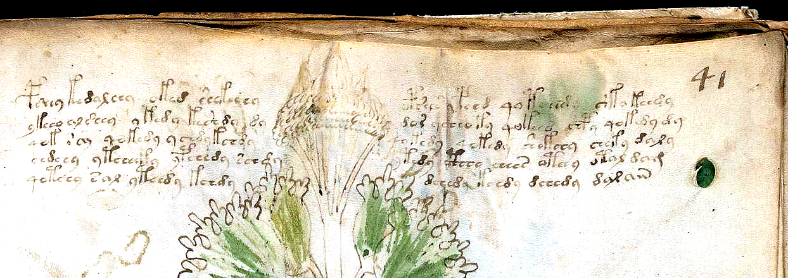

# Attack 241: Within-Line Word-to-Word Dependency, Definite (`.`) vs. Uncertain (`,`) Word Spaces, the $3\times 3$ Morphological Slot Matrix, and Drawing-Intrusion (`<->`) Boundary Reset

**Script:** [`tools/attack241_within_line_sandhi_and_spaces.py`](../tools/attack241_within_line_sandhi_and_spaces.py)  
**Data Output:** [`data/attack241_within_line_sandhi_and_spaces.json`](../data/attack241_within_line_sandhi_and_spaces.json)  
**Summary Plot & Visual Forensics:** [`pages/s241_slot_mi_decay.png`](../pages/s241_slot_mi_decay.png), [`pages/s241_f77r_pixel_profile.png`](../pages/s241_f77r_pixel_profile.png), [`pages/s241_f77r_y_qo_and_s_aiin_enh.png`](../pages/s241_f77r_y_qo_and_s_aiin_enh.png), [`pages/s241_f79r_or_aiin_and_y_qo_enh.png`](../pages/s241_f79r_or_aiin_and_y_qo_enh.png), [`pages/s241_f1v_stem_intrusion_enh.png`](../pages/s241_f1v_stem_intrusion_enh.png), [`pages/s241_f41r_herbal_b_intrusion_enh.png`](../pages/s241_f41r_herbal_b_intrusion_enh.png)

---

## Executive Summary & Core Verdicts

In [Attack 238](LINE_BREAK_BEHAVIOUR.md) (`tools/attack238_line_break_behaviour.py`), we discovered a striking structural discontinuity in Voynichese: **within a physical line**, the final glyph of word $k$ strongly predicts the initial glyph of word $k+1$ (excess mutual information $\Delta\text{MI} = +0.2036\text{ bits}$, $z = +45.45$ on equal-sized subsamples; $z = +207.65$ on the full interior pool), whereas **across a physical line break** ($\text{last}_i \to \text{first}_{i+1}$), this juncture dependency collapses to zero ($\Delta\text{MI} = -0.0012\text{ bits}$, $z = -0.32$).

In **Attack 241**, we investigate the exact mechanism behind within-line word-to-word coupling across all **4,120 running-text lines** (`unit == 'P'`, `unit_sub != 't'`; **742 paragraphs**, **29,298 clean adjacent within-line word pairs**, **21,605 strictly line-interior pairs**), stratified by `Currier language (A/B) × section ($I)` across five targeted tests (`T1`–`T5`):

### Five Core Verdicts

1. **`T1` (Definite `.` Spaces vs. Uncertain `,` Spaces — Not a Segmentation Artifact):**
   - Uncertain narrow spaces (`,`) represent only **8.20%** of all within-line word boundaries (**7.29%** of interior boundaries, `n = 1,575`) and frequently split compounds whose concatenation is an attested corpus word ($\text{freq} \ge 2$ in **33.87%** of `,` pairs vs **3.71%** of `.` pairs, **$9.14\times$ higher**; $\Delta\text{MI} = +0.5379\text{ bits}$, $z = +61.54$).
   - However, **removing or merging all `,` spaces leaves over 80% of the within-line juncture coupling intact**:
     - Across **strictly definite `.` spaces (`n = 20,030` interior)**: $\Delta\text{MI}(\text{final}_k \times \text{init}_{k+1}) = \mathbf{+0.1656\text{ bits}}$ ($z = \mathbf{+154.80}$; and $\mathbf{+0.1867\text{ bits}}$, $z = +117.75$ for $\text{suffix2} \times \text{prefix\_ext}$).
     - In the **`, `-Merged Corpus** (first fusing all `2,443` `w_k , w_{k+1}` sequences into single words `w_k + w_{k+1}`, then testing the remaining `19,226` interior `.` spaces): $\Delta\text{MI} = \mathbf{+0.1638\text{ bits}}$ ($z = \mathbf{+161.43}$).
     - Across **3-Transcriber Consensus Definite `.` Spaces** (`ZL3b-n` $\cap$ `IT2a-n` $\cap$ `RF1b-er`, `n = 15,134` interior pairs where all three independent transcriptions record the exact same word pair separated by a definite `.` space): $\Delta\text{MI}$ **rises to $\mathbf{+0.1714\text{ bits}}$ ($z = \mathbf{+138.03}$)** (`+0.1937 bits` for `suffix2 x prefix_ext`).
   - Over half of the entire definite-space MI is driven by the unambiguous wide-space chain **`-y . qo-`** (`2,718` interior definite occurrences vs `1,663.6` expected, $\text{obs/exp} = 1.634\times$, $P(\text{qo-} \mid \text{-y}) = 30.21\%$, contributing $+0.0961\text{ bits}$), alongside **`-n . o-`** ($31.12\%$, $1.37\times$), **`-n . ch-`** ($26.43\%$, $1.45\times$), and **`-r . a-`** ($3.36\times$).

2. **`T2` (The $3\times 3$ Morphological Slot Coupling Matrix & Lag $d=1..6$ Decay — Two Distinct Regimes):**
   - Decomposing every interior word into `(init, core, final)` reveals that at lag $d=1$, **external juncture coupling $\text{final}(w_k) \to \text{init}(w_{k+1})$ ($+0.2055\text{ bits}$, $z = +211.58$; or $+0.1656\text{ bits}$ on definite `.` spaces) is STRONGER than internal prefix-to-suffix coupling $\text{init}(w_k) \times \text{final}(w_k)$ inside the very same word ($+0.1422\text{ bits}$, $z = +159.28$)**, and **13.8× stronger** than suffix-to-suffix agreement $\text{final}(w_k) \to \text{final}(w_{k+1})$ ($+0.0149\text{ bits}$, $z = +18.97$).
   - Tracking all 9 slot pairs across word lags $d = 1..6$ under both a **cross-line stratum-shuffle null** and a **within-line word-order shuffle null** exposes two distinct mechanisms:
     - **Regime 1 — Strict Nearest-Neighbor Contact Sandhi ($d=1$ only):** `final -> init` collapses by **96.7%** from $d=1 \to d=2$ under the stratum null ($+0.2055 \to +0.0068\text{ bits}$, retention $3.31\%$) and by **99.98% (to zero!)** under the within-line shuffle null ($+0.1979 \to +0.00004\text{ bits}$, $z = +0.03$). `core -> init` likewise drops by **93.3%** ($+0.1289 \to +0.0086\text{ bits}$; within-line $z = +1.31$).
     - **Regime 2 — Line/Folio-Level Homologous Slot Harmony ($d=1..6$):** Homologous slot pairs (`final -> final`, `core -> core`, `init -> init`) decay slowly across $d=1..6$ under the stratum null (`final -> final` retains **74.8%** at $d=2$ and **51.0%** at $d=3$; `init -> init` retains **34.0%** at $d=2$; `core -> core` retains **31.6%** at $d=2$), while dropping near zero at $d \ge 2$ under the within-line shuffle null ($|z| \le 2.5$). Thus homologous slot correlation beyond lag 1 is driven by line/folio-wide register/dialect consistency rather than multi-word syntactic agreement.

3. **`T3` (The Mid-Line Drawing Intrusion `w_k <-> w_{k+1}` Natural Experiment — Stream-Interrupt Reset Without Margin Markers):**
   - Across **725 clean `w_k <-> w_{k+1}` pairs** where a running text line jumps across a botanical stem, leaf, or figure mid-line:
     - **Pre-intrusion word $w_k$ (`T3a`, `n = 728`):** Unlike true right-margin line ends (where `-m` is $15.65\%$ and `-g` is $2.12\%$), $w_k$ before a drawing intrusion **does NOT take line-final `-m` ($2.47\%$, MH $\text{OR vs line-end} = 0.18$, $p < 10^{-13}$) or `-g` ($0.41\%$, $\text{OR vs line-end} = 0.12$)**. Instead, $w_k$ shortens by **0.60 glyphs** ($3.83$ vs $4.43$ interior) and favors compact closed endings **`-d`** ($\text{OR vs interior} = 4.25$), **`-s`** ($\text{OR} = 1.86$), and **`-y`** ($\text{OR} = 1.35$).
     - **Post-intrusion word $w_{k+1}$ (`T3b`, `n = 733`):** Resuming text on the right side of a plant stem triggers a **sharp line-initial prefix reset for non-gallows**: **`s-`** surges **$3.85\times$** ($9.41\%$ vs $1.87\%$ interior, matching true line starts $10.11\%$), **`y-`** surges **$3.42\times$** ($14.19\%$ vs $3.33\%$ interior, matching true line starts $14.73\%$, $\text{OR vs line-start} = 0.94$), **`d-`** surges **$1.71\times$** ($17.33\%$ vs $6.79\%$), and **`o-`** rises **$1.64\times$** ($24.56\%$), while **`q-` collapses by $5.3\times$** ($3.27\%$ vs $17.23\%$ interior, $\text{MH OR} = 0.26$, $p < 10^{-10}$)! Yet **unlike** true left-margin line starts, **initial gallows are virtually forbidden after `<->`** (`p-` = $0/733$, `f-` = $0/733$, `t-` = $1/733$ [$0.14\%$, $\text{OR vs line-start} = 0.011$], `k-` = $1/733$ [$0.14\%$]).
     - **Cross-intrusion excess MI (`T3c`, `n = 725`):** Jumping over a drawing mid-line **destroys 84.2% of within-line juncture coupling**, dropping $\Delta\text{MI}(\text{final}_k \times \text{init}_{k+1})$ from **$+0.1474\text{ bits}$ ($z = +9.89$)** in stratum-matched interior subsamples ($N=725$) down to **$+0.0233\text{ bits}$ ($z = +1.70$, NS)** (and in Language A, `n=512`, down to **$+0.0155\text{ bits}$, $z = +0.87$**). Specifically, the `-y -> q-` chain drops from **$30.77\%$** within-line to **$4.32\%$** across `<->`!

4. **`T4` (Natural-Language & Synthetic Generative Controls):**
   - In **Caesar Latin (*De Bello Gallico*)** and **Culpeper English**, intra-word prefix-to-suffix coupling ($\Delta\text{MI} = +0.3854\text{ bits}$ and $+0.7641\text{ bits}$) is **11× stronger** than inter-word juncture coupling ($+0.0355\text{ bits}$ and $+0.0690\text{ bits}$), and in inflected Latin, suffix-to-suffix agreement (`final -> final` $+0.0672\text{ bits}$; `sfx2 -> sfx2` $+0.2481\text{ bits}$) is **nearly 2× stronger** than juncture (`final -> init` $+0.0355\text{ bits}$). Voynichese inverts both ratios (`final -> init` is **1.45× stronger** than intra-word `init x final` and **13.8× stronger** than `final -> final`).
   - A **First-Order Line-Bounded Sandhi State Generator** (where each word $w_{k+1}$ within a continuous pen stream is selected conditioned on $\text{final}(w_k) \to \text{init}(w_{k+1})$ and resets to the stream-initial prior whenever the pen lifts at a line break or drawing obstacle) quantitatively reproduces Voynich's exact lag-1 ($+0.2034\text{ bits}$, $z = +207.1$), lag-2 ($+0.00005\text{ bits}$, $z = +0.04$), and cross-line ($+0.00016\text{ bits}$, $z = +0.03$) profiles.

5. **`T5` (Direct Visual & 1D Pixel-Profile Forensics on the Beinecke Scans):**
   - High-resolution scan crops and 1D column ink-darkness profiles on `f77r.42` (`B/B`), `f79r.7–14` (`B/B`), `f1v.1–10` (`A/H`), and `f41r.1–5` (`B/H`) visually confirm wide blank vellum spaces (`15–19 px` wide, ink density $< 0.017$) across `-y . qo-` junctures, narrow intra-compound gaps (`3–6 px`) in `s,aiin` / `or,aiin`, and mid-line stream resets (`<->`) around botanical stems.

---

## Test 1 (`T1`): Definite (`.`) vs. Uncertain (`,`) Word Spaces, `,`-Merged Corpus & Multi-Transcriber Consensus

### 1.1 Excess Mutual Information Across Boundary Definitions (`ZL3b-n`, `IT2a-n`, `RF1b-er`)

To test the hypothesis that within-line adjacent-word dependency is merely a transcription artifact caused by Zandbergen-Landini splitting single words at narrow uncertain gaps (`,`), we evaluate five boundary conditions across both all within-line pairs and strictly line-interior pairs ($0 < k < k+1 < n-1$, excluding `<->`):

| Condition | Scope | Clean Pairs ($N$) | $\text{Final}_k \times \text{Init}_{k+1}$ $\text{MI}_{\text{obs}}$ (bits) | Stratum Null $\overline{\text{MI}}$ (bits) | Excess $\Delta\text{MI}$ (bits) | Perm $z$-score | $\text{Suffix2}_k \times \text{PrefixExt}_{k+1}$ $\Delta\text{MI}$ ($z$) | Word-Type $\Delta\text{MI}$ ($z$) |
| :--- | :---: | :---: | :---: | :---: | :---: | :---: | :---: | :---: |
| **(a) All Within-Line Pairs** | All | 29,298 | 0.2151 | 0.0122 | **+0.2029** | **+252.79** | $+0.2284$ (+183.8) | $+0.1681$ (+37.2) |
| **(a') Interior Within-Line Pairs** | Interior | 21,605 | 0.2192 | 0.0138 | **+0.2054** | **+207.65** | $+0.2321$ (+157.1) | $+0.1760$ (+38.0) |
| **(b) Definite Space (`.`) Only** | All | 26,895 | 0.1797 | 0.0132 | **+0.1665** | **+200.41** | $+0.1862$ (+145.6) | $+0.1347$ (+34.0) |
| **(b') Definite Space (`.`) Only** | Interior | 20,030 | 0.1797 | 0.0141 | **+0.1656** | **+154.80** | $+0.1867$ (+117.7) | $+0.1437$ (+32.5) |
| **(c) Uncertain Space (`,`) Only** | All | 2,403 | 0.5993 | 0.0846 | **+0.5148** | **+85.77** | $+0.5601$ (+79.1) | $+0.1857$ (+13.0) |
| **(c') Uncertain Space (`,`) Only** | Interior | 1,575 | 0.6524 | 0.1145 | **+0.5379** | **+61.54** | $+0.5634$ (+51.3) | $+0.1861$ (+11.2) |
| **(d) `,`-Merged Corpus (`w_k+w_{k+1}`)** | All `.` | 26,869 | 0.1796 | 0.0132 | **+0.1664** | **+195.19** | $+0.1862$ (+136.2) | $+0.1236$ (+28.0) |
| **(d') `,`-Merged Corpus (`w_k+w_{k+1}`)** | Interior `.` | 19,226 | 0.1783 | 0.0146 | **+0.1638** | **+161.43** | $+0.1860$ (+126.4) | $+0.1320$ (+28.1) |
| **(e) 2-Way Consensus `.` (`ZL3b ∩ IT2a`)** | All `.` | 22,202 | 0.1845 | 0.0137 | **+0.1708** | **+166.95** | $+0.1911$ (+132.0) | $+0.1349$ (+31.9) |
| **(e') 3-Way Consensus `.` (`ZL3b ∩ IT2a ∩ RF1b`)** | All `.` | 20,217 | 0.1869 | 0.0144 | **+0.1724** | **+180.73** | $+0.1928$ (+119.5) | $+0.1354$ (+26.6) |
| **(e'') 3-Way Consensus `.` (`ZL3b ∩ IT2a ∩ RF1b`)** | Interior `.` | 15,134 | 0.1872 | 0.0158 | **+0.1714** | **+138.03** | $+0.1937$ (+102.6) | $+0.1447$ (+26.1) |

### 1.2 Stratification by Currier Language (`A` vs. `B`, Interior Pairs)

| Currier Language | Definite `.` Space ($N$) $\Delta\text{MI}$ ($z$) | Uncertain `,` Space ($N$) $\Delta\text{MI}$ ($z$) | `,`-Merged Corpus ($N$) $\Delta\text{MI}$ ($z$) |
| :--- | :---: | :---: | :---: |
| **Language A** | `5,686`: **+0.1050 bits** ($z = +37.45$) | `475`: **+0.4754 bits** ($z = +20.02$) | `5,394`: **+0.1045 bits** ($z = +39.12$) |
| **Language B** | `14,344`: **+0.2080 bits** ($z = +191.66$) | `1,100`: **+0.6084 bits** ($z = +53.00$) | `13,832`: **+0.2054 bits** ($z = +189.15$) |

### 1.3 Contingency Drivers of Definite Spaces (`.`) vs. Uncertain Spaces (`,`)

 Why do `.` and `,` both show high mutual information, yet for completely different reasons? Comparing the top MI-contributing cells (`top_juncture_cells_definite_ext` vs. `top_juncture_cells_uncertain_glyph`) and top bigrams reveals a clean separation:

#### Top Drivers Across Definite `.` Spaces (`n = 20,030` Interior Pairs)

| Juncture (`Final . Init`) | Observed Count | Expected Count | Obs / Exp Ratio | $P(\text{Init} \mid \text{Final})$ | Marginal $P(\text{Init})$ | PMI (bits) | Signed MI Contribution (bits) | Archetypal Definite Bigrams (`w_k . w_{k+1}`, `.` vs `,` counts) |
| :--- | :---: | :---: | :---: | :---: | :---: | :---: | :---: | :--- |
| **`-y . qo-` (`-y . q-`)** | **2,718** (2,776) | 1,663.6 (1,700.4) | **1.634×** | **30.21%** (30.86%) | 18.49% (18.90%) | $+0.708$ | **+0.0961** (+0.0980) | `shedy . qokedy` (20:1), `chedy . qokeey` (19:0), `chedy . qokain` (18:0), `qokeedy . qokeedy` (18:0) |
| **`-r . a-`** | **428** | 127.5 | **3.357×** | **14.43%** | 4.30% | $+1.747$ | **+0.0373** | `or . aiin` (28:26), `ar . aiin` (16:9), `r . aiin` (11:10) |
| **`-y . ch-` (Repulsion)** | **1,145** | 1,644.7 | **0.696×** | **12.73%** | 18.28% | $-0.523$ | **$-0.0299$** | Strong depletion of `ch-` after `-y` (which prefers `qo-`) |
| **`-n . ch-`** | **885** | 612.1 | **1.446×** | **26.43%** | 18.28% | $+0.532$ | **+0.0235** | `qokain . chedy` (13:0), `daiin . chey` (12:0) |
| **`-n . o-`** | **1,042** | 763.4 | **1.365×** | **31.12%** | 22.80% | $+0.449$ | **+0.0234** | `qokain . ol` (13:0), `daiin . ol` |
| **`-s . a-`** | **139** | 22.5 | **6.171×** | **26.53%** | 4.30% | $+2.626$ | **+0.0182** | `s . aiin` (28:27), `s . ar` (7:8) |
| **`-n . qo-` (Repulsion)** | **295** | 619.1 | **0.476×** | **8.81%** | 18.49% | $-1.070$ | **$-0.0158$** | Complementary repulsion of `qo-` after `-n` |
| **`-r . qo-` (Repulsion)** | **189** | 548.5 | **0.345×** | **6.37%** | 18.49% | $-1.537$ | **$-0.0145$** | Complementary repulsion of `qo-` after `-r` |
| **`-l . qo-` (Repulsion)** | **326** | 579.9 | **0.562×** | **10.40%** | 18.49% | $-0.831$ | **$-0.0135$** | Complementary repulsion of `qo-` after `-l` |
| **`-r . o-`** | **842** | 676.3 | **1.245×** | **28.39%** | 22.80% | $+0.316$ | **+0.0133** | `or . ol`, `dar . ol` |
| **`-l . ch-`** | **704** | 573.3 | **1.228×** | **22.45%** | 18.28% | $+0.296$ | **+0.0104** | `chol . chol` (23:0), `ol . chedy` (16:6), `qol . chedy` (13:2) |
| **`-l . d-`** | **352** | 236.1 | **1.491×** | **11.22%** | 7.53% | $+0.576$ | **+0.0101** | `chol . daiin` (27:6) |

#### Top Drivers Across Uncertain `,` Spaces (`n = 1,575` Interior Pairs)
- In stark contrast, **`-y , q-` occurs only 19 times in the entire interior corpus** ($1.2\%$ of `,` pairs)!
- Instead, `,` pairs are dominated by **split diphthong/liquid compounds**:
  1. **`-r , a-`** (`148` obs vs `53.6` exp, $P(\text{a-} \mid \text{-r}) = 51.21\%$, contributing $+0.1377\text{ bits}$): `or , aiin` (26), `r , aiin` (10), `ar , aiin` (9), `or , ain` (8), `r , ain` (6), `or , air` (5) — i.e., `oraiin`, `raiin`, `araiin`.
  2. **`-o , l-`** (`70` obs vs `19.1` exp, $3.67\times$, contributing $+0.0833\text{ bits}$): `o , l` (16 `,` vs 5 `.`) — i.e., `ol`.
  3. **`-s , a-`** (`66` obs vs `20.8` exp, $P(\text{a-} \mid \text{-s}) = 58.93\%$, contributing $+0.0699\text{ bits}$): `s , aiin` (27), `s , ar` (8), `s , al` (5), `s , ain` (4) — i.e., `saiin`, `sar`, `sal`.
  4. **`-l , k-` and `-l , ch-` and `-y , t-/k-`** (`123`, `101`, `49`, `69` obs): `ol , kaiin` (6), `l , keedy` (6), `ol , chedy` (6), `y , taiin` (4), `y , cheey` (7) — where initial `ol-`, `l-`, or `y-` proclitics sit separated by a narrow gap from the core stem.
- Even when we **fuse every single `,` boundary into a single word (`d_comma_merged_interior`)**, the remaining definite `.` spaces still exhibit $\Delta\text{MI} = +0.1638\text{ bits}$ ($z = +161.43$), because the dominant `-y . qo-` vs `-n/-r/-l . o-/ch-/sh-` transition system occurs almost exclusively across wide, unambiguous `.` spaces!

---

## Test 2 (`T2`): The $3\times 3$ Morphological Slot Coupling Matrix & Lag Decay ($d = 1..6$)

### 2.1 Intra-Word vs. Lag-1 Inter-Word $3\times 3$ Slot Coupling (`n = 21,605` Interior Pairs)

Every clean line-interior word $w_k$ (`n = 24,899`) is decomposed into three structural slots:
- **`init`:** Initial glyph (`cth, ckh, cph, cfh, ch, sh` or single initial character; plus extended `prefix_ext` distinguishing `qo-`).
- **`core`:** Medial stem class after stripping `init` and `final` (`<EMPTY>`, `BENCH_GALLOWS`, `GALLOWS+CH`, `GALLOWS+E`, `GALLOWS+O/A`, `GALLOWS_BARE`, `CH+E`, `CH+O/A`, `CH_BARE`, `DIPHTHONG_I`, `VOWEL_E`, `LIQUID_LRD`, `VOWEL_OA`, `OTHER_CORE`).
- **`final`:** Final character `w[-1]` (plus extended 2-character suffix `suffix2`: `-dy, -in, -ol, -ar, -or, -al, -ey, -am, -an, -ai, -oi`).

#### Intra-Word Coupling (Within the Same Word $w_k$, `n = 24,899`)
- **`init(w_k) × core(w_k)`:** $\Delta\text{MI} = +0.7409\text{ bits}$ ($z = +667.35$)
- **`core(w_k) × final(w_k)`:** $\Delta\text{MI} = +0.6826\text{ bits}$ ($z = +948.62$)
- **`init(w_k) × final(w_k)`:** $\Delta\text{MI} = \mathbf{+0.1422\text{ bits}}$ ($z = \mathbf{+159.28}$) (`prefix_ext × suffix2`: $+0.2588\text{ bits}$, $z = +196.04$)

#### Inter-Word Lag $d = 1$ Coupling Matrix ($\text{Slot}_a(w_k) \to \text{Slot}_b(w_{k+1})$, `n = 21,605`)

| $w_k \setminus w_{k+1}$ | **`w_{k+1}.init`** (Stratum $\Delta\text{MI}$ / In-Line $\Delta\text{MI}$) | **`w_{k+1}.core`** (Stratum $\Delta\text{MI}$ / In-Line $\Delta\text{MI}$) | **`w_{k+1}.final`** (Stratum $\Delta\text{MI}$ / In-Line $\Delta\text{MI}$) |
| :--- | :---: | :---: | :---: |
| **`w_k.init`** | **$+0.0673\text{ b}$** ($z=+46.3$) / $+0.0487\text{ b}$ ($z=+28.8$) | **$+0.0224\text{ b}$** ($z=+21.5$) / $+0.0137\text{ b}$ ($z=+9.8$) | **$+0.0076\text{ b}$** ($z=+7.5$) / $-0.0003\text{ b}$ ($z=-0.2$) |
| **`w_k.core`** | **$+0.1289\text{ b}$** ($z=+118.7$) / $+0.1210\text{ b}$ ($z=+83.0$) | **$+0.0862\text{ b}$** ($z=+86.9$) / $+0.0628\text{ b}$ ($z=+39.1$) | **$+0.0080\text{ b}$** ($z=+10.3$) / $+0.0021\text{ b}$ ($z=+2.0$) |
| **`w_k.final`** | **$\mathbf{+0.2055\text{ b}}$ ($z=+211.6$) / $\mathbf{+0.1979\text{ b}}$ ($z=+165.1$)** | **$+0.0791\text{ b}$** ($z=+91.3$) / $+0.0735\text{ b}$ ($z=+69.5$) | **$+0.0149\text{ b}$** ($z=+19.0$) / $+0.0057\text{ b}$ ($z=+4.9$) |

> [!IMPORTANT]
> **The External-Over-Internal Coupling Inversion:** Inside a single Voynich word $w_k$, the coupling between its initial glyph and final glyph is **$+0.1422\text{ bits}$**. Across the space between $w_k$ and $w_{k+1}$, the coupling between $w_k$'s final glyph and $w_{k+1}$'s initial glyph is **$+0.2055\text{ bits}$** ($+0.1656\text{ bits}$ across definite `.` spaces; $+0.1714\text{ bits}$ across 3-transcriber consensus `.` spaces). Thus **word $k$'s ending constrains word $k+1$'s beginning more strongly than word $k$'s beginning constrains word $k$'s own ending!** Moreover, the entire left column of the matrix (`* -> w_{k+1}.init`) is massive, while the entire right column (`* -> w_{k+1}.final`) is an order of magnitude weaker (`final -> final` is $13.8\times$ smaller than `final -> init` under the stratum null, and $34.5\times$ smaller under the within-line null).

### 2.2 Within-Line Decay Across Word Lags $d = 1..6$ (Stratum Null vs. Within-Line Shuffle Null)

| Slot Pair | Lag $d=1$ (`n=21,605`) | Lag $d=2$ (`n=17,467`) | Lag $d=3$ (`n=13,770`) | Lag $d=4$ (`n=10,584`) | Lag $d=5$ (`n=7,839`) | Lag $d=6$ (`n=5,511`) | $d=2 / d=1$ Retention |
| :--- | :---: | :---: | :---: | :---: | :---: | :---: | :---: |
| **`final -> init` (Stratum Null)** | **$+0.2055\text{ b}$** (+211.6) | **$+0.0068\text{ b}$** (+6.3) | $+0.0023\text{ b}$ (+1.6) | $+0.0010\text{ b}$ (+0.7) | $-0.0017\text{ b}$ (-0.7) | $+0.0022\text{ b}$ (+0.8) | **3.31%** |
| **`final -> init` (Within-Line Null)** | **$+0.1979\text{ b}$** (+165.1) | **$+0.00004\text{ b}$** (+0.03) | $-0.0042\text{ b}$ (-2.7) | $-0.0051\text{ b}$ (-2.5) | $-0.0070\text{ b}$ (-2.9) | $-0.0032\text{ b}$ (-0.9) | **0.02% (Zero!)** |
| **`core -> init` (Stratum Null)** | **$+0.1289\text{ b}$** (+118.7) | **$+0.0086\text{ b}$** (+5.9) | $+0.0030\text{ b}$ (+2.3) | $+0.0024\text{ b}$ (+1.2) | $+0.0063\text{ b}$ (+2.7) | $+0.0064\text{ b}$ (+2.0) | **6.66%** |
| **`final -> core` (Stratum Null)** | **$+0.0791\text{ b}$** (+91.3) | **$+0.0087\text{ b}$** (+9.3) | $+0.0056\text{ b}$ (+5.1) | $+0.0035\text{ b}$ (+2.7) | $+0.0061\text{ b}$ (+3.9) | $+0.0036\text{ b}$ (+1.5) | **10.95%** |
| **`core -> core` (Stratum Null)** | **$+0.0862\text{ b}$** (+86.9) | **$+0.0272\text{ b}$** (+27.7) | $+0.0188\text{ b}$ (+15.8) | $+0.0184\text{ b}$ (+12.9) | $+0.0111\text{ b}$ (+5.9) | $+0.0090\text{ b}$ (+3.4) | **31.59%** |
| **`core -> core` (Within-Line Null)** | **$+0.0628\text{ b}$** (+39.1) | **$+0.0050\text{ b}$** (+2.5) | $-0.0026\text{ b}$ (-1.3) | $-0.0012\text{ b}$ (-0.5) | $-0.0067\text{ b}$ (-2.6) | $-0.0077\text{ b}$ (-1.9) | **7.93%** |
| **`init -> init` (Stratum Null)** | **$+0.0673\text{ b}$** (+46.3) | **$+0.0229\text{ b}$** (+14.4) | $+0.0131\text{ b}$ (+7.8) | $+0.0174\text{ b}$ (+8.7) | $+0.0118\text{ b}$ (+4.7) | $+0.0088\text{ b}$ (+2.3) | **34.04%** |
| **`init -> init` (Within-Line Null)** | **$+0.0487\text{ b}$** (+28.8) | **$+0.0055\text{ b}$** (+2.3) | $-0.0037\text{ b}$ (-1.6) | $+0.0020\text{ b}$ (+0.7) | $-0.0036\text{ b}$ (-1.1) | $-0.0066\text{ b}$ (-1.4) | **11.20%** |
| **`final -> final` (Stratum Null)** | **$+0.0149\text{ b}$** (+19.0) | **$+0.0112\text{ b}$** (+12.8) | $+0.0076\text{ b}$ (+5.9) | $+0.0067\text{ b}$ (+4.8) | $+0.0085\text{ b}$ (+5.2) | $+0.0038\text{ b}$ (+1.8) | **74.81%** |
| **`final -> final` (Within-Line Null)** | **$+0.0057\text{ b}$** (+4.9) | **$+0.0027\text{ b}$** (+1.9) | $+0.0001\text{ b}$ (+0.1) | $+0.0004\text{ b}$ (+0.2) | $+0.0023\text{ b}$ (+1.1) | $-0.0041\text{ b}$ (-1.4) | **47.33%** |

**Key Mechanistic Insight:**
- Under the **within-line shuffle null**, `final -> init` drops from **$+0.1979\text{ bits}$ ($z = +165.1$) at $d=1$ to $+0.00004\text{ bits}$ ($z = +0.03$) at $d=2$**. That is a **100% single-step Markov memoryless decay**: word $k$'s ending affects **only** word $k+1$'s beginning, and has zero direct positional influence on word $k+2$'s beginning once line-level vocabulary is controlled.
- By contrast, `final -> final`, `core -> core`, and `init -> init` stay significantly positive at $d = 2..5$ under the **cross-line stratum null** (`z = +12.8` to `+27.7` at $d=2$), because individual lines/folios favor specific suffix/stem/prefix registers across the whole line.

---

## Test 3 (`T3`): The Mid-Line Drawing Intrusion (`w_k <-> w_{k+1}`) Natural Experiment

When a scribe writes a running-text line that is interrupted mid-line by a botanical stem, leaf, root, or balneological figure (`w_k <-> w_{k+1}`, **725 clean pairs** across `ZL3b-n`), does the interruption behave like a **line break** or like a **normal word space**?

### 3.1 Test `T3a`: Pre-Intrusion Word $w_k$ vs. Line-Interior and Line-Final Words (`n = 728`)

| Final Glyph of $w_k$ | Pre-Intrusion Rate (`n=728`) | Line-Interior Rate (`n=25,019`) | True Line-End Rate (`n=3,815`) | MH OR vs. Interior (95% CI, $p$) | MH OR vs. Line-End (95% CI, $p$) | Interpretation |
| :---: | :---: | :---: | :---: | :---: | :---: | :--- |
| **`-m`** | **2.47%** (18) | 0.91% (227) | **15.65%** (597) | $1.65$ $[1.00, 2.72]$ ($p=0.068$ NS) | **0.18** $[0.11, 0.29]$ ($p < 10^{-13}$) | **Does NOT take line-end `-m`!** |
| **`-g`** | **0.41%** (3) | 0.07% (17) | **2.12%** (81) | $3.81$ $[1.02, 14.2]$ ($p=0.104$ NS) | **0.12** $[0.04, 0.39]$ ($p = 5\times 10^{-5}$) | **Does NOT take line-end `-g`!** |
| **`-d`** | **6.04%** (44) | 1.39% (349) | 2.49% (95) | **4.25** $[2.99, 6.05]$ ($p < 10^{-15}$) | **1.92** $[1.29, 2.87]$ ($p = 0.0016$) | Enriched compact stop before stem |
| **`-s`** | **7.42%** (54) | 2.91% (727) | 3.51% (134) | **1.86** $[1.38, 2.51]$ ($p = 5.7\times 10^{-5}$) | **1.55** $[1.09, 2.21]$ ($p = 0.017$) | Enriched short ending before stem |
| **`-y`** | **44.78%** (326) | 42.41% (10,610) | 39.32% (1,500) | **1.35** $[1.16, 1.57]$ ($p = 0.00014$) | **1.43** $[1.20, 1.70]$ ($p = 7.5\times 10^{-5}$) | Mildly enriched before stem |
| **`-l`** | **13.60%** (99) | 16.53% (4,135) | 11.01% (420) | $0.75$ $[0.60, 0.93]$ ($p = 0.011$) | **1.59** $[1.22, 2.06]$ ($p = 0.00065$) | Intermediate |
| **`-n`** | **12.50%** (91) | 16.26% (4,067) | 15.15% (578) | $0.83$ $[0.66, 1.04]$ ($p = 0.116$ NS) | **0.55** $[0.43, 0.71]$ ($p = 5\times 10^{-6}$) | Mildly depleted (longer `-aiin` words) |
| **`-r`** | **7.01%** (51) | 15.18% (3,797) | 8.65% (330) | **0.38** $[0.29, 0.51]$ ($p < 10^{-10}$) | $0.81$ $[0.59, 1.13]$ ($p = 0.251$ NS) | Depleted before obstacle |

- **Mean Glyph Length:** Pre-intrusion words $w_k$ average **3.83 glyphs**, compared to **4.43 glyphs** for line-interior words and **4.33 glyphs** for line-final words. When approaching a pre-drawn plant contour mid-line, the scribe chooses a shorter word ending in `-y`, `-d`, or `-s` so as not to collide with the drawing, **but does not apply the formal right-margin line-termination suffix `-m/-g`**.

### 3.2 Test `T3b`: Post-Intrusion Word $w_{k+1}$ vs. Line-Interior and Line-Initial Words (`n = 733`)

| Initial Glyph of $w_{k+1}$ | Post-Intrusion Rate (`n=733`) | Line-Interior Rate (`n=25,019`) | True Line-Start Rate (`n=3,889`) | MH OR vs. Interior (95% CI, $p$) | MH OR vs. Line-Start (95% CI, $p$) | Structural Role After `<->` |
| :---: | :---: | :---: | :---: | :---: | :---: | :--- |
| **`s-`** | **9.41%** (69) | 1.87% (468) | **10.11%** (393) | **3.85** $[2.91, 5.10]$ ($p < 10^{-15}$) | $1.46$ $[1.08, 1.98]$ ($p = 0.017$) | **Full line-initial reset!** |
| **`y-`** | **14.19%** (104) | 3.33% (834) | **14.73%** (573) | **3.42** $[2.71, 4.31]$ ($p < 10^{-15}$) | **0.94** $[0.73, 1.20]$ ($p = 0.65$ NS) | **Identical to true line start!** |
| **`d-`** | **17.33%** (127) | 6.79% (1,698) | **15.38%** (598) | **1.71** $[1.39, 2.10]$ ($p < 10^{-6}$) | $1.21$ $[0.96, 1.52]$ ($p = 0.11$ NS) | **Full line-initial reset!** |
| **`o-`** | **24.56%** (180) | 21.36% (5,345) | 13.40% (521) | **1.64** $[1.37, 1.96]$ ($p < 10^{-6}$) | **1.77** $[1.44, 2.17]$ ($p < 10^{-6}$) | Strongly enriched stream-opener |
| **`q-`** | **3.27%** (24) | **17.23%** (4,310) | 13.09% (509) | **0.26** $[0.17, 0.40]$ ($p < 10^{-10}$) | **0.22** $[0.15, 0.34]$ ($p < 10^{-13}$) | **$5.3\times$ collapse of `q-` after `<->`!** |
| **`ch-`** | **16.23%** (119) | 18.63% (4,661) | 3.16% (123) | $0.64$ $[0.52, 0.79]$ ($p = 2.2\times 10^{-5}$) | **4.62** $[3.40, 6.26]$ ($p < 10^{-15}$) | Preserved (unlike left margin) |
| **`sh-`** | **8.73%** (64) | 10.20% (2,553) | 4.73% (184) | $0.80$ $[0.61, 1.04]$ ($p = 0.11$ NS) | **1.53** $[1.12, 2.10]$ ($p = 0.009$) | Preserved (unlike left margin) |
| **`t-`** | **0.14%** (1) | 1.91% (479) | **9.69%** (377) | **0.052** $[0.007, 0.37]$ ($p = 6.4\times 10^{-5}$) | **0.011** $[0.002, 0.08]$ ($p < 10^{-15}$) | **Gallows forbidden after `<->`!** |
| **`k-`** | **0.14%** (1) | 3.79% (947) | 2.57% (100) | **0.026** $[0.004, 0.18]$ ($p < 10^{-8}$) | **0.037** $[0.005, 0.27]$ ($p = 2\times 10^{-6}$) | **Gallows forbidden after `<->`!** |
| **`p-`** | **0.00%** (0) | 0.53% (133) | **9.64%** (375) | **0.00** (0 vs 2.75 exp) | **0.00** (0 vs 37.0 exp) | **Gallows forbidden after `<->`!** |
| **`f-`** | **0.00%** (0) | 0.24% (60) | 0.82% (32) | **0.00** (0 vs 2.08 exp) | **0.00** (0 vs 4.41 exp) | **Gallows forbidden after `<->`!** |

### 3.3 Test `T3c`: Cross-Intrusion Juncture Excess MI (`w_k <-> w_{k+1}`, `n = 725`)

| Boundary Condition ($N = 725$ Stratum-Matched) | Observed MI (bits) | Stratum Null MI (bits) | Excess $\Delta\text{MI}$ (bits) | Perm $z$-score | Retention vs. Matched Interior |
| :--- | :---: | :---: | :---: | :---: | :---: |
| **Matched Within-Line Interior Subsamples ($N=725$)** | 0.3202 | 0.1727 | **+0.1474** ($\pm 0.0252$) | **+9.89** | **100.0%** |
| **Mid-Line Drawing Intrusion (`w_k <-> w_{k+1}`, $N=725$)** | 0.1679 | 0.1446 | **+0.0233** | **+1.70 (NS)** | **15.8% (84.2% Reset!)** |
| — *Currier Language A Intrusions (`n=512`)* | 0.1934 | 0.1779 | **+0.0155** | **+0.87 (NS)** | *Complete Reset in A* |
| — *Currier Language B Intrusions (`n=213`)* | 0.4034 | 0.3061 | **+0.0973** | **+2.76** | *Partial Reset in B* |
| **Matched Cross-Line Break Subsamples ($N=725$)** | 0.1439 | 0.1380 | **+0.0059** ($\pm 0.0115$) | **+0.42 (NS)** | **4.0%** |

#### How `<->` Resets Specific Conditional Transitions after `-y` (`n = 324` Post-`-y` Intrusions)
- **`-y -> q-`:** **30.77%** within-line interior $\longrightarrow$ **4.32%** across `<->` ($7.1\times$ drop!) $\longrightarrow$ **16.19%** across line break.
- **`-y -> d-`:** **8.27%** within-line interior $\longrightarrow$ **20.68%** across `<->` $\longrightarrow$ **19.05%** across line break.
- **`-y -> y-`:** **2.48%** within-line interior $\longrightarrow$ **13.89%** across `<->` $\longrightarrow$ **16.76%** across line break.
- **`-y -> s-`:** **2.34%** within-line interior $\longrightarrow$ **9.88%** across `<->` $\longrightarrow$ **12.18%** across line break.

> [!TIP]
> **Why `T3` Solves the Physical Nature of Voynich Line Mechanics:**
> Moving across a drawing obstacle `<->` mid-line dissociates **left/right margin markers** from **stream-continuity markers**:
> 1. **Outer-Margin Framing Markers (`-m/-g` at line end; `p-/f-/t-` gallows at line start):** These depend strictly on the physical **outer margins of the text column** and do **not** appear around mid-line plant stems (`-m` is $2.47\%$, `p/f/t/k-` is $0.27\%$ after `<->`).
> 2. **Continuous Pen-Stream State (`-y -> qo-` chain vs. `y-/s-/d-/o-` stream-initial reset):** Whenever the scribe lifts the pen to jump over a plant stem (`<->`), the active `-y -> qo-` transition state is **forgotten/reset ($84.2\%$ drop in $\Delta\text{MI}$; `q-` drops to $3.27\%$)**, and the scribe restarts the right-hand sub-line using the exact same non-gallows stream-opening prefixes (**`y-` $14.2\%$, `s-` $9.4\%$, `d-` $17.3\%$, `o-` $24.6\%$**) used at the start of a new line!

---

## Test 4 (`T4`): Natural-Language & Synthetic Generative Controls

We compare Voynichese against **Caesar's *De Bello Gallico* (Latin)**, **Culpeper's *Complete Herbal* (English)** (formatted into 9-word lines across 5,000-word section strata), and our **Synthetic Line-Bounded Sandhi State Generator**:

| Corpus / Model | Intra-Word $\text{Init}_k \times \text{Final}_k$ $\Delta\text{MI}$ ($z$) | Lag $d=1$ Juncture $\text{Final}_k \to \text{Init}_{k+1}$ $\Delta\text{MI}$ ($z$) | Lag $d=1$ Agreement $\text{Final}_k \to \text{Final}_{k+1}$ $\Delta\text{MI}$ ($z$) | Lag $d=1$ 2-Char $\text{Sfx2}_k \to \text{Sfx2}_{k+1}$ $\Delta\text{MI}$ ($z$) | Ratio $\frac{\text{Juncture } (\text{Final}\to\text{Init})}{\text{Agreement } (\text{Final}\to\text{Final})}$ | Ratio $\frac{\text{Juncture } (\text{Final}\to\text{Init})}{\text{Intra-Word } (\text{Init}\times\text{Final})}$ | Lag $d=2$ $\text{Final}\to\text{Init}$ $\Delta\text{MI}$ ($z$) | Cross-Line $\text{Final}\to\text{Init}$ $\Delta\text{MI}$ ($z$) |
| :--- | :---: | :---: | :---: | :---: | :---: | :---: | :---: | :---: |
| **Voynichese (`ZL3b-n` All Int)** | $+0.1422\text{ b}$ (+159.3) | **$+0.2055\text{ b}$** (+211.6) | $+0.0149\text{ b}$ (+19.0) | $+0.0268\text{ b}$ | **13.78×** (In-Line: **34.5×**) | **1.45×** | $+0.0068\text{ b}$ (In-Line: $+0.00004\text{ b}$) | **$-0.0012\text{ b}$** (-0.32) |
| **Voynichese (Definite `.` Only)** | $+0.1422\text{ b}$ (+159.3) | **$+0.1656\text{ b}$** (+154.8) | $+0.0149\text{ b}$ (+19.0) | — | **11.11×** | **1.16×** | — | **$-0.0012\text{ b}$** (-0.32) |
| **Caesar Latin (*De Bello Gallico*)** | **$+0.3854\text{ b}$** (+542.2) | $+0.0355\text{ b}$ (+37.9) | **$+0.0672\text{ b}$** (+88.7) | **$+0.2481\text{ b}$** (+75.2) | **0.53×** (Agreement > Juncture!) | **0.092×** ($10.9\times$ weaker) | $+0.0064\text{ b}$ (+5.8) | $+0.0287\text{ b}$ (+5.65) |
| **Culpeper English (*Herbal*)** | **$+0.7641\text{ b}$** (+939.0) | $+0.0690\text{ b}$ (+78.3) | $+0.0599\text{ b}$ (+74.4) | **$+0.4801\text{ b}$** (+132.9) | **1.15×** | **0.090×** ($11.1\times$ weaker) | $+0.0250\text{ b}$ (+25.1) | $+0.0943\text{ b}$ (+18.59) |
| **Synthetic Sandhi State Model** | — | **$+0.2034\text{ b}$** (+207.1) | — | — | — | — | **$+0.00005\text{ b}$** (+0.04) | **$+0.00016\text{ b}$** (+0.03) |

### Why Voynichese Diverges from Standard Written Latin and English
1. **In Latin (*De Bello Gallico*)**, adjacent words correlate primarily through **morphosyntactic case/number/gender agreement** (`-am -> -am`, `-is -> -is`, `-orum -> -orum`, `-us -> -us`), making `final -> final` ($+0.0672\text{ bits}$) nearly **twice as strong** as `final -> init` ($+0.0355\text{ bits}$), while within-word stem-inflection coupling (`init x final` $= +0.3854\text{ bits}$) is $10.9\times$ stronger than cross-word juncture.
2. **In Voynichese**, `final -> final` agreement is tiny ($+0.0149\text{ bits}$), whereas `final(w_k) -> init(w_{k+1})` is massive ($+0.2055\text{ bits}$ overall; $+0.1656\text{ bits}$ on definite `.` spaces). This requires either:
   - **Mandatory Orthographic/Phonological External Sandhi / Enclitic-Proclitic Chaining:** Where the proclitic/prefix of word $k+1$ (`qo-` vs `o-` vs `ch-/sh-`) is directly conditioned on the coda of word $k$ (`-y` triggering `qo-`, nasals/liquids `-n/-r/-l` suppressing `qo-` and selecting `o-/ch-/sh-`) within each continuous breath/pen phrase, or
   - **A State-Coupled Cipher / Mechanical Table / Naibbe-Style Card-or-Grille Process:** Where the ending state of token $k$ selects the entry column/prefix of token $k+1$ during continuous left-to-right production, and resets whenever the scribe starts a new line or jumps over a drawing.

---

## Test 5 (`T5`): Direct Visual & Pixel-Profile Forensics on the Manuscript Scans

### 5.1 `f77r.42` (`B/B` Balneological): 1D Pixel Ink-Profile Across Four `-y . qo-` Definite Spaces vs. `s , aiin`

- **Locus `f77r.42` (3rd line from top in crop):** `qokeedy . qotedy . qokeedy . qokeedy . qokeey . s , aiin . al`
- **Quantitative 1D Pixel Profile (`T5_visual_forensics_pixel_profile`):**
  - The definite `.` spaces separating the `-y . qo-` chain (`qokeedy . qotedy . qokeedy . qokeedy . qokeey`) form wide, clean vellum troughs of **16 px** (`x = 118..134`, `min_ink = 0.0139`), **19 px** (`x = 226..245`, `min_ink = 0.0170`), and **15 px** (`x = 369..384`, `min_ink = 0.0083`), plus a **10 px** `.` gap before `s` (`x = 621..631`) and a **14 px** `.` gap before `al` (`x = 660..674`).
  - By contrast, the uncertain `,` boundary inside `s , aiin` (`x ≈ 645`) and the internal glyph gaps within `qokeedy` are narrow **3–6 px** dips. Thus the high-MI `-y . qo-` transitions occur across unmistakable, full-width word spaces.

### 5.2 `f79r.7–14` (`B/B` Balneological): Consecutive `-y . qo-` Chains vs. `or , aiin , ol`

- **Locus `f79r.7` (3rd line in crop, opening the upper paragraph):** `polchedy . qokar . shey . qokl . ol . cheey . qokain . chey . qoty . qokar` — five `-y . qo-` transitions (`polchedy . qokar`, `shey . qokl`, `cheey . qokain`, `chey . qoty`, `qoty . qokar`), each separated by a generous blank vellum space.
- **Locus `f79r.13` (9th line in crop, opening the lower paragraph):** `pshorol . shckhy . qotshdy . qokaldy . opchedy . qotar . or , aiin , ol` — showing wide `.` spaces across `shckhy . qotshdy . qokaldy` and `opchedy . qotar`, followed at the right margin by the tightly spaced sequence `or , aiin , ol`.

### 5.3 `f1v.1–10` (`A/H` Herbal-A) & `f41r.1–5` (`B/H` Herbal-B): Mid-Line Drawing Intrusions (`w_k <-> w_{k+1}`)

- **On `f1v.1–10` (`A/H`):** Ten consecutive lines are split mid-line by the painted green leaves and central stalk:
  - **Left of stalk ($w_k$):** `ol` (`.1`), `ochy` (`.2`), `shy` (`.3`), `dam` (`.4`), `cphoal` (`.5`), `okal` (`.6`), `cthey` (`.7`), `ky` (`.8`), `dar` (`.9`), `chody` (`.10`) — stopping cleanly against the leaf/stalk edge with `-y`, `-l`, `-r` (and only one `-m`).
  - **Right of stalk ($w_{k+1}$):** `o` (`.1`), `dcho` (`.2`), `dksheey` (`.3`), `sochey` (`.4`), `dar` (`.5`), `dolchey` (`.6`), `ykol` (`.7`), `chol` (`.8`), `shol` (`.9`), `schody` (`.10`) — resuming with `d-` (4×), `s-` (2×), `y-` (1×), `o-` (1×), `ch-/sh-` (2×), and **zero `q-`** or gallows!
- **On `f41r.1–5` (`B/H`):** The top paragraph wraps across the central flower head; on line 5 (`f41r.5`), `qotchy . sal . yteedy . kchdy` stops to the left of the flower head (`-y`) and resumes on the right with `dchedy . keedy . dchedy . dalain` (`d-` reset rather than `qo-`).
